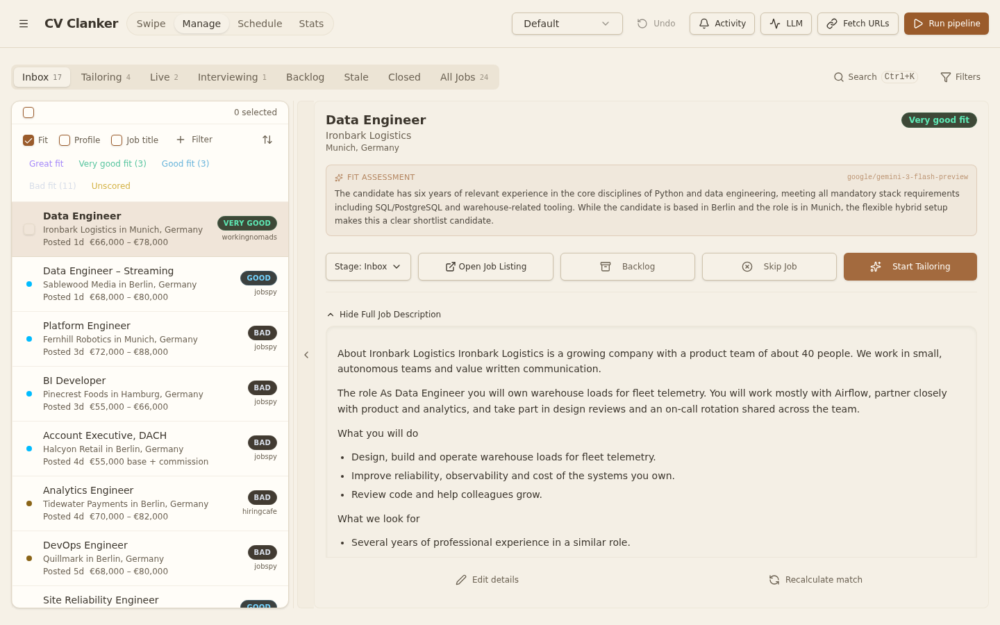
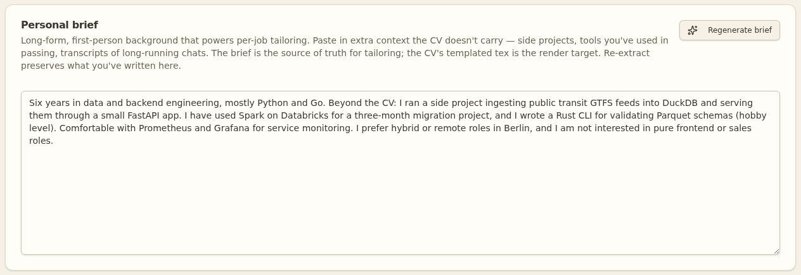
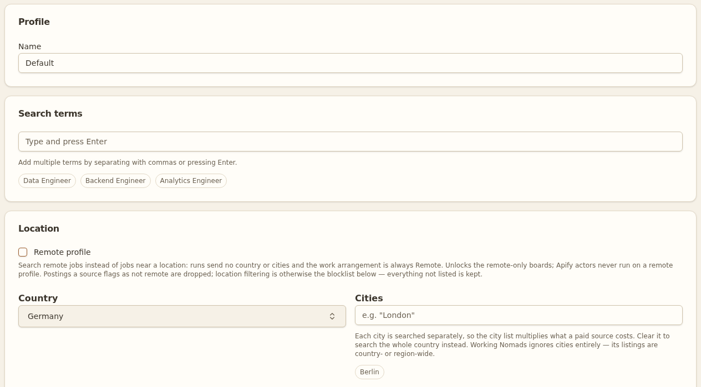
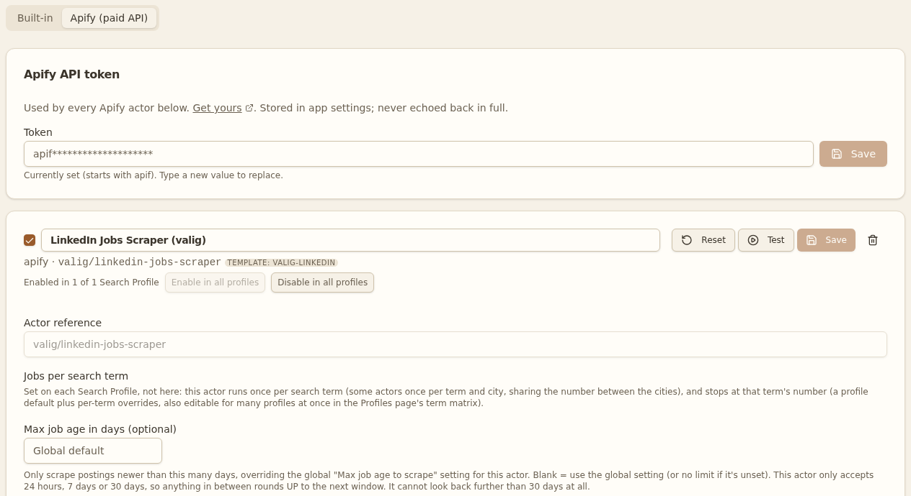
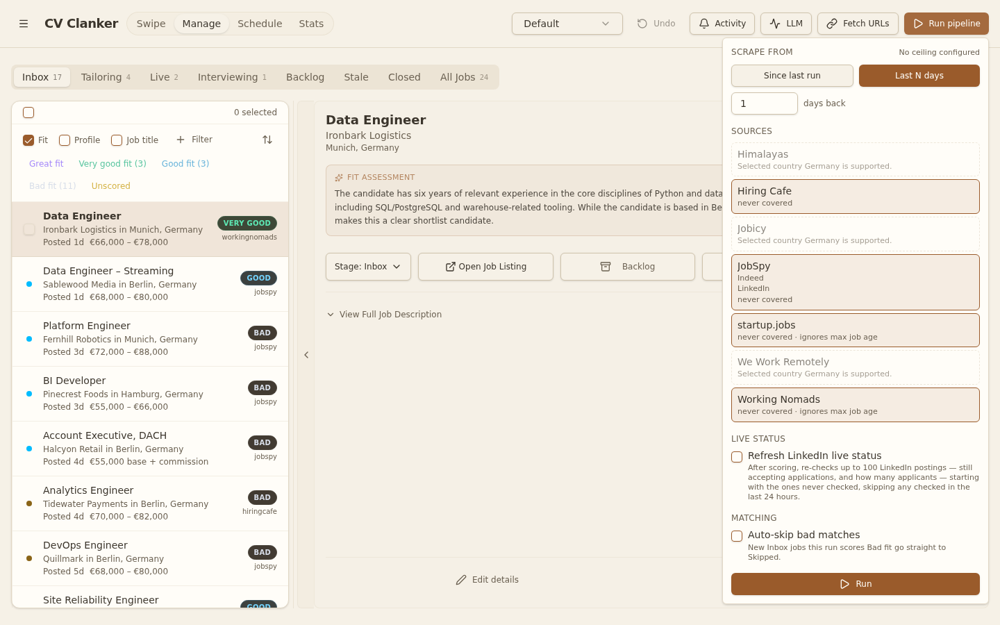
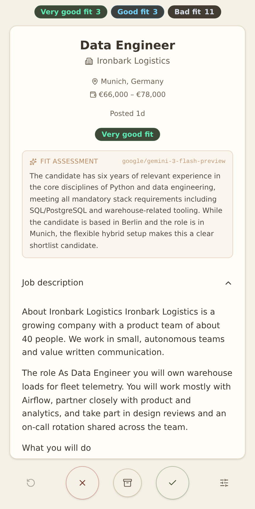
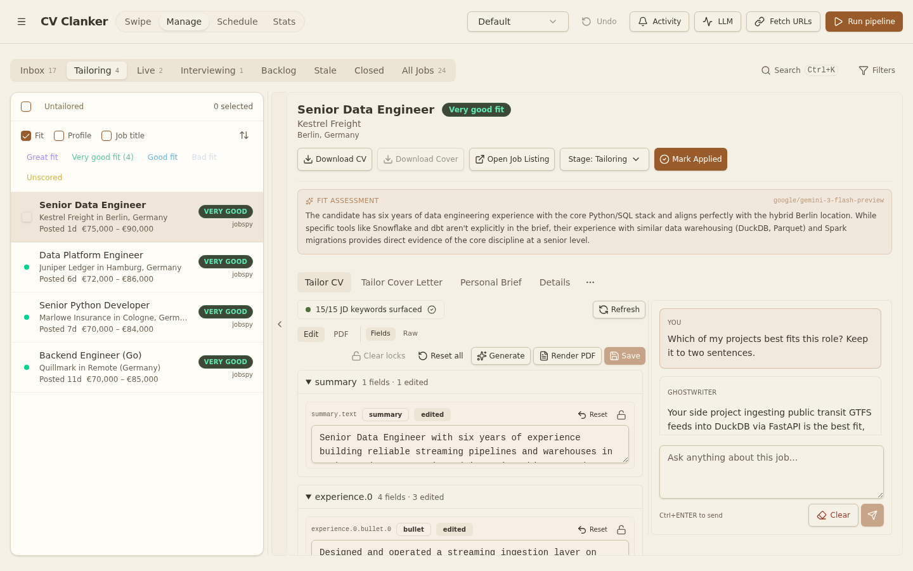

<div align="center">


<h3>CV Clanker</h3>

A self-hosted workspace for a job search.<br>
It scrapes job boards, scores each posting against you, and tailors your own CV and a cover letter for each one.

[](https://github.com/joaopn/cvclanker/pkgs/container/cvclanker)


[Getting started](docs/guide/getting-started.md) · [CVs](docs/guide/cvs.md) · [Job sources](docs/guide/job-sources.md) · [Tailoring](docs/guide/tailoring.md) · [LLM providers](docs/guide/llm-providers.md) · [FAQ](docs/guide/faq.md)

</div>

<picture>
  <source media="(prefers-color-scheme: dark)" srcset="docs/assets/hero-dark.png">
  
</picture>

## What it does

- **Your CV, your format.** Upload a `.tex`, `.docx` or `.html` CV; tailoring edits that document instead of filling a fixed template.
- **Scrape.** LinkedIn, Indeed, Hiring Cafe, startup.jobs, Working Nomads and more, plus any [Apify](https://apify.com) actor.
- **Score.** An LLM rates each posting against your CV and a free-text brief, so you triage the good fits first.
- **Tailor.** Per-job CV and cover letter, with an ATS keyword pass and a chat that proposes edits you accept or reject.
- **Local.** Runs in Docker on one SQLite file; no accounts, no telemetry. Bring OpenAI, Gemini, OpenRouter, Claude Code, Codex or a local model.

## Install

You need [Docker](https://docs.docker.com/get-docker/).

```bash
docker run -d --name cvclanker -p 3005:3001 -e HOST_PORT=3005 --cap-drop ALL --security-opt no-new-privileges -v cvclanker-data:/app/data --restart unless-stopped ghcr.io/joaopn/cvclanker:latest
```

Open http://localhost:3005; the onboarding wizard does the rest. Your data lives in the `cvclanker-data` volume.

<details>
<summary>Update</summary>

```bash
docker pull ghcr.io/joaopn/cvclanker:latest
docker rm -f cvclanker
docker run -d --name cvclanker -p 3005:3001 -e HOST_PORT=3005 --cap-drop ALL --security-opt no-new-privileges -v cvclanker-data:/app/data --restart unless-stopped ghcr.io/joaopn/cvclanker:latest
```

</details>

<details>
<summary>Build from source</summary>

```bash
git clone https://github.com/joaopn/cvclanker.git
cd cvclanker
docker compose up -d --build
```

Update with `git pull && docker compose down && docker compose up -d --build`.

</details>

Logs, backups and starting over: [Getting started](docs/guide/getting-started.md).

## How it works

**1\.** Upload your CV and write a personal brief: the projects and tools your CV leaves out. The upload is accepted only if the app can reproduce your document exactly ([details](docs/guide/cvs.md)).



**2\.** Set up a search profile: search terms, country, cities.



**3\.** Optionally, add [Apify](https://apify.com) actors as paid extra sources, starting from a ready-made template or any actor you name ([details](docs/guide/apify.md)).



**4\.** Run the pipeline. It scrapes the sources you picked and scores every new posting.



**5\.** Triage, at the desk or by swiping on your phone.



**6\.** Tailor. Review each edited field, ask the chat about the job, and download the CV and cover letter.



Applied jobs move on through Live, Interviewing and Closed; the Stats page shows where they stop. More in the [docs](docs/).

## Relation to JobOps

A fork of [JobOps](https://github.com/DaKheera47/job-ops), reworked around your own CV document, with application tracking, the hosted cloud and telemetry removed. It is a personal project shared in case it is useful: no roadmap, hosted version or support commitment.

<details>
<summary>Comparison</summary>

| | CV Clanker | JobOps |
|---|---|---|
| CV output | LaTeX, Word `.docx` and HTML | PDF only (`.docx` import-only) |
| Apify | Any actor, plus templates | One hard-coded actor |
| Telemetry | None | Umami (opt-out) |
| Hosting | Self-host only | Self-host and paid cloud |
| Scope | CV documents | Full application tracking (Gmail, kanban, visa) |

Diverged at commit `01452b6`. Fuller comparison: [CV Clanker vs. JobOps](docs/guide/comparison.md).

</details>

## License

AGPLv3 + Commons Clause, see [LICENSE](LICENSE). Contributions welcome: [CONTRIBUTING.md](CONTRIBUTING.md).
