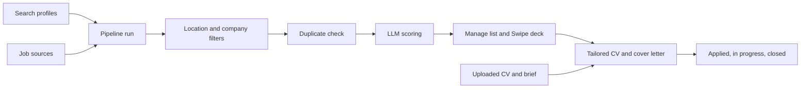

# CV Clanker documentation

CV Clanker is a self-hosted workspace for a job search. It scrapes job boards through built-in extractors and Apify actors, filters what it finds against your search profiles, optionally scores each posting's fit with an LLM, and lets you triage the result in a list or a swipe deck. For the jobs you pursue it tailors a copy of your own LaTeX, Word or HTML CV and writes a cover letter, then tracks the application until it closes. It runs as a single Docker container with everything in one SQLite file, and it never submits an application for you.

New here? Start with **[Getting started](guide/getting-started.md)**.

These docs come in two parts:

- **[User guide](guide/index.md)**: what to do and what you see, from installing to tracking your applications.
- **[How it works](architecture/index.md)**: what happens inside when you press something, what connects to what, and why it was built that way.

These docs describe what CV Clanker does today. If something here disagrees with the app, the app wins. Please [open an issue](https://github.com/joaopn/cvclanker/issues).
