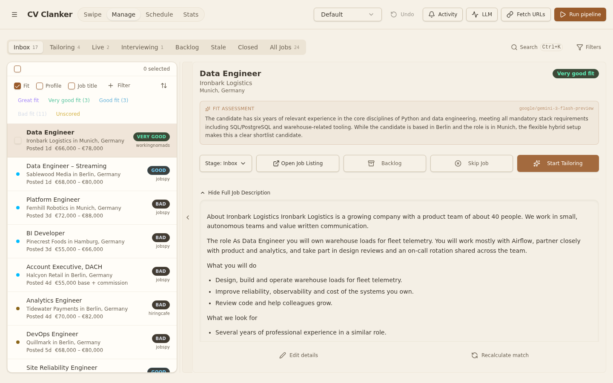

# CV Clanker

CV Clanker is a self-hosted workspace for your job search. It collects postings from job boards, scores how well each one fits you, and tailors your own CV and a cover letter for the jobs you pursue. It runs on your machine as one Docker container, keeps everything in one file, and never applies anywhere for you.

New here? Start with **[Getting started](guide/getting-started.md)**: install, the first-run wizard and your first search.

## A job hunt in six steps

1. **Upload your CV and write a personal brief**: the projects and tools your CV leaves out. LaTeX, Word and HTML CVs work. See [CVs and the brief](guide/cvs.md).
2. **Set up a search profile**: what to search for and where. See [Search profiles](guide/search-profiles.md).
3. **Pick your sources**: the built-in job boards, and optionally paid Apify actors. See [Job sources](guide/job-sources.md) and [Apify](guide/apify.md).
4. **Run a search.** New postings land in your Inbox, scored for fit. See [Running a search](guide/runs.md).
5. **Triage**, in the job list or by swiping on your phone. See [Manage and Swipe](guide/reviewing-jobs.md).
6. **Tailor and apply.** Review the edited CV, ask the chat about the job, download the CV and cover letter. See [Tailoring and AI assist](guide/tailoring.md).

Then follow each application through to an outcome in [Tracking your hunt](guide/job-lifecycle.md), and see where your search stalls in [Stats](guide/stats.md).

## Also in the guide

| Page | What it covers |
|---|---|
| [LLM providers and prompts](guide/llm-providers.md) | Which AI model to use, cloud or local, and editing the prompts. |
| [Agent access](guide/agent-access.md) | Letting your own AI agent (Claude Code or another MCP client) read your jobs. |
| [Configuration](guide/configuration.md) | Settings, sign-in, user profiles, backups and starting over. |
| [FAQ](guide/faq.md) | Privacy, cost, auto-apply, which CV format. |
| [CV Clanker vs. JobOps](guide/comparison.md) | How CV Clanker differs from the project it was forked from. |

## How it works

Curious what happens inside when you press something, or why it was built that way? The **[How it works](architecture/index.md)** section explains each part of the app.

These docs describe what CV Clanker does today. If something here disagrees with the app, the app wins. Please [open an issue](https://github.com/joaopn/cvclanker/issues).
