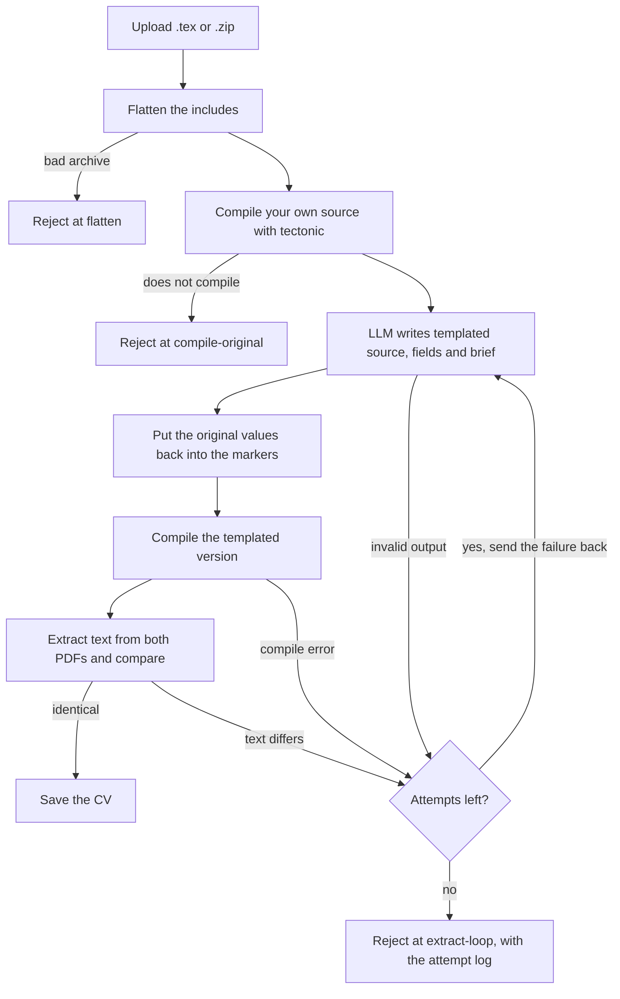
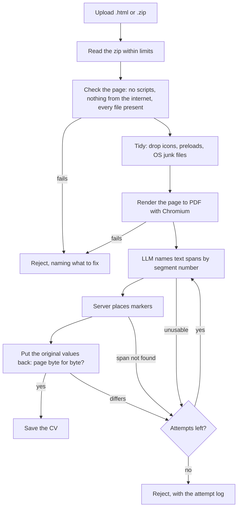

# CV upload and rendering

CV Clanker never writes a CV from scratch. It takes the CV you already have (a LaTeX source, a Word document or a web page) and turns it into a template with named, replaceable fields; from then on every tailored CV is that same template with some field values swapped. This page covers how a CV gets in (the upload gate that decides whether it is accepted), what is stored, what the **My CV** page lets you inspect and change, and how a CV is rendered back to a PDF. What happens per job is on [Tailoring and cover letters](tailoring.md).

Using it: [CVs and the brief](../guide/cvs.md)

## How it works

### The LaTeX upload gate

Dropping a `.tex` or `.zip` on **My CV** (or on the CV step of onboarding) runs the whole gate inside one request. Nothing is saved unless every step passes; there is no "mostly worked" state.

| Stage | What happens | Rejects when |
|---|---|---|
| Flatten | `\input{}` / `\include{}` are resolved from the zip into one source. The entrypoint is the `\documentclass` file named `main.tex`, `cv.tex`, `resume.tex` or `document.tex`, else the one with the shortest path. Images and fonts are noted as assets. | Unsafe zip path, no `.tex` in the zip, a single `.tex` that still has an `\input{}`, includes nested deeper than 10 or more than 100 of them, expanded source larger than **Expanded LaTeX size (MB)**. |
| Compile original | tectonic compiles your untouched source, with the zip's class files, fonts and images next to it. | Your CV does not compile. This is checked before any LLM call is paid for. |
| Extract | One LLM call (the **Tailoring Model**) returns the source with every tailorable span replaced by a `«field-id»` marker, the list of fields (`id`, `role`, original `value`), and a first-person personal brief. | Empty or duplicate ids, an unknown role, an empty value, a marker with no field, or a field with no marker. |
| Substitute | Each marker is replaced by its field's original value. | A leftover marker, or the result contains `\write18`, `\openout`, or an `\input{}` with an absolute or `../` path. |
| Compile templated | tectonic compiles the substituted source. | Compile failure. |
| Compare | `pdftotext -layout` runs on both PDFs; runs of whitespace collapse to one space, lines are trimmed, blank lines dropped; the two must match line for line. | Any line differs. |

The extract-to-compare loop runs up to 3 times. A failed attempt sends its own template plus the tectonic error or the text diff back to the model, asking it to correct rather than restart; an attempt where the model's output itself was unusable starts fresh. On rejection the page shows **Upload failed** with the stage and, for the loop, every attempt's template, error and diff. On success it says how many attempts it took.

Every compile is bounded by **LaTeX compile timeout (ms)** (default 10 minutes, Settings → Pipeline). The first compile on a fresh container downloads the LaTeX packages the CV needs, so it is much slower than later ones.

### Word CVs

A user profile is LaTeX, Word or HTML, chosen once (see the decisions below). On a Word profile **My CV** accepts `.docx`, and the gate keeps the same three stages and the same retry loop, but checks different things:

| | LaTeX | Word |
|---|---|---|
| What the LLM produces | The whole templated source, markers included | Only a list of spans: verbatim pieces of numbered paragraphs, each with an id and role. The server inserts `⟦field-id⟧` markers itself. |
| Rejected up front | Flatten errors | Not a `.docx` (or a password-protected / legacy `.doc`), macros, unresolved tracked changes, fields that pull in external content, text that already contains a marker glyph, oversized or many-part archives |
| Before the LLM | Compile your source | Re-save the untouched document and check its text did not change (round trip), then convert it with LibreOffice |
| Content check | Text of two PDFs compared | The document's own text (body, headers, footers) compared exactly: no renderer, no whitespace folding |
| Retried on | Unusable model output, a compile error, a text difference | Unusable model output; a span not found, ambiguous or overlapping; a text difference; a failed conversion |
| Tailored result | A PDF | A `.docx`: downloads give you the Word file; the PDF is only a preview |
| Hand-editing the template | Yes | No |

LibreOffice runs as a resident `unoserver` daemon, started on first use. Each conversion has a 60-second limit; a conversion that hits it kills the daemon, and the next one starts a fresh one.

### HTML CVs

HTML support is for simple CVs written as a web page, the kind an AI agent produces. **My CV** accepts a single `.html` page, or a `.zip` with the page and every file it uses (stylesheets, fonts, images) linked by relative paths. The gate keeps the same shape as Word's: the model names spans, the server places `⟦field-id⟧` markers, and the same 3-attempt loop retries.

| | HTML |
|---|---|
| Rejected up front | A script of any kind (`<script>`, event handlers, `javascript:` links), anything loaded from the internet (a web font, image or stylesheet: put the file in a `.zip` instead), a missing file, a page that does not parse the same way twice, marker characters already in the text, oversized or too-deep pages |
| Tidied, not rejected | Links that change nothing in the PDF (icons, preloads, manifests) and OS junk files in a zip are dropped |
| What the LLM produces | A list of spans: verbatim pieces of the page's numbered text segments, each with an id and role |
| Content check | The template with the original values put back must be the tidied page byte for byte; the page must print to PDF with every file it asks for answered |
| Tailored result | A PDF, plus the tailored page in the shape uploaded: the `.html`, or the `.zip` with only the page swapped in |
| Hand-editing the template | No |

Every parse of a page runs in a separate worker thread with a time and memory limit, because the cost of parsing HTML is not bounded by its size. Text the browser does not print (hidden elements, for instance) or that cannot be templated safely (preformatted text, SVG, MathML) is kept byte for byte and never offered as a field.

**Printing.** One headless Chromium, started on first use and shared, prints every HTML CV; each render gets a fresh context with JavaScript off, and every request the page makes is answered from the uploaded files in memory. Anything else is refused, so nothing is ever fetched. The page is printed at its own `@page` size (A4 when it sets none), with a 1 cm margin when it sets none, with backgrounds, and laid out at the width it prints at so styles for narrow screens apply before printing.

**Tailored values.** A tailored value may use only the inline formatting the CV's own values already use (the same tags, classes, attribute values and links), and a field that sits inside a link cannot hold another link. A value that breaks this is dropped when the LLM proposes it, so the rest of the tailor goes through.

### What a CV stores

| Stored | Used for |
|---|---|
| The original upload (HTML: the tidied page and files, in the shape uploaded) | Re-extract, **Original PDF**, and every later compile. A zip is unpacked again for each one, so class files, fonts and images are always there |
| Flattened source (Word: the document's visible text; HTML: the page's text segments) | **Original PDF** on LaTeX, and **Regenerate brief** |
| Templated source (Word: the templated XML parts; HTML: the page with markers, and which fields sit inside a link) | Every render |
| Fields and their original values | What tailoring may rewrite, and the fallback value for any field a job has not changed |
| Personal brief | Tailoring evidence, scoring, cover letters, the ghostwriter, interview QA, onboarding search terms |
| Extraction prompt | This CV's override of the extraction system prompt (empty = the shipped default) |
| Last compile log, attempt count | Shown on **My CV** |

### Rendering

Every PDF of a CV is built the same way: take the templated source, start from the original field values, lay a job's overrides on top, replace the markers (longest id first, so `experience.0.title` is never half-replaced by `experience.0`), compile. **Templated PDF** on My CV is that render with no overrides; the upload gate made sure it carries the same text as **Original PDF**, which compiles (or converts) your untouched upload. Per-job renders, and the guard that refuses a "tailored" CV identical to the original, are on [Tailoring and cover letters](tailoring.md).

### The My CV page

| Control | What it does |
|---|---|
| **Re-extract** / **Re-extract with this prompt** | Re-runs the full gate on the stored upload. A pass replaces the template, fields, values and log but keeps the CV's identity and your brief; a failure changes nothing (an edited extraction prompt is saved first, so the next try uses it). |
| **Templated PDF** / **Original PDF** | The two previews above, opened in a new tab |
| **Extraction prompt** with **Save** and **Reset to default** | The whole system prompt the extraction uses for this CV. The user message (source, assets, retry context) stays server-controlled. Reset clears the override so future re-extracts follow the shipped prompt. |
| **Personal brief** with **Regenerate brief** | Free text you edit and save with **Save changes**. Regenerate asks first, then replaces it with a fresh 100–400 word summary of the CV's text. |
| **Templated LaTeX** with **Save template** | LaTeX only: hand-edit the layout (see below) |
| **Extracted fields** | Every field with its role and original value. Check the roles; a wrong one is fixed by re-extracting |
| **Compile log** / **Conversion log** / **Render log** | Output of the last accepted compile (LaTeX), conversion (Word) or render (HTML) |

**Hand-editing the template.** For a line break, spacing or a font size, editing the templated source beats re-uploading. **Save template** accepts the edit only if it keeps exactly the same set of `«field»` markers, each still outside a `%` comment, and if it compiles without any LaTeX error the stored template does not already have. There is no text comparison against your original (changing the output is the point), so check **Templated PDF** afterwards. If a re-extract replaced the template while the edit was compiling, the save is refused. PDFs already generated for jobs keep the old layout until they are generated again, and a later re-extract replaces hand edits.

### One CV per profile

The UI works with one CV per user profile: the *active* CV is the most recently updated CV document, and tailoring, scoring, cover-letter generation and the ghostwriter all read it. **My CV** shows that one and offers an upload only when there is none. A tailored job remembers which CV it was tailored against; re-rendering uses that one, and re-tailoring moves it to the active CV. A CV in an older format, with no template, is marked "Older CV format — re-extract to enable tailoring" and cannot be tailored until it is re-extracted.

## Design decisions

### No partial uploads, ever

A CV is accepted only when the templated source compiles, putting the original values back yields the same text as your CV, and every tailorable span is a field. Anything less is a hard reject: no dropping a span that would not extract and carrying on. A partial template would let tailoring ship a CV missing bullets or sections without anyone noticing. For the same reason the accept/reject decision is the compile plus the text comparison, never a heuristic such as "the field count looks plausible", and the comparison starts strict (exact lines after whitespace folding), because loosening a gate later is cheaper than tightening it.

### The model writes the template; the compile gate makes that safe

An earlier design had the model extract verbatim spans and walked the source to find them. That was brittle: one span that did not match byte for byte (a normalised space, a dropped backslash) failed the whole upload. Since the model is in the loop on every upload anyway, it now authors the templated source, and the compile plus text comparison catches the classic failure of model-written LaTeX (one wrong brace and nothing compiles) before anything is saved. Once accepted, the template is known good, so later tailoring failures are about the new values, never the template. Retries send the actual error back so the model corrects rather than starts over.

### Markers and plain replacement, not a template engine

Fields are `«field-id»` markers substituted by plain text replacement. Guillemets are not LaTeX syntax, so a marker that survives substitution breaks the compile instead of silently printing, and there is no template-engine scoping to trip over. The cost is that a field's value cannot contain another field's marker, which real CV content never does. Rendered output is also scanned for `\write18`, `\openout` and escaping `\input{}` paths, and tectonic is never given shell escape.

### Word CVs: the model picks spans, the server places markers

For `.docx` the model never sees or writes XML; it names verbatim text spans and the server splices markers into the document. That makes "marker without a field" impossible by construction. The content check compares the document's own text exactly instead of extracting text from two PDFs: putting the original values back must reproduce the original text by construction, so any difference is a real failure, and adding a renderer to the comparison could only add noise. Word markers are `⟦…⟧` rather than `«…»` because guillemets are ordinary quotation marks in French or German CV text.

### The CV format is fixed per user profile

Whether a profile is LaTeX, Word or HTML is set once and cannot change: the server refuses a different value once one is stored, and refuses switching to Word or HTML while LaTeX CVs exist. Every CV in a profile's database is therefore that format by construction, so there is no per-document format to track or get wrong, and an upload whose file type disagrees is rejected with a pointer to create another user profile. The onboarding question starts with nothing selected because the answer is permanent. Cover letters stay LaTeX on every profile.

### LibreOffice behind a resident daemon

Word conversion uses a long-lived `unoserver` process rather than starting LibreOffice per file. This is not an optimisation: a real CV hung a cold `soffice --convert-to` indefinitely, yet converts quickly through the running daemon. Because a stuck conversion can wedge the daemon, the per-conversion limit kills and restarts it rather than waiting.

### HTML CVs are self-contained and script-free

HTML support is for simple pages like the ones AI agents write, not for web apps: a page that needs JavaScript to build itself is rejected rather than run. A page that loads a font or image from the internet is rejected too, with a request to upload the complete zip: fetching at render time would make every tailored PDF depend on a remote server and leak each render to it. Together these mean the renderer can answer every request from memory and refuse everything else.

### HTML prints with Chromium

Chromium was chosen for the cleanest PDF of a web page; the image carries it beside Camoufox (the Firefox build that gets past bot checks) and no plain Firefox. The byte-for-byte check replaces a PDF text comparison for the same reason as on Word: putting the original values back reproduces the page by construction, so any difference is a real failure.

### A 1 cm margin unless the page sets one

A page with no `@page` margin of its own prints with 1 cm on every side. Without it, a page with no padding would print to the paper's edge; the cost is that a page painting a tinted background around its content shows that background as a frame, and may take an extra page.

### Tailored HTML downloads never open in the browser

The tailored page or zip is served only as a download, with a sandboxing header and no content sniffing, so a page is never shown in the app's own origin. The PDF stays the thing you view.

### Re-extract never touches your brief

The brief is your own scratch space (background the CV does not carry, pasted context, notes), so re-extracting a CV to recover from a bad extraction or pick up an improved prompt keeps it, even though the extraction produces a new one. Rebuilding the brief is a separate, confirmed action, **Regenerate brief**, which uses a small dedicated prompt and touches nothing else.

### Hand edits are judged against the template's own errors

tectonic is run in a mode that keeps going past recoverable LaTeX errors and still exits successfully, matching Overleaf's behaviour; at upload, the text comparison is what catches a visibly broken result. A hand edit has no such comparison, so the server compiles the stored template and the edited one the same way and rejects only error messages the edit adds. An error your CV already had does not block an unrelated layout tweak.

## Where it lives

| Path | What |
|---|---|
| `orchestrator/src/server/services/cv/upload-pipeline.ts` | The LaTeX gate: flatten, compile original, extract loop |
| `orchestrator/src/server/services/cv/` | Flattening, LLM extraction, marker rendering, tectonic, pdftotext comparison, brief regeneration |
| `orchestrator/src/server/services/cv/docx/` | The Word substrate: parse, normalise, span splicing, rendering, round trip, LibreOffice conversion, its gate |
| `orchestrator/src/server/services/cv/html/` | The HTML substrate: zip reader, page checks, text segments, marker splicing, the value check, the parse worker, the Chromium renderer, its gate |
| `orchestrator/src/server/api/routes/cv.ts` | Upload, previews, re-extract, template edit, brief regeneration |
| `orchestrator/src/server/services/cv-active.ts` | Which CV is active |
| `orchestrator/src/client/pages/CvPage.tsx`, `orchestrator/src/client/components/cv/CvTemplateEditor.tsx` | The **My CV** page and its template editor |
| `prompts/cv-template-extract.yaml`, `prompts/cv-docx-extract.yaml`, `prompts/cv-html-extract.yaml`, `prompts/cv-generate-brief.yaml` | Seed prompts for extraction and the brief (live copies are edited in Settings → Prompts) |
