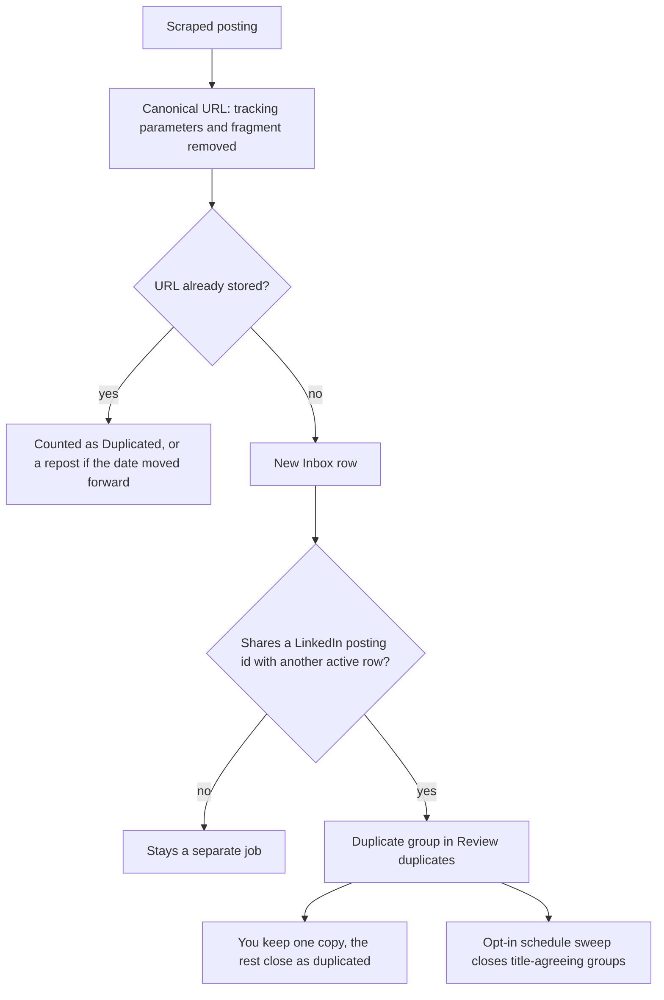

# Duplicates

The same job reaches CV Clanker more than once: the same link scraped again by the next run, the same LinkedIn posting under a country subdomain or a slugged URL, or the same ad picked up by JobSpy and by an Apify actor. A repeated link is caught silently at import and never becomes a second row. A posting the job board itself identifies as one is shown to you as a **duplicate group** to resolve by hand. And a softer signal, that you already have work in flight at the same company, is only ever a warning. Nothing is ever merged on similarity alone.

Using it: [Tracking your hunt](../guide/job-lifecycle.md)

## How it works

| Layer | Evidence used | When it runs | What it does |
|---|---|---|---|
| Same link | The canonical job URL | Every import | The second copy is never stored and is counted under **Duplicated** in the run banner. A newer posting date makes it a repost instead (see [Job lifecycle](job-lifecycle.md)). |
| Same posting | The board's own posting id | On demand, on the Manage screen | Groups the copies for you to resolve; never closes anything by itself. |
| Same company in flight | The exact employer name | Every job list load, and on Tailor | Tints the row's status dot; optionally asks before tailoring. Never closes anything. |

### Same link: URL canonicalisation

Before a URL is stored or compared, a fixed list of known tracking parameters is removed (names compared ignoring case), together with the `#fragment`:

| Family | Parameters removed |
|---|---|
| LinkedIn | `refId`, `trackingId`, `trk`, `trkInfo`, `originalSubdomain`, `position`, `pageNum`, `eBallotId`, `lipi` |
| Campaign tags | `utm_source`, `utm_medium`, `utm_campaign`, `utm_term`, `utm_content`, `utm_id` |
| Ad-click ids | `gclid`, `fbclid`, `msclkid`, `mc_cid`, `mc_eid`, `igshid` |
| Indeed | `from`, `tk`, `vjs`, `advn`, `adid` |

Every other query parameter is kept, because some boards put the job's identity there (Indeed's `jk`, LinkedIn's `currentJobId`). The host's case is folded too. The job URL is unique in the database, so the canonical form is what makes "already stored" work.

### Same posting: the board's id

Only LinkedIn is recognised, on `linkedin.com` and every country subdomain. The id is read from the end of a `/jobs/view/` path, either bare (`/jobs/view/4383993915`) or after a slug (`/jobs/view/senior-engineer-4383993915`), with at least six digits; grouping reads it from the URL alone. The key is the board plus the id, never the scraper, so one posting found by JobSpy and by two Apify actors lands in one group. Other boards are not keyed: LinkedIn supplies most rows, and a board is added only once its ids are shown to group something.

| Case | Grouped? |
|---|---|
| `at.linkedin.com/jobs/view/…-4383993915` and `www.linkedin.com/jobs/view/4383993915` | Yes, same id |
| Two postings at one employer with the same title and location but different ids | No, the board says they differ |
| A LinkedIn copy and an Indeed copy of one role | No, there is no shared id to prove it |
| A LinkedIn profile or post URL ending in digits | No, only `/jobs/view/` paths count |
| A row you ever applied to | Never proposed, whatever its status |

### Review groups

Only rows in the Inbox and Tailoring tabs (`discovered`, `processing`, `ready`) take part. When any groups exist the Manage screen shows "N duplicate groups (one posting id, listed more than once)" with **Review duplicates** and **Dismiss**. The wizard walks the groups largest first; for each it lists the copies with their source, tab, fit and age, an **Open** link, and a pre-selected copy to keep:

| Order | Keeper rule |
|---|---|
| 1 | Furthest along: Ready, then `processing`, then Inbox |
| 2 | Best fit |
| 3 | Newest posting date |
| 4 | Newest discovered |

You can pick a different keeper. **Close k as duplicates** closes the others as `closed` with outcome `duplicated`; **Skip group** moves on; a close can be reversed with **Undo**. When the copies in a group disagree about the job title, the wizard says so ("decide this group yourself; Close all stops here") and shows each title.

When at least two title-agreeing groups follow in a row from the one on screen, a **Close all** button closes the current group and every following one in that run in one press, keeping the selected copy where you chose one and the rule's pick elsewhere. Its label counts what it covers: "Close all N groups (k jobs)", or "Close next N groups (k jobs)" when it stops at a group whose titles disagree. If the copies would exceed **Max jobs per bulk action** it takes as many whole groups as fit ("Close n of m groups (k jobs)"); a second press continues.

### The scheduled sweep

A schedule can tick **Close duplicate copies automatically after each run** (off by default). After a run that completed (not one that was cancelled, failed or stopped on an LLM rate limit), it closes the extra copies of title-agreeing groups using the same keeper rule, skips any group with a tailor running, and re-reads every row just before closing it so a copy you moved since is left alone. The count shows on the schedule card as **Duplicates closed**. There is no undo: closed copies are reopened by hand from the Closed tab.

### Same company in flight

"In flight" means Tailoring, Live or Interviewing (statuses `processing`, `ready`, `applied`, `in_progress`). Every job list load counts, per employer, how many other jobs are in flight there, and a row with any gets a warning-coloured status dot with the tooltip "N other jobs in flight at X (tailoring, applied or interviewing)". With Settings → Display → **Warn before tailoring a company you have work in flight at** turned on (off by default), pressing Tailor on Manage or swiping right on Swipe first lists those jobs in a "You already have work in flight at X" dialog, with **Cancel**, **Tailor the other N** (shown only when some of the selection has no clash) and **Tailor anyway (N)**. The employer match is exact apart from case and surrounding spaces, and a blank employer never matches. The dialog is described from the screen side in [Manage and Swipe views](manage-and-swipe.md#the-company-in-flight-check).

## Design decisions

### Extra duplicates beat a wrong join
A missed duplicate costs one row in the Inbox; a wrong join closes an opening you would have applied to. So the rule is to prefer extra duplicates over incorrectly joining two jobs, and everything here follows from it: no id means no proposal, a disagreeing board id outranks any similarity, and nothing closes without either you or an opt-in schedule.

### Group on the board's id, not on title and company
Measured on a real database, keying on normalised title plus employer proposed about twice as many groups, and three times as many rows to close, as the board-id rule, and many of them were real, separate openings: one employer often posts several identical-looking ads, each with its own requisition id. A list in the hundreds gets swept rather than read, which turns weak evidence into lost jobs.

### No matching on description text
A layer matching identical ad text was measured and not shipped: it found very few duplicates the id rule did not, while many of its proposals contradicted the board's own ids (employers post one ad text per requisition). The tested text helpers remain in the shared module, unused.

### A title disagreement stops the bulk close
A board id is strong evidence but not perfect: a few id groups carry more than one title. Those groups stay reviewable one at a time and are barred from Close all and from the scheduled sweep, the two places where a wrong call is multiplied.

### Close all covers whole groups, contiguously
The wizard advances by the number of groups a press covered, so Close all sweeps an unbroken run starting at the group on screen. A filtered sweep that jumped over a group needing you would advance you onto groups the same press had already closed, and starting at the current group rather than the first keeps **Skip group** meaningful. Whole groups only: half a closed group leaves copies that no longer look like duplicates to anyone. In the wizard the size cap is honoured by stopping early, never by quietly looping.

### Automatic closing is opt-in, per schedule, and narrower
Auto-resolution is a per-schedule tickbox limited to title-agreeing groups, off by default. It overrides the never-auto-merge rule only for schedules that ask, because there is no server-side undo.

### One keeper rule for the wizard and the sweep
The pre-selected keeper and the scheduler's keeper come from one shared function, and a test enforces that there is only one definition. If the two disagreed, a sweep could close the very copy you had been about to keep.

### Company in flight is employer-only and only a warning
The check is about the employer alone, not title plus employer, and it is about avoiding duplicated work, not erasing data. It exists because the same opening often arrives under two boards' URLs, which the id rule deliberately cannot join. Since it only informs and never closes, a false positive costs a glance; for the same reason it does no accent folding or "Ltd"/"GmbH" trimming, each of which would be a guess that two names are one company.

## Where it lives

| Path | What it holds |
|---|---|
| `shared/src/job-url.ts` | URL canonicalisation and the tracking-parameter list |
| `shared/src/duplicate-identity.ts` | Board and posting-id extraction, the group key, the unused text helpers |
| `shared/src/duplicate-resolution.ts` | The keeper rule shared by the wizard and the sweep |
| `shared/src/company-in-flight.ts` | In-flight statuses and the employer key |
| `orchestrator/src/server/repositories/jobs.ts` | URL collision handling at import, the duplicate groups, in-flight counts |
| `orchestrator/src/server/services/scheduler/resolve-duplicates.ts` | The scheduled sweep |
| `orchestrator/src/client/pages/orchestrator/DuplicateReviewModal.tsx` | The review wizard and Close all |
| `orchestrator/src/client/pages/orchestrator/CompanyInFlightDialog.tsx`, `orchestrator/src/client/pages/orchestrator/useTailorCompanyGuard.tsx` | The pre-tailor warning |
