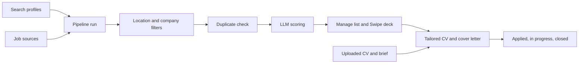

# How it works

This section explains how CV Clanker works inside: what happens when you press something, what connects to what, and why it was built that way. Each page covers one area of the app. It describes the mechanism (diagrams, tables, the rules the code follows), then the design decisions behind it and the reasons for them, and ends with a table of where that area lives in the repository. To learn what to click, see the [User guide](../guide/index.md).

| Page | What it covers |
|---|---|
| [System overview](system.md) | The container, the server, the SQLite file, the helper programs, and how the app boots. |
| [CV upload and rendering](cv-pipeline.md) | How a LaTeX, Word or HTML CV is accepted only when it can be reproduced exactly, and how it is rendered back. |
| [Tailoring and cover letters](tailoring.md) | Per-job tailoring from the personal brief, keyword coverage, the ghostwriter chat, cover letters and generated documents. |
| [LLM providers and scoring](llm-and-scoring.md) | The provider layer, how fit is scored, model benchmarking, and the editable prompts. |
| [Search profiles](search-profiles.md) | What a profile holds (terms, places, sources, blocked companies) and how it drives a run. |
| [Location matching](location-matching.md) | How a job's location is judged against a profile's countries, cities and remote setting. |
| [Job sources](job-sources.md) | The built-in extractors, Apify actors and templates, their costs and health. |
| [Pipeline runs](pipeline-runs.md) | What a run does step by step, its progress banner, multi-profile chains and scheduling. |
| [Job lifecycle](job-lifecycle.md) | Job statuses, what moves a job between them, the applied mark, stale jobs, live status and adding jobs by URL. |
| [Duplicates](duplicates.md) | How the same posting from different places is recognised, and how duplicates are reviewed. |
| [Manage and Swipe views](manage-and-swipe.md) | The job list, tabs, filters, sorting, the ctrl+K search and the Swipe deck. |
| [Settings and onboarding](settings-and-onboarding.md) | The settings registry, the onboarding wizard, user profiles, sign-in and the database controls. |
| [Stats](stats.md) | What the Stats page measures, including per-search-term yield. |
