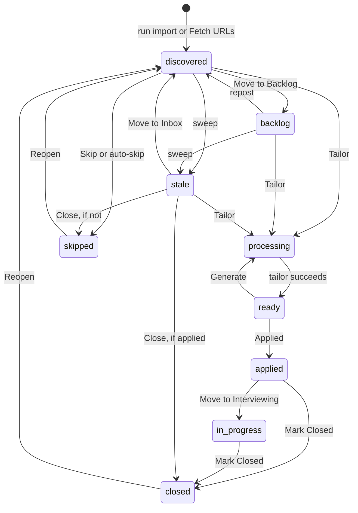
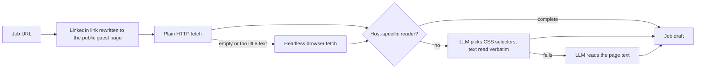

# Job lifecycle

Every job sits in exactly one status, and the status decides which Manage tab shows it. Jobs move because you press something (a row button, a bulk action, a swipe, the **Stage:** dropdown), because a [pipeline run](pipeline-runs.md) acts on them (import, auto-skip, auto-tailor), or because a sweep on the Stale tab shelves them. Separately from the status, a job can carry a permanent **applied** mark that survives every later move: it is what lets the app tell a closed application from a job you never applied to.

Using it: [Tracking your hunt](../guide/job-lifecycle.md)

## How it works

| Status | Manage tab | Meaning |
|---|---|---|
| `discovered` | Inbox | New, waiting for triage. Everything a run or **Fetch URLs** imports starts here. |
| `processing` | Tailoring | A tailor is running (no failure reason), or a tailor failed and waits for a retry (reason set). |
| `ready` | Tailoring | Tailored; the PDF is ready to send. |
| `applied` | Live | Application sent. |
| `in_progress` | Interviewing | Past the initial application. |
| `backlog` | Backlog | Parked by hand. |
| `stale` | Stale | A holding pen for jobs you are considering retiring. |
| `skipped` | Closed | Not pursued. |
| `closed` | Closed | Concluded, with an outcome: rejected, withdrawn, ghosted, duplicated or other. |

A tenth status, `selected`, is retired: any row still carrying it is folded back into `discovered` at every server start.

The diagram shows the ordinary routes. The full set the server accepts, per action:

| Action (button) | Allowed from | Moves to | Notes |
|---|---|---|---|
| **Tailor** (`move_to_ready`) | Inbox, Backlog, Stale, a failed tailor | `processing`, then `ready` | Returns at once; tailoring runs in a background queue (3 at a time by default). On failure the row stays in Tailoring with its reason, retryable in place. |
| **Generate** (`retailor`) | `ready`, a failed tailor | `processing`, then `ready` | Re-tailors against the current active CV; the bulk action refuses a tailor that is still running. |
| **Skip** | Inbox, Ready, Backlog, Stale, a failed tailor | `skipped` | A run also auto-skips low-fit Inbox rows, never ones carrying the applied mark. |
| **Move to Backlog** | Inbox, Stale | `backlog` | |
| **Move to Inbox** | Stale | `discovered` | |
| Move to Stale | Inbox, Backlog | `stale` | Done in bulk by the Stale tab's sweeps, below. |
| **Applied** (**Mark Applied** on the Ready panel) | any | `applied` | Stamps the applied mark if not already set. |
| **Move to Interviewing** | any | `in_progress` | Also stamps the mark. |
| **Mark Closed** | Live, Interviewing | `closed` + outcome | Asks for Rejected, Withdrew, Ghosted or Other. |
| **Close** (Stale tab) | Stale | `closed` as ghosted, or `skipped` | Ghosted if the row carries the applied mark, skipped otherwise. |
| Close as duplicate | Inbox, Tailoring | `closed` as duplicated | Only from [duplicate review](duplicates.md). |
| **Reopen** | Skipped, Closed | `discovered` | Clears outcome and close date. |
| **Stage:** dropdown | any | any listed stage | See below. |
| **Delete** | any but a running tailor | gone | Irreversible. |

### The Stage dropdown

Every job's detail panel has a **Stage:** dropdown that moves it to Inbox, Tailoring, Live, Interviewing, Backlog, Stale or Skipped from wherever it is, plus a **Close with reason** group (Rejected, Withdrew, Ghosted, Other) on jobs carrying the applied mark (on an already-closed job it reads **Change reason** and keeps the original close date). Choosing Tailoring moves the job to `ready` without tailoring it, and the menu says "no PDF" when it has none. Moving a job out of Closed clears its outcome. The dropdown never offers `processing` (choosing it would start no tailor and leave a fake in-flight row) or the retired `selected`. Every move is undoable except a move off `processing`, because undo would put the row back into exactly the stuck state the move escaped.

### The permanent applied mark

`applied_at` is stamped the first time a job moves to `applied` or `in_progress`, and later moves never re-date it. In the app only **Undo** of the move that set it can clear it. Wherever the mark is set but the status no longer says so, the row shows an **Applied** badge; the Filters panel's **Ever applied** filter and the search's `@ever-applied` lock find every such job however it ended. Code that has to decide "was this an application?" reads the mark, never the status:

| Where | What the mark changes |
|---|---|
| Auto-skip in a run | Never skips a marked job. |
| Stale sweeps | Shelf and closed-posting sweeps leave marked jobs alone; only **Move Applied** shelves them. |
| Stale tab **Close** | Marked: closed as ghosted; unmarked: skipped. |
| Repost of a stale job | A marked stale job stays in Stale instead of returning to the Inbox. |
| Duplicate review | Marked jobs are never proposed as duplicates. |
| **Stage:** dropdown | The **Close with reason** group appears only on marked jobs. |
| Settings → Danger Zone, **Clear Jobs by Fit Category** | Marked jobs are spared. |

### The Stale tab and its sweeps

Nothing ages jobs automatically. The Stale tab has an **Older than** day count (default 7) and four buttons, each a single database update rather than a batch of per-job actions:

| Button | Moves into Stale | Age measured by |
|---|---|---|
| **Move stale rows** | Inbox and Backlog jobs, never applied to | Posting date, else discovery date |
| **Move Tailoring** | Ready jobs, never applied to | Posting date, else discovery date |
| **Move Applied** | Live and Interviewing jobs | Applied date, else posting date |
| **Move closed postings** | Inbox and Backlog jobs whose LinkedIn check says closed, never applied to | Not aged |

Jobs in `processing` are in no sweep: a clean one is a tailor running right now (which would write `ready` over the move when it finished), and a failed one is work waiting for a retry.

### Reposts

When a run imports a URL the app already has, nothing new is created, unless the incoming posting date is later than the stored one. Then the row is treated as a repost: its posting date advances, its repost count goes up, its live LinkedIn verdict is cleared (it described the old posting), and a job sitting in Backlog, or in Stale without the applied mark, returns to the Inbox. Every other status keeps its place: a skip or a close is a decision a relisting should not undo.

### Live LinkedIn status and Easy Apply

The **Live status** bulk action (LinkedIn rows only) and the optional run step both read LinkedIn's public guest page for the posting and store four things: whether it still accepts applications, the applicant-count caption, whether it is an Easy Apply posting, and when it was checked. A closed posting stores no applicant count and no Easy Apply verdict, because LinkedIn resets the caption and removes the Apply button on closure. The row then shows **No longer accepting applications** or an **Easy Apply** chip. Every request goes through one pacer: one request a second, a shared back-off when LinkedIn answers "too many requests", and never a fall-back to the browser on a rate limit, since a rate-limited address only gets the sign-in wall. See [Manage and Swipe views](manage-and-swipe.md) for how the chips sort and filter.

### Adding jobs by URL

**Fetch URLs** opens the **Import URLs** sheet: paste up to 50 job URLs, one per line. The import runs on the server, one import at a time per app (a second import is refused while one runs; inside it, URLs are fetched a few at a time, set by **Batch URL import concurrency**, default 3), and any tab can reattach to it and see per-URL results. Each new job lands in the Inbox as source "manual" and is scored in the background when scoring is on; a URL already in the database is reported as a duplicate instead. Each URL is read in tiers:

A URL whose page yields no title, employer or description (often because the company name or the posting is an image) ends as a failed row. Every failed row carries a **Manual** button: it opens a form pre-filled with whatever was read, the job URL defaulting to the row's own, and saving files the job the same way a fetched one is filed (Inbox, scored, or reported as a duplicate), after which "Retry failed only" leaves the row alone. What was read is held in memory with the import, so after a restart, or once the next import starts, the form opens with only the URL. Duplicates are checked against the URL as stored (tracking parameters, fragment and host case folded), and against the URL as given for rows stored before that folding existed.

**Rescrape** (bulk) re-reads a job's own URL through the same tiers, overwrites the description, fills only fields that were empty, and re-scores when scoring is on. It refuses a job in `processing` and one with no web URL.

### Bulk actions run as detached batches

The bulk bar and the Swipe deck send an action to the server, get a batch id back at once, and watch progress over one shared stream; closing the tab does not stop the batch. Limits: **Max jobs per bulk action** (default 1000) per request and **Bulk action concurrency** (default 4) at a time. A job that another running batch is already working on is refused for the second one. Status moves (Skip, Move to Backlog, Move to Inbox, Mark Closed, Reopen, Close) offer **Undo**, which writes the previous status, outcome, close date, tailoring date and applied mark back; Tailor, Generate, Rescrape, Live status, Delete and the scoring actions do not.

### Deleting

**Delete** removes the job and everything attached to it: chat threads, notes, legacy task and interview rows, and its stored PDFs. It is refused only for a tailor that is running right now; a failed tailor deletes fine. Settings → Danger Zone can also clear jobs in bulk, by status (**Clear Jobs by Status**) or by fit category (**Clear Jobs by Fit Category**, which spares applied jobs).

## Design decisions

### The applied mark is separate from the status
Once the Stage dropdown can move any job anywhere, the status stops being evidence of anything: an applied job can be sent back to the Inbox, a closed one reopened. A rejection statistic, the stale sweeps and the duplicate sweep all need to know "was this ever an application?", so that question has its own column, stamped once and kept. Leaving `in_progress` out of the stamp would let a job moved straight from Tailoring to Interviewing close out looking unapplied.

### The Stage dropdown can reach every row
A tailor that never reports back leaves a `processing` row that the ordinary buttons refuse and whose detail view is only a spinner. Rather than adding more special-case escapes, the dropdown offers every real stage from every status, so no row can get stuck. It does not offer `processing` itself, and offers outcomes only on applied jobs, because a closed-with-rejection row with no apply date is exactly what the start-up backfill would later stamp as an application.

### Tailoring is move-then-tailor
Pressing Tailor flips the row to `processing` and returns immediately; a bounded background queue does the LLM call and the PDF. A running tailor and a failed one share the status and are told apart only by the failure reason, so a failure stays visible and retryable in the Tailoring tab instead of bouncing back to the Inbox. A server restart stamps any orphaned running tailor "Tailoring interrupted (server restart)", which turns it into a retryable failure.

### No automatic aging
Jobs are never aged from one tab to another by a run. An automatic age test moves rows you never looked at, on a rule you cannot see at the moment it fires; the Stale tab's buttons cover the need with a decision you make.

### Shelves revive on repost, decisions do not
A relisting with a newer date is a reason to look again at something you parked, so Backlog and (unapplied) Stale return to the Inbox. Skipped, closed and active statuses stay where they are, because those are decisions or work in progress that a board re-posting an ad should not overturn.

### Batches belong to the server
A bulk action held in the browser dies with the tab, and the Swipe deck fires one action per swipe, so batches are a server-side registry any tab can watch over a single shared stream. The stream carries counters only, never job rows, because a batch can be a thousand jobs long. Batch URL import is one import at a time and does carry per-URL results: a tab attaching halfway through must be able to show which URLs failed.

### Live status is paced per machine, not per job
LinkedIn limits by IP address, and a bulk check at full parallelism draws rate limits that then block ordinary browsing from the same connection. One pacer for every caller and a shared back-off keep the load at roughly human browsing speed.

## Where it lives

| Path | What it holds |
|---|---|
| `shared/src/types/jobs.ts` | Statuses, outcomes, fit categories |
| `orchestrator/src/server/api/routes/jobs.ts` | Every job action and its allowed-from statuses, batches, sweeps, PATCH, apply |
| `orchestrator/src/server/repositories/jobs.ts` | Import, reposts, the applied-mark stamp, sweeps, delete, start-up reconcile |
| `orchestrator/src/server/services/job-actions/`, `orchestrator/src/server/services/batches/` | The detached batch registry |
| `orchestrator/src/server/services/live-status.ts` | LinkedIn live status and Easy Apply |
| `orchestrator/src/server/services/manualJob.ts`, `orchestrator/src/server/api/routes/manual-jobs.ts` | Reading a job off its URL; Import URLs |
| `orchestrator/src/client/pages/orchestrator/JobStageSwitcher.tsx` | The Stage dropdown |
| `orchestrator/src/client/pages/orchestrator/StaleControlBar.tsx` | The Stale tab's sweeps |
