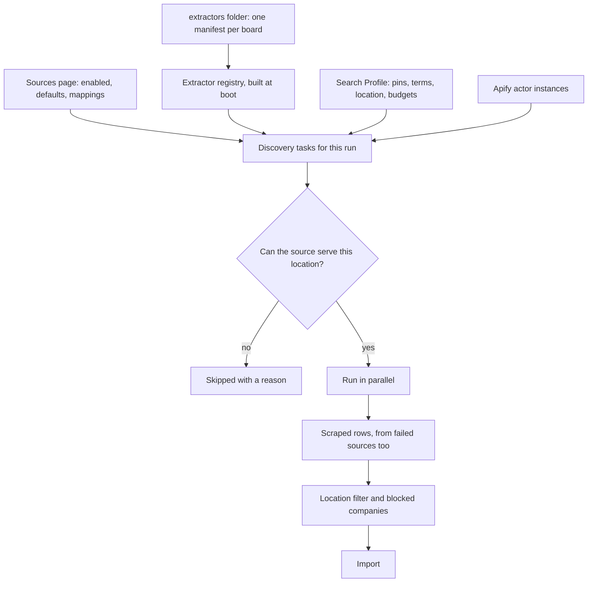

# Job sources

Job sources are where postings come from: seven built-in extractors (one of them, JobSpy, serves both LinkedIn and Indeed) and any number of Apify actors you add yourself, either from one of three ready-made LinkedIn templates or configured by hand. You switch sources on and configure them on the **Sources** page, and each [Search Profile](search-profiles.md) picks which of them its runs use. Whatever the source, every scraped row lands in the same discovery step, goes through the same [location filter](location-matching.md) and blocked-company check, and is imported, deduplicated and scored the same way.

Using it: [Job sources](../guide/job-sources.md), [Apify](../guide/apify.md)

## How it works

At boot the server scans the `extractors/` folder and registers every board that has a manifest. A run then builds one discovery task per built-in extractor and one per Apify actor, runs them in parallel (up to the **Discovery concurrency** setting, default 3), and pools what they return.



Before anything runs, each built-in source is checked against the run's location: the three remote-only boards are skipped on a non-remote profile, and startup.jobs is skipped when there is neither a country nor a city. If built-in sources were selected and none of them can serve the location, the run fails with "No compatible sources ..." and names why. Apify actors are not checked here; a remote profile leaves them out earlier, when the run is assembled.

### The built-in sources

| Card on the Sources page | Boards | How it fetches | Search terms | Location sent | Max job age | Runs on |
|---|---|---|---|---|---|---|
| JobSpy | LinkedIn, Indeed | The python-jobspy library, one Python subprocess per location | All terms OR-joined into one query | One search per city, the city sent bare; with no cities, the country. Indeed also gets the country. | Exact (3 days when blank) | Any profile |
| Hiring Cafe | Hiring Cafe | Camoufox (a Firefox build that gets past bot checks) reads the search page's embedded data; each job's description is fetched separately | One search per term | With a country: each city geocoded and searched within a 1-mile radius, else the country. Cities without a country are searched unscoped. | Approximate, see below | Any profile |
| startup.jobs | startup.jobs | The startup-jobs-scraper package: a search-index pass, then each job page, paced against rate limits | One search per term | The city list, else the country | Ignored | A profile with a country or a city |
| Working Nomads | Working Nomads | Its public search API | All terms OR-joined | Country and region words only; cities are ignored | Ignored | Any profile |
| Himalayas | Himalayas | Its JSON API, newest first, 20 per page | Matched on our side | None | Walks back to the window, 7 days when blank | Remote profiles only |
| We Work Remotely | We Work Remotely | Category RSS feeds (four programming feeds by default) | Matched on our side | None | Skips older postings | Remote profiles only |
| Jobicy | Jobicy | Its JSON API | One request per term | Only the card's optional **Geo filter** field | Skips older postings | Remote profiles only |

Glassdoor still appears as a label and filter on old jobs but no longer runs: it was retired (see below).

Hiring Cafe has no publish-date filter; the only date it can filter on is when it indexed a posting, which can be months after publication. So the extractor drops postings whose estimated publish date is older than the window (with two days of tolerance, keeping any posting with no usable date), and asks for newest-first results whenever the run hands it a window, so a capped search fills with recent postings instead of relevant old ones. With no window it searches postings indexed in the last 30 days, ranked by relevance.

### Configuring a built-in source

Each card has an enable tick, **Source-specific defaults** (for example "Max jobs per term", JobSpy's "Country (Indeed)", startup.jobs' "Detail concurrency", We Work Remotely's "Category feeds"), and **Global field mappings**. A mapping, when ticked, lets the run's own value, which comes from the Search Profile, override the source's default; unticked, the source keeps the value typed on its card. **Show raw** previews the settings the source would receive, with the location fields and max job age taken from the default Search Profile; it does not apply the per-term job budget or the since-last-run narrowing, so the job count it shows is the card's own.

| Global field | Comes from | Notes |
|---|---|---|
| City | the profile's **Cities** | JobSpy, Hiring Cafe and startup.jobs; Working Nomads and the remote-only boards ignore cities |
| Country | the profile's **Country** | JobSpy only, as Indeed's country; Hiring Cafe, startup.jobs and Working Nomads read the profile's country directly |
| Workplace types | the profile's **Work arrangement** | A remote profile always sends Remote |
| Max jobs per term (budget) | the profile's **Max jobs discovered**, divided over terms times boards | On by default, so the card's own number is normally overridden |
| Max job age (days) | the profile's **Max job age (days)**, the Run menu's window, or the since-last-run window | Not offered by startup.jobs or Working Nomads |

Under each card's title, **Enable in all profiles** and **Disable in all profiles** tick or untick that source on every Search Profile at once, without touching the card's own enable tick. For a remote-only board, Enable adds it only to remote profiles and says which profiles it skipped. Disable always asks for confirmation; on an Apify actor card Enable does too, since it starts paying for that actor on every profile, scheduled runs included.

### Apify actors

The **Apify (paid API)** tab holds one Apify API token for the account and a card per actor. **Add actor** creates one either from a template or as a custom actor: you give the actor reference, an input template in JSON, and an output mapping that says where each job field sits in the actor's results (`jobUrl` and `title` are required; rows missing them are counted as unreadable, not imported half-empty). A custom input template can use these placeholders:


```text
{{searchTerms}}  {{city}}  {{country}}  {{workplaceTypes}}
{{maxJobsPerTerm}}  {{maxJobs}}  {{maxAgeDays}}
```


Each actor runs as its own source, labelled with the name you gave it, with its own optional max jobs and max job age.

An actor run is started on Apify and then polled until it finishes, after which its result dataset is read page by page. A run that times out or is aborted still hands back everything it scraped: those rows are imported, while the source is marked failed and its [scrape watermark](search-profiles.md#only-scrape-since-the-last-run) does not advance.

| Template | Actor | Runs per search | Result cap | Max job age | Stops early |
|---|---|---|---|---|---|
| LinkedIn Jobs Scraper (curious_coder) | `curious_coder/linkedin-jobs-scraper` | One run per term, one after another; each city is one search URL in that run | The term's budget (at least 10), shared evenly across the cities | Sent exactly | Yes |
| LinkedIn Jobs Scraper (cheap_scraper) | `cheap_scraper/linkedin-job-scraper` | One run per term, one after another | The larger of 150 and the term's budget, for the whole run | 24 hours, 7 or 30 days: rounded up, and capped at 30 days | No |
| LinkedIn Jobs Scraper (valig) | `valig/linkedin-jobs-scraper` | One run per term and city, several at once (setting **Apify term-run concurrency**, default 8) | The term's budget split across its cities, 1 to 1000 each | 24 hours, 7 or 30 days: rounded up, and capped at 30 days | No; it asks the actor to filter on the title instead |

All three take their budget from the profile's **LinkedIn jobs per search term** (and the per-term numbers there or in the Term matrix), not from the actor card, and all three qualify each city with the selected country, for example "Cambridge, United Kingdom" (a city that already ends in the country is left as it is). Cities go out bare only when there is no single country to add: no country set, or one that names no single place (Worldwide, or USA/CA). A posting that matches two terms is fetched, and billed, by both runs. After a run, the run banner reports for each actor which terms reached their budget ("LinkedIn likely had more"), which failed, which were not searched, and which stopped early.

On the two templates with fixed windows, a profile **Max job age (days)** above 30 is quietly scraped as 30 days, while an explicit Run menu window above 30 refuses the run (see [Pipeline runs](pipeline-runs.md)).

**Stopping a term early (curious_coder).** LinkedIn ranks a one-term search by relevance and then keeps padding it with loosely related postings. While a term's run is going, the app reads its results every 10 seconds. A city search has run dry when fewer than N of its 20 deepest-ranked results have a title naming the term, where N is the setting **Stop a LinkedIn search term early** (default 2; 0 switches it off). The run is aborted once every city search has run dry, reached its own cap, or gone quiet for a minute while another city kept growing, and at least one of them ran dry. A city search that has returned nothing never counts as finished, because it may simply not have started yet.

**valig** takes the other route to the same problem: the app passes the term to the actor as a title filter, so the padding is dropped before it is billed.

### Checking that a source works

| Check | Where | What it does |
|---|---|---|
| **Test** on an Apify actor card | Sources → Apify (paid API) | Runs the actor once with the default profile's terms and location and shows up to five mapped rows. A per-term actor tries the terms in order until one returns postings; valig searches only the first city. Stopped after five minutes, keeping what it found. |
| Extractor health check | API only: `GET /api/<source>/health` | Runs one built-in board with the term "software" in the United Kingdom, asking for a single job, and reports healthy if it returns a valid one. Cached for an hour. No button calls it. |

## Design decisions

### Boards are discovered at runtime, and the registry refuses an inconsistent one
Adding a board is a folder under `extractors/` with a manifest; nothing imports it by name. In exchange the registry checks every manifest at boot: two manifests claiming the same board, or a global mapping that points at a field the card does not have, stop the server from starting. The second rule exists because unticking a mapping falls back to the card's own field, and a mapping with no field to fall back to would silently throw the value away.

### Retire a dead source, never delete it
Glassdoor stopped returning jobs while still reporting success: the library builds a broken request URL, and the token its search needs can no longer be fetched from Glassdoor's bot-walled pages, with no newer release to move to. It was retired rather than deleted: the id stays so old jobs keep their label and filter chip, while it is removed from the runnable list and from JobSpy's manifest together. A retired board that a manifest still provides stops a production server from starting (outside production it is a warning, unless strict mode is switched on with `EXTRACTOR_REGISTRY_STRICT`), because the Run menu would otherwise offer a tick that then fails the whole run.

### A city reaches a LinkedIn actor with its country
LinkedIn resolves a bare city name to whichever place it ranks highest, not the one in your country: a plain "Cambridge" can return Toronto-area jobs. Those rows are paid for on a per-result actor and then thrown away by the location filter. So the Apify templates send "city, country" whenever there is a country to send. JobSpy still sends bare cities, because its location field is shared between LinkedIn and Indeed.

### One actor run per search term
Joining all terms into one LinkedIn query let the padding LinkedIn adds to every search eat the whole result cap. Running each term on its own, capped at that term's budget, keeps every term's share of results; cheap_scraper follows the same shape, and valig goes one step further with one run per term and city.

### Early stop ships on
LinkedIn front-loads a one-term search: matching titles crowd the top of the results and thin out quickly after. Measured on real searches, stopping once fewer than 2 of the last 20 results named the term would have kept nearly all of the matching rows for about half the billed rows, so the rule is on by default with that threshold. A city with no results never counts as done, so an early stop cannot skip a city that had not started.

### Apify actors never run on a remote profile
LinkedIn's forced AI search turned the actors' remote filters into a plain "remote" keyword, so every actor would bill for rows that are not remote at all. The actors are therefore left out of remote profiles; the remote-only boards, which are remote by construction, serve those profiles instead.

### Failed sources keep what they scraped
An Apify run that hits its timeout has often already fetched, and been billed for, useful rows; the same goes for a startup.jobs run cut short by rate limiting. Those rows are imported while the source still reads as failed, and its watermark holds so the next run reaches back over the gap. Every row a mapper cannot read is counted and reported rather than skipped silently.

### Hiring Cafe is read the way its own pages are
Hiring Cafe's search results come from the data embedded in its search page, and each description from the job's own page, both fetched through the extractor's browser session. The site also answers a much lighter JSON endpoint for descriptions, and it is deliberately not used: Hiring Cafe has shut its JSON endpoints before, which is why search had to move to page data in the first place, and depending on another one would invite the same break. Its newest-first sort is requested only when the run hands it a window (a max job age, or the since-last-run narrowing), because the sort decides which postings a capped search keeps, and a profile that expressed no freshness wish should keep relevance ranking.

## Where it lives

| Path | What it holds |
|---|---|
| `extractors/` | One folder per built-in board, each with its manifest and runner |
| `orchestrator/src/server/extractors/` | Manifest discovery and the registry's boot checks |
| `shared/src/extractors/index.ts` | The board catalog: labels, order, remote-only and retired flags |
| `orchestrator/src/server/services/source-configs/resolve.ts` | How card defaults and global mappings combine into a source's settings |
| `orchestrator/src/server/providers/apify/` | The Apify client, per-term runs, templates and custom mapping |
| `shared/src/term-stop.ts` | The early-stop rule |
| `orchestrator/src/server/services/extractor-health.ts` | The built-in health probe |
| `orchestrator/src/client/pages/SourcesPage.tsx`, `orchestrator/src/client/pages/sources/` | The Sources page, Apify tab and actor cards |
