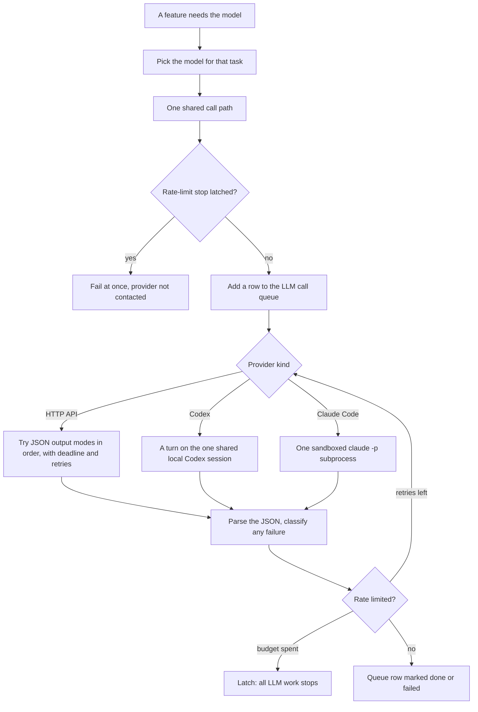
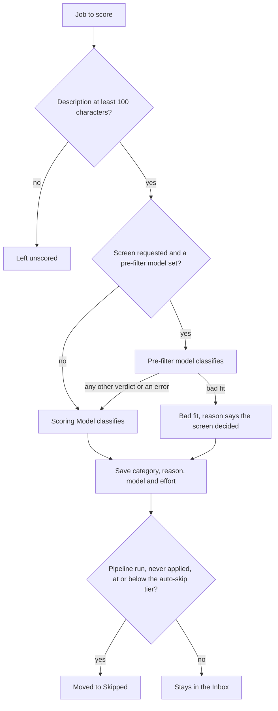

# LLM providers and scoring

Every step that needs a language model (reading your CV, scoring a job's fit, tailoring, writing a cover letter, the ghostwriter, interview notes, reading a job off a URL) goes through one service that talks to whichever provider you configured: a cloud API, a local model, or a CLI that bills your own subscription. On top of it sit job scoring (a four-tier fit category with a one-line reason), an optional cheap pre-filter in front of the scorer, a benchmark that compares models on your own jobs, and the prompts, which live in the database where you can edit them. This page explains how those pieces fit together and why they behave as they do.

Using it: [LLM providers and prompts](../guide/llm-providers.md)

## How it works

There is exactly one way to call a model, so every call shows up in the **LLM call queue** (the **LLM** button in the page header): **Running** calls and the **Recent** finished ones, live, with duration and token count. The server keeps the last 50 finished calls and never drops one that is still running; token counts are only ever what the provider reported, never an estimate.

### Providers

| Provider | How a call is made | Credential | Endpoint | Structured-output fallback order | Model picker in Settings |
|---|---|---|---|---|---|
| OpenRouter | HTTPS chat completions, with OpenRouter's response-healing plugin | API key | fixed | JSON schema → plain | free text |
| OpenAI | HTTPS Responses API | API key | fixed | JSON schema → JSON object → plain | fetched from the account |
| Gemini | HTTPS `generateContent` | API key | fixed | JSON schema → JSON object → plain | fetched from the account |
| OpenAI-compatible | HTTPS chat completions | API key | you choose the base URL | JSON schema → JSON object → text → plain | free text |
| LM Studio | local chat completions | none | you choose (default `localhost:1234`) | JSON schema → text → plain | free text |
| Ollama | local chat completions | none | you choose (default `localhost:11434`) | JSON schema → text → plain | fetched from Ollama |
| Codex | the local Codex app-server, installed into the data directory from Settings or the wizard | device-code sign-in kept under `data/codex-home/` | — | prompt only | free text |
| Claude Code | one headless `claude -p` subprocess per call; the CLI version is pinned in the image and can be updated from Settings until the next rebuild | OAuth token (Claude subscription) | — | the CLI's `--json-schema` | suggested aliases and ids (`sonnet`, `opus`, …) |

When an HTTP provider rejects a structured-output mode as unsupported, the call moves to the next mode and remembers which one worked for that provider and endpoint, so later calls start there.

### Which model runs which task

The **Models** section (Settings → AI) has a **Default model** and two **Task-Specific Overrides**; an empty override inherits the default.

| Setting | Used for |
|---|---|
| **Scoring Model** | Job scoring; also what a benchmark column on the configured provider runs when its model is left blank |
| **Tailoring Model** | Tailoring, cover letters, the ghostwriter, the chat panel, interview notes, CV and cover-letter extraction, drafting the personal brief, suggesting search terms in onboarding |
| **Default model** | Reading a job off a pasted URL; the fallback for both overrides |
| **Pre-filter model** | Only the optional screen in front of scoring (see below); empty means off |
| **Reasoning effort** | Claude Code only: the `--effort` level for every call (`low`, `medium`, `high`, `xhigh`, `max`, or **CLI default**) |

When the **Default model** is empty, the server uses the `MODEL` environment variable if it is set and fits the provider, otherwise `gpt-5.4-mini` on OpenAI, the CLI's own default on Codex and Claude Code, and `google/gemini-3-flash-preview` on every other provider; the Settings form shows that fallback as the field's placeholder. Changing the provider clears the three model fields you did not also change, and the server ignores a saved model that cannot belong to the provider (a Gemini name under OpenAI, a non-Gemini name under Gemini, a non-Claude name under Claude Code), so a leftover never reaches the wrong API.

### Time limits, retries and the rate-limit stop

| Knob | Default | What it bounds |
|---|---|---|
| **LLM request timeout (ms)** (Pipeline Behavior) | 300 000 (5 min), allowed 5 s to 30 min | One attempt of any provider. Armed after the retry back-off, so a call allowed 2 retries is bounded at three times this. |
| Per-call retries | 2 for scoring, 1 for tailoring | Malformed JSON, HTTP 429 and 5xx, timeouts, network failures, with a growing back-off. |
| **LLM rate-limit retries** (Pipeline Behavior) | 3 | Rate-limit retries across *all* calls in the process together. When spent, every later call fails without contacting the provider. |
| `CLAUDE_CODE_REQUEST_TIMEOUT_MS`, `CODEX_APP_SERVER_TURN_CEILING_MS` | unset | Environment-only overrides of the timeout for that one provider. |
| **Scoring / Tailoring / Bulk action / Batch URL import concurrency** | 4 / 3 / 4 / 3 | How many jobs each pool works on at once; capped at 100. There is no global limit across pools, except that Codex serialises every call through its one session. |

A failure is sorted into one of three classes, and the class decides what happens next:

| Class | Recognised by | Consequence |
|---|---|---|
| Rate limited | HTTP 429; or rate-limit wording when the provider gave no HTTP status (the CLI-based providers can report a limit only as text) | Spends one retry from the shared budget; when the budget is gone the process latches stopped. A scoring run ends instead of failing job after job. |
| Auth | HTTP 401/403, or key/credential wording | The call fails; reading a job off a URL then says the key is not set instead of showing the raw provider error. For scoring it is a single-job failure like the row below. |
| Other | everything else | The call fails; a scoring run leaves that one job unscored and moves on. |

The latch clears only when you start new LLM work yourself: starting a run (after the run passed its own checks), starting an LLM-driven bulk action such as **Recalculate match** when no other LLM-driven batch or URL import is running, or starting a benchmark while no run is in progress.

### Job scoring

The model sees your personal brief, the job's title, employer, location, salary, degree, disciplines and description, and the **Scoring policy**, and answers with one of four categories plus a one-to-two-sentence reason. The policy text is the entire definition of the tiers:

| Category | Meaning in the shipped policy |
|---|---|
| **Great fit** | Reads as written for you: everything below, plus most desirables met and it matches your stated target roles. |
| **Very good fit** | Clear shortlist: direct, demonstrated experience on the core at the right level, no demanded differentiator missing. |
| **Good fit** | Worth applying: the core discipline is practised, with one gap (level stretch, a missing differentiator, a slightly short threshold). |
| **Bad fit** | The core discipline is not one you practise, a mandatory threshold is clearly unmet, or a hard blocker exists. |

| What triggers scoring | Pre-filter used | Can auto-skip |
|---|---|---|
| A pipeline run's scoring step (unscored Inbox jobs only) | yes, when a pre-filter model is set | yes |
| **Recalculate match** | no | no |
| **Screen first** (shown only when a pre-filter model is set) | yes | no |
| Rescraping a job | no | no |
| Importing a job from a URL | no | no |

Each saved score records the model that produced it and, on Claude Code, the effort level; the fit card shows it in a "Scored by …" tooltip. An optional missing-salary penalty demotes a job one tier when it lists no salary; it is off by default and has no Settings control (the `PENALIZE_MISSING_SALARY` environment variable sets it).

### Prompts

Every prompt is a YAML document stored in the database. The files in `prompts/` are only the seed the image carries; on every boot the seed is compared with the stored copy:

| On boot | What happens |
|---|---|
| A prompt has no row yet | It is inserted from the seed. |
| The seed changed and you never edited the prompt | Both the live text and the stored default are refreshed, so upgrades reach you. |
| The seed changed and you edited the prompt | Only the stored default is refreshed; your text stays. |


**Settings → Prompts** lists them with an **Edit** editor per prompt; a save applies from the next call. A save is checked before it is stored (valid YAML, the prompt schema, every referenced fragment exists) and rejected inline if not; **Reset to default** copies the stored default back. Shared pieces (the CV-format rules for LaTeX, Word or HTML, the writing style, the output language) are fragments spliced into the bigger prompts with `{{> name}}`, one level deep: a fragment may not include another.


**Writing Style** (Settings → AI) feeds those fragments: tone, formality, constraints, words to avoid, and the output language.

| Output language mode | Ghostwriter | Tailoring and cover letters |
|---|---|---|
| A specific language | that language | that language |
| **Match current resume language** | detected from your personal brief (English if unclear) | English |

### Model Benchmarking

**Settings → AI → Model Benchmarking** answers "would another model, effort level or provider classify my jobs the same way, and what would it cost?". You add configurations (provider, model, Claude Code effort, optional price per million input and output tokens), pick **Jobs to sample** and which saved categories to draw from, and press **Run benchmark**. The server draws that many random jobs that are not closed and have a scoreable description, and runs the real classification path for every job × configuration: the same prompt and policy, but no salary penalty and nothing written to any job. A **Saved in database** column shows what each job already carries, and you pick one column as the **Baseline**. Against it each column reports exact agreement, within-one-tier agreement, bad-vs-not-bad agreement, how many of the baseline's great and very good fits it would have thrown away as bad, the same for good fits, how many bad fits it caught, the share it would forward, tokens per job and estimated cost. One run at a time; it lives in server memory, survives a page reload and is gone after a restart. A rate limit stops the whole run.

## Design decisions

### A failed call never produces a score

When scoring fails, the job stays unscored; nothing guesses a category. An earlier version fell back to keyword matching when a call failed, and a provider's session limit was mistaken for a missing key, so a batch of jobs got invented categories that looked exactly like real ones, and auto-skip then moved some of them out of the Inbox. A missing score is honest; a fabricated one is not.

### One rate-limit budget for the whole process

A session or quota limit is account-wide and lasts hours, so letting each queued job retry on its own only multiplies the damage. All calls spend from one small budget, and once it is gone the process latches stopped until you start new work. Rate-limit *wording* is trusted only when the provider gave no HTTP status, because an HTTP error body can echo the request, and a job description about "API rate limiting and quota management" would otherwise stop every call in the process. Auth wording stays trusted with or without a status, because Gemini reports a bad key as 400 and a misread auth error has no global effect.

### One timeout for every provider, per attempt

Nothing below the app guarantees a stuck call ends (the HTTP client's idle timer re-arms on every byte), and one call that never settles holds a whole pipeline run in "scoring" where **Cancel** cannot reach it. So a single setting bounds each attempt, sized as a stuck-detector rather than a tuning knob. For Claude Code this replaced a fixed 120-second ceiling with the 300-second setting, rather than keep a provider-specific number the Settings page could not honestly show. Codex additionally tears its shared session down after an abandoned turn, because the turn keeps running and every later call would queue behind it.

### The scoring policy is a setting, the prompt is a shell

The `job-score` prompt only carries the inputs and the JSON contract; the whole rubric (category meanings, gates, calibration examples) is the **Scoring policy** text in Pipeline Behavior, so there is one place to tune scoring. The shipped policy reads as a recruiter's shortlist decision, treats research, academic and open-source work as direct evidence, and carries corrected verdicts as calibration examples; it was rewritten that way after a stricter model left almost no job in the upper tiers. Clearing the field restores the shipped policy; there is no "no guidance" state, because a bare shell gives the model no meaning for the categories.

### The cheap screen can only remove, and only when you ask

Two-stage scoring lets a cheap model screen jobs before the expensive one. The screen's only power is to call a job a bad fit and stop; any other verdict is thrown away and the scoring model decides from scratch, so a generous screen costs money but never accuracy. It runs only in the pipeline's scoring step and on **Screen first**, so a new caller that forgets to opt in gets the good model. It fails open (a broken screen falls through), a screened-out job's reason says the main model never saw it, and a plain **Recalculate match** remains the second opinion on anything it removed.

### A provider's key is never lent to another provider

The ambient key and base URL belong to the configured provider only; any other provider (a benchmark column, the pre-filter) uses the key saved for it under **Provider Credentials**, or is refused. A caller-supplied base URL is accepted only for LM Studio, Ollama and OpenAI-compatible, both in the credentials route and in the call path, because for the others it could only redirect that provider's key to another host. This closed a leak where changing the provider dropdown sent one vendor's key to another's model-listing endpoint. The connection check behind the wizard's **Test** and the onboarding gate follows the same rule, so testing Ollama next to OpenAI no longer sends the OpenAI key to the Ollama URL. Whether a call inherits the configured provider's key is decided on the provider's name as configured, so an OpenAI-compatible server on LM Studio's port does not lend its key to a call that names LM Studio.

### Claude Code runs as a locked-down plain model call

Each query is a fresh `claude -p` with tools, user settings, MCP servers, session persistence, telemetry and auto-update off, a throwaway working and home directory, an allow-listed environment (no other server secrets), and the prompt on stdin rather than the command line. The replacement system prompt is what makes it affordable: the stock agent harness measured about 52k input tokens and $0.062 for a trivial call, the trimmed one about 2.1k tokens and $0.007. The saved effort is mirrored into the server's environment and passed to the CLI as `--effort`, but a call can carry its own effort that wins over it. That per-call path exists because the environment is shared by every concurrent call, and it is what lets the benchmark and the pre-filter run different efforts side by side.

### Prompts live in the database, with the seed kept beside them

Storing prompts per database means each [user profile](settings-and-onboarding.md) carries its own, an edit applies on the next call with no restart, and **Reset to default** needs no files. Unedited prompts follow image upgrades automatically; edited ones are never overwritten. Editing the YAML on the host does nothing to a running install.

## Where it lives

| Path | What it holds |
|---|---|
| `orchestrator/src/server/services/llm/` | The shared call path, provider strategies, error classes, rate-limit budget, call-queue observer, Codex and Claude Code clients |
| `orchestrator/src/server/services/modelSelection.ts` | Which model a task uses |
| `orchestrator/src/server/services/scorer.ts` | Classification, the pre-filter and the salary penalty |
| `orchestrator/src/server/pipeline/steps/score-jobs.ts` | The pipeline's scoring step and auto-skip |
| `orchestrator/src/server/services/scoring-bench/`, `shared/src/scoring-bench.ts` | Benchmark runner and its arithmetic |
| `orchestrator/src/server/services/prompts/`, `prompts/` | Prompt loader and the seed YAML files |
| `shared/src/settings-registry.ts` | Provider list, defaults, timeouts and the shipped scoring policy |
| `orchestrator/src/client/pages/settings/components/` | Models, Provider Credentials, Model Benchmarking, Writing Style and Prompts sections |
