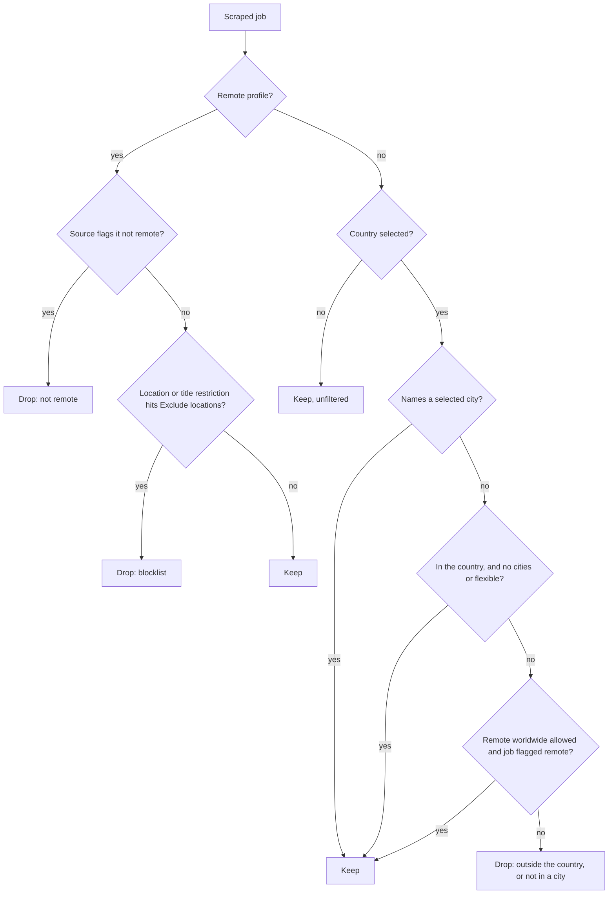

# Location matching

Boards do not return only what you asked for: LinkedIn treats a city as a radius, aggregators list whole countries, and remote boards attach restrictions such as "US only" to their postings. Location matching is the check that decides, for every scraped job, whether it fits the run's [Search Profile](search-profiles.md). It runs once all sources have returned and before anything is imported, so a dropped job is never imported or scored; it shows up in the run banner's Rejected list with the reason. A normal profile matches on country and cities; a remote profile instead keeps everything except postings its source flags as not remote and what its **Exclude locations** list names.

Using it: [Search profiles](../guide/search-profiles.md)

## How it works

The run turns the profile's location fields into one location intent: the selected country, the cities, the work arrangement ticks, the location scope, the match strictness, and for a remote profile the blocklist. That intent does two jobs. Before scraping it decides which built-in sources can run at all (the remote-only boards need a remote profile, startup.jobs needs a country or a city; see [Job sources](job-sources.md)). After scraping it is the filter below, applied in the discovery step to every row from every source, Apify actors included, before the blocked-company check.

### What the filter reads

A job's location candidates are its location text plus whatever structured location the source gave (city, country, and a remote/hybrid/on-site flag). All comparisons are case-insensitive, treat punctuation as a word break, and fold accents through one shared rule, so "Málaga" and "Malaga", "Zürich" and "Zurich", "Kraków" and "Krakow" are the same word. Folding is not translation: "München" becomes "munchen", never "munich", so a profile that wants both spellings lists both (as with "Vienna" and "Wien").

| Check | Counts as a match when |
|---|---|
| City | The requested city's words appear, in order, as whole words in any candidate: "London" matches "Greater London Area", "Malag" does not match "Málaga". A city alone is enough, whatever country the posting names or omits. A "city" entry that is just the country's name counts only when the country matched. |
| Country, by name | A candidate contains the country's name or a known variant: England, Scotland, Wales, Great Britain, Britain, Northern Ireland or UK for the United Kingdom; US, USA, U.S., U.S.A. or United States of America for the United States; Türkiye for Turkey; Czech Republic for Czechia. |
| Country, by code | A three-part location ending in the country's two-letter code, the way Indeed writes "Wien, W, AT". A two-part "Wilmington, DE" is a US state, not Germany. |
| Country, by omission | No geographic candidate names any country or ends in a two-letter code: "Greater Reading Area" or "Vienna or Graz" is taken to be inside the selected country. Placeless text such as "Remote" or "Worldwide" does not qualify; those rows are left to the remote rules. |

### Strictness and scope

**Match strictness** decides what happens to a job that is in the right country but names none of your cities. It does nothing until the profile has both a country and at least one city.

| Job's location | No cities | **Include likely matches** (default) | **Exact matches only** |
|---|---|---|---|
| Names one of your cities | not applicable | keep | keep |
| In your country, another town or country-wide | keep | keep | drop, unless kept as remote worldwide |
| Names no country at all | keep | keep | drop, unless kept as remote worldwide |
| Names another country | drop, unless kept as remote worldwide | drop, unless kept as remote worldwide | drop, unless kept as remote worldwide |

**Location scope** decides whether a remote job outside your geography may come in anyway. The escape applies only when **Work arrangement** includes Remote and the source itself flagged the job as remote.

| Location scope (label) | Remote job outside your geography | Extra effect |
|---|---|---|
| **Only selected locations** (default) | dropped | none |
| **Selected locations + remote worldwide** | kept | none |
| **Remote worldwide** | kept | When auto-tailoring picks its top jobs, a job in your selected location goes ahead of a remote-worldwide one of the same fit category. |

Work arrangement is otherwise not checked by the filter: it is sent to the boards as their own search filter, and its Remote tick is what opens the escape above. Which sources flag remoteness decides who can use the escape: JobSpy (LinkedIn and Indeed), startup.jobs and Working Nomads do, a custom Apify actor can if its output mapping maps `isRemote`, and the three LinkedIn actor templates and Hiring Cafe do not, so for those only your selected locations are kept. The **Location scope** field says so whenever a remote-worldwide option is chosen.

### Remote profiles: a blocklist

A profile with **Remote profile** ticked sends no country or cities to the boards and always searches Remote. Its filter keeps everything except:

| Dropped when | Reason shown |
|---|---|
| The source reports the posting as not remote (JobSpy's LinkedIn and Indeed return on-site postings even with their remote filter on). A source that does not say, such as Hiring Cafe, is believed to be remote. | the source flags this posting as not remote |
| An **Exclude locations** entry appears in the job's location candidates, or in a restriction in its title: a bracketed part such as "(US Only)" or "[EU]", or the text after its last " - ", " – ", " — ", " \| " or ": ". The description is never read. | location matches the remote profile's blocklist |

Entries match case- and punctuation-blind, and the country variants above are unified on both sides, so "US-only" also catches "USA Only" and "United States only", and "UK only" also catches "England only". An entry must appear as a whole run of words, so "US only" does not block a bare "United States". In titles a lowercase "us" inside a longer phrase is read as the pronoun ("help us scale"), not the country. Stored country, cities, strictness and scope survive on a remote profile, ignored, and come back if the box is unticked.

### What the run shows

Each dropped job is captured with one readable reason, which the run banner's Rejected popup lists per source.

| Reason | Shown as |
|---|---|
| Not in the selected country | location mismatch: outside *country* |
| In the country, no selected city, exact matches only | location mismatch: in *country*, but not in a selected city |
| Remote profile, blocklist hit | location matches the remote profile's blocklist |
| Remote profile, source says not remote | the source flags this posting as not remote |

### Edge cases worth knowing

| Situation | What happens |
|---|---|
| A city with the same name elsewhere ("Vienna, VA, US" on an Austria profile listing Vienna) | Kept: a named city is enough on its own. |
| A one-word country name inside a place name ("Jersey City", "Georgia, Atlanta" on a US profile) | The location reads as naming a country, so the no-country fallback does not apply and the job is dropped unless a city or the US name also matches. |
| Country set to **Worldwide** | Most sources treat it as no geography (the LinkedIn actor templates, Hiring Cafe and Working Nomads send no country; startup.jobs skips the run), but the filter treats it as a country name: only jobs whose location says "Worldwide", names no country, or comes in as remote worldwide are kept. |
| Manual URL import or batch import | Not filtered: the check exists only in the pipeline's discovery step. |

The same accent folding also powers location search in the Manage view's filters, so "Malaga" finds "Málaga" there too. The ctrl+K search finds it as well, through the server's full-text index, which folds with its own copy of the same letter table (see below).

## Design decisions

### Filter after scraping, before import
The filter cannot save scrape cost: by the time it runs, every source has already returned and every paid row is billed. What it saves is everything after: a dropped job is never stored, deduplicated or scored. That is also why **Include likely matches** is not a cost saving but the opposite, since every extra job kept costs one scoring call.

### "Include likely matches" is the default
Cities steer where the boards search, but they are not a good filter on what comes back: a board resolves a city to a radius, so a city search also returns its commuter towns and postings listed for the whole country, all inside the country you asked for. Exact matching drops those. New profiles therefore default to flexible matching. A profile that already chose exact matching keeps it, since there is no way to tell a deliberate "exact" from an inherited one.

### A named city is enough on its own
Postings often list several cities without the country ("Vienna or Graz or Munich"), and checking the city only after the country matched would reject them. The city check stands alone. The known price is a same-named city in another country being kept; that is accepted because missed jobs are the worse failure.

### A location that names no country counts as yours
The scrape only asked the board for your country, so "Greater Reading Area" or "Utrecht Area" is no evidence of a mismatch. Three guards stop this from becoming "anything goes": a trailing two-letter code always blocks it ("Wenatchee, WA" stays out of a Spain profile), an ISO country code counts only in a three-part "City, REGION, CC" location, and placeless text like "Remote" is left to the remote rules. Country words inside place names ("Jersey City") defeat the fallback; that gap is recorded in the tests and left for a change with its own measurement, since the same fallback is what keeps bare metro names such as "Utrecht Area" in.

### A remote profile filters with a blacklist, not a whitelist
Keeping a remote posting only if its restriction named your country or a region containing it would drop every posting whose restriction is phrased in a way the matcher does not know. A remote profile therefore keeps everything except what **Exclude locations** names, and the country is not an eligibility filter at all. The description is not scanned because "US" appears in most job ads for reasons that have nothing to do with eligibility.

### Paid sources do not feed the remote-worldwide escape
Remoteness is not read from the Apify LinkedIn templates or Hiring Cafe. Those are the paid or high-volume sources, and with the escape open every country profile would import its own copy of the same worldwide remote postings, each costing a scoring call. The escape stays for the free scrapers that already report remoteness, where volumes are small.

### One folding rule, and it is not a translation
Without accent folding, a tokenizer that turns an accented letter into a word break means a city typed as "Malaga" can never match the board's "Málaga", and every result for that city is scraped, paid for and dropped. Folding happens in one place, shared by the filter, the remote blocklist and the Manage view filters. The one exception is the ctrl+K search index, which has to fold inside the database: it keeps a copy of the same letter table, checked by a test so the two cannot drift, and gives the same results on Latin-script text, but treats Greek and Cyrillic marks differently. Exonyms ("Munich" for "München") stay unmatched on purpose: mapping them is a translation table, a different and much larger promise.

### A reject names the check that failed
A bare "location mismatch" could only be diagnosed by digging through the database. The filter returns which check failed, so the banner can say "outside Austria" or "in Austria, but not in a selected city", and the two cases call for different fixes (a wider country setting versus a longer city list or flexible matching).

## Where it lives

| Path | What it holds |
|---|---|
| `shared/src/job-matching.ts` | The filter itself, its reasons, and the title-restriction reading |
| `shared/src/search-cities.ts` | City and country matching, the no-country fallback, blocklist matching |
| `shared/src/location-support.ts` | Accent folding, country aliases, the country list |
| `shared/src/country-codes.ts` | Two-letter country codes, derived from the runtime's region names |
| `shared/src/location-domain.ts` | The location intent and which sources can serve it |
| `orchestrator/src/server/services/pipeline-run/assemble.ts` | Building a run's intent from the profile, including the remote rules |
| `orchestrator/src/server/pipeline/steps/discover-jobs.ts` | Where the filter runs and rejects are recorded |
| `orchestrator/src/client/pages/orchestrator/run-fields/` | The Country, Location scope and Match strictness fields |
