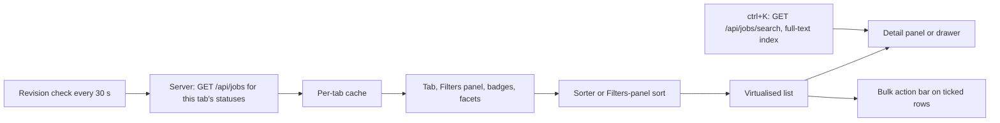
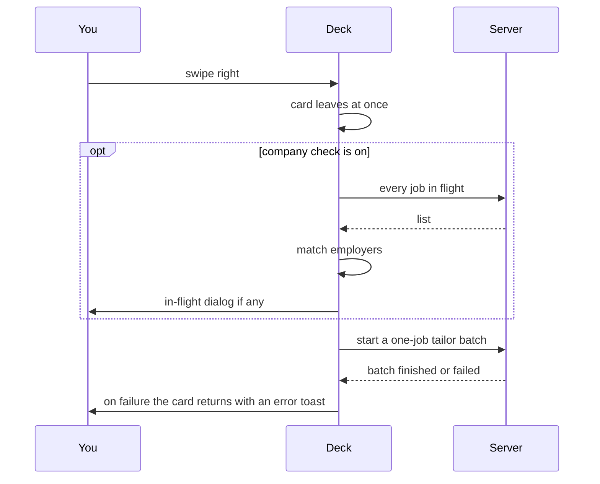

# Manage and Swipe views

These are the two screens where you work through the jobs the pipeline found. **Manage** is the full workspace: a list split into tabs by stage, filters and sorting, a detail panel with every action, a ctrl+K search across all jobs, and bulk actions on ticked rows. **Swipe** is the phone-first deck for the Inbox: one card at a time, right to tailor, left to skip. Both read and write the same jobs through the same actions; only the presentation differs. How a job moves between stages is on [Job lifecycle](job-lifecycle.md); this page is about the screens.

Using it: [Manage and Swipe](../guide/reviewing-jobs.md)

## How it works

The **Swipe | Manage | Schedule | Stats** switch in the top bar of those four screens moves between them (the side menu reaches them too, as **Jobs** and **Swipe**). **Manage** opens on the Tailoring tab; the address bar always carries the tab (`/jobs/inbox`, `/jobs/live`, …) and the selected job, and old tab names in a bookmark are redirected to the nearest current tab.

### Loading the list

The list is loaded one tab at a time: opening a tab fetches only the jobs in that tab's statuses (the All Jobs tab fetches everything). A tab you have already visited paints instantly from memory while a fresh copy loads behind it. The counts on the tabs come from the server's per-status totals, sent with every list load, not from counting the rows on screen, so every tab shows its true count while only one tab's rows are loaded.

To notice changes, the screen asks the server every 30 seconds for a small "revision" of the current tab (the newest update time and the row count for those statuses) and reloads the list only when it changed; it does the same when the window regains focus or comes back online, and reloads fully every 10 minutes. Checks pause while the window is hidden or while you have unsaved tailoring edits open in the detail panel. Only the rows in view are rendered, so a tab with thousands of jobs scrolls smoothly.

### The tabs

| Tab | Shows (statuses) | Key | Tab-specific controls |
|---|---|---|---|
| Inbox | Discovered | 1 | facets; titles dim once older than the Inbox stale threshold |
| Tailoring | Processing and Ready | 2 | **Untailored** toggle: hide the finished Ready rows |
| Live | Applied | 3 | date pill shows days since you applied |
| Interviewing | Interviewing | none | date pill shows days since you applied |
| Backlog | Backlog | 4 | facets |
| Stale | Stale | 5 | facets; the sweep bar (**Move stale rows**, **Move Tailoring**, **Move Applied**, **Move closed postings**) |
| Closed | Skipped and Closed | 6 | chips: All, Skipped, Rejected, Withdrawn, Ghosted, Duplicated, Other; no filter bar |
| All Jobs | everything except Closed, Skipped and Stale; those come back when the **Closed** date filter is ticked | 7 | facets |

What the detail panel shows depends on the tab. On the Inbox it is the decision view (**Start Tailoring**, **Skip Job**, **Backlog**, **Recalculate match**). On Tailoring, a job still being tailored shows its progress, a failed one shows the decision view with **Retry tailoring** and the failure detail. A Ready row on Tailoring opens the tailoring panel with the PDF and the editing chat ([Tailoring](tailoring.md)). Everywhere else it is the job card with an action bar: **View**, the **Stage:** dropdown (move the job to another stage; the close-with-outcome choices appear only on jobs you once applied to), and the buttons that fit the status (**Applied**, **Move to Interviewing**, **Mark Closed**, **Tailor**, **Skip**, **Reopen**), plus a **More actions** menu (edit, copy, downloads). Live and Interviewing jobs also get **Interview QA** and **Notes** tabs. The Description, Interview QA and Notes tabs each have an expand icon at the top right that opens the tab's text in a wide, read-only reader box over the darkened page; clicking outside or Esc closes it. On a narrow screen the panel opens as a drawer; on a desktop the list and panel sit side by side, with a splitter you can drag between 280 and 720 pixels and a button to hide the list, both remembered by the browser.

When the server finds the same posting listed twice, a banner offers **Review duplicates** ([Duplicates](duplicates.md)).

### A row in the list

Each row shows a status dot, title, company, location, one date pill, badges and the source. The **date pill** reads `Posted 3d` (or `Found 3d` when the board gave no date); on Live and Interviewing it reads `Applied 12d` instead, because there the number you are waiting on is how long ago the application went out. Other markers: `Reposted 2×`, `Tailor failed`, the salary, the fit rating, an outcome or **Skipped** chip, and a teal **Applied** badge on any job you once applied to whose status no longer says so (a closed, skipped or reopened job). When a live-status check has read the posting, a line shows LinkedIn's applicant caption ("Accepting applications" when there is none) or **No longer accepting applications**, an **Easy Apply** chip, and when it was checked ("checked today", "checked 3d ago").

The **status dot turns to the warning colour** when another job at the same employer is already in Tailoring, Live or Interviewing; its tooltip says how many. The server works this out for every row when it sends the list, by employer name ignoring case and surrounding spaces. Clicking a **company name** anywhere opens the company dialog (below).

### Filtering

Filters stack: every layer narrows what the one before it left.

| Layer | Where | Remembered in | Acts on |
|---|---|---|---|
| **Filters** panel: Sources, Ever applied (Any / Yes / No), Dates (Ready, Applied, Closed, Discovered), Ad age, Salary, Sort | **Filters** button beside Search | the address bar | every tab |
| **Fit** badges (four ratings plus Unscored) | filter bar | the address bar | every tab; visible everywhere but Closed |
| **Profile** badges (one per Search Profile plus Unattributed) and **Job title** badges (every profile's search terms) | filter bar, each behind its tickbox | this page only | tabs that show the filter bar |
| **+ Filter** facets: Company, Title, Location, Description, Degree required, Job level, Remote | filter bar | this page only | Inbox, Backlog, Stale, All Jobs |
| Sorter icon | right end of the filter bar | the address bar | tabs that show the filter bar |

Inside one family the picks combine with "or", across families with "and". A Job title badge matches when the term appears as text inside the title. Facets accept `a|b` for "either", ignore accents (all but Remote, which is a yes/no field), and apply when you press Enter, so typing does not re-filter the list on every key. Description, Degree required, Job level and Remote need fields the light list payload does not carry, so adding one of them makes the tab reload with full job details. **Reset** in the Filters panel clears all of it, including the badges and facets.

### Sorting

The sorter icon offers four orders. **None** leaves the Filters panel's Sort in charge (newest posted first by default); the panel notes when the sorter is overriding it.

| Sorter | Order |
|---|---|
| None | the Filters panel's Sort |
| Posted / found | newest posting date first, discovery date when the board gave none |
| Fewer applicants | jobs with an applicant count, fewest first; then LinkedIn jobs with no count yet; then postings reported closed; then everything not on LinkedIn. Equal counts, and the groups without a count, newest posted first |
| Easy Apply, Fewer applicants | the same ladder, but every job wearing the **Easy Apply** chip comes before every job that does not |

The groups hold whichever way the direction points: "most applicants first" reorders the counts, it never lifts the jobs that have no count.

### The ctrl+K search

**Ctrl/Cmd+K** or **/** opens a search over every job in every status. Typing sends nothing: **Enter** or the **Search** button asks the server, which looks the text up in a full-text index of the title, company and location. The typed words are one phrase: they must sit next to each other, in order, within one field ("senior eng" finds "Senior Engineer", not a senior role at an engineering firm). The server sends back at most 200 matches, those where the last word was typed in full first, newest first, then the newest of the rest; when there are more, the dialog says "Showing 200 of N matches. Search with more words to narrow." Searching with an empty box lists the 200 newest jobs. Once the results answer what the box says, Enter opens the highlighted job; after changing the text, Enter searches again first. Matching ignores accents both ways ("malaga" finds "Málaga", "strasse" finds "Straße") and treats the last word typed as the start of a word ("eng" finds "Engineer"), but it does not find letters inside a word ("gineer") or across a space ("nodejs" does not find "Node JS"). Results are grouped under Ready, Discovered, Applied and Other. While a search runs, the earlier results give way to "Searching all jobs for “…”…" and the Search button spins; a search that fails says so, and Enter tries it again. When the same search is asked again (after a change made from the dialog, or a second Search press) its rows stay, with a note if that re-ask fails. Choosing a result jumps to that job's tab and clears the source, salary, date, ad-age, Ever-applied and Closed sub-filters so they cannot hide it.

Without `@` a search covers every status. Typing `@` offers locks that narrow the results; finish the word and press Tab or Enter. Backspace on an empty search, or Esc, releases the lock. Choosing or releasing a lock does not search by itself: until Enter or Search, the results on screen are dimmed under "Filter changed — press Enter or Search to update." A lock is applied on the server, so it narrows every job, not just the 200 shown.

| Lock | Shows | Typed as, for example |
|---|---|---|
| ready | Ready | `@ready`, `@rdy` |
| discovered | Inbox | `@discovered`, `@disc` |
| applied | Live (status Applied only) | `@applied`, `@app` |
| in-progress | Interviewing | `@in-progress`, `@prog` |
| skipped | Skipped | `@skipped`, `@skip` |
| ever-applied | every job you ever applied to, however it ended | `@ever-applied`, `@ever`, or the **Ever applied** button |

With **Ever applied** searched, each application still open (Live or Interviewing) carries a **Rejected** button. Pressing it closes that job with the outcome Rejected, empties the search box at once and keeps the dialog and the lock, so a pile of rejection emails can be worked through by typing one company name after another. It can be undone like any other move.

### The company dialog

Clicking a company name opens a dialog with every job from that employer (same name, ignoring case) in every status: title, age, location, fit, status or closure reason, and a failed-tailor line. Clicking a job jumps to it, clearing the same sub-filters a search pick does. **Hide skipped** is always shown for a company with jobs, with the skipped count when there are any, and the choice persists while you stay on Manage. The footer's **Blacklist** button adds the company to the blocked list of the Search Profiles you tick, which affects future runs only ([Search profiles](search-profiles.md#blocked-companies)).

### Bulk actions and undo

Ticking rows (Shift-click for a range, or the select-all box) brings up an action bar with the moves that fit the tab: Tailor, Skip, Move to Backlog or Inbox, Mark Closed, Reopen, Recalculate match, Live status, Delete, Generate and others. Each runs as a background batch on the server with a progress toast, up to the bulk limit set in Settings (1000 by default). The header's undo button, the toast's **Undo** and Ctrl/Cmd+Z revert the most recent undoable move, one level deep: bulk triage moves (skip, backlog, inbox, close, reopen), the detail panel's **Applied** and **Move to Interviewing**, **Stage:** dropdown moves, and a duplicate-review close. Tailoring, Generate, rescoring, clearing a score and delete are not undoable, because a status revert cannot take back a generated PDF or a deleted row.

### Keyboard shortcuts

| Key | Does | Where |
|---|---|---|
| `j` / `k`, arrows up/down | next / previous job | all tabs |
| `1`–`7`, arrows left/right | Inbox, Tailoring, Live, Backlog, Stale, Closed, All Jobs; previous/next tab | all tabs |
| `s` | skip (on Stale: close) | Inbox, Tailoring, Backlog, Stale |
| `r` | tailor | Inbox, Backlog, Stale |
| `a`, `p`, `d` | mark applied, view PDF, download CV | on a selected Ready job |
| `b`, `i`, `u` | move ticked rows to Backlog / Inbox, reopen | Inbox and Stale / Stale / Closed |
| `o`, `x`, `Esc` | open the listing, tick the row, clear ticks | all tabs |
| Ctrl/Cmd+K or `/`, `?`, Ctrl/Cmd+Z | search, shortcut help, undo | all tabs |
| Shift+H | hide or show the top bar | every page |

Holding Ctrl shows the key hints and, on a desktop, a strip at the bottom with every shortcut that works on the current tab. The help dialog opens by itself the first time on a device with a keyboard.

### The top bar and themes

Clicking empty space in the top bar, or Shift+H, folds it away to a thin **Show top bar** strip, which keeps the Chat button at its right end; the choice is remembered by the browser on every page. The bar is hidden, not removed, so an open menu or the profile picker keeps its state; only the Chat button is re-created on the strip, so its saved-chats menu does not stay open across the switch. Themes are picked in Settings → Display: System, Light or Dark, with five palettes for each. Status and fit badges keep the same hues on every palette so a colour always means the same thing ([Settings and onboarding](settings-and-onboarding.md)).

### The Swipe deck

The deck holds every Inbox job, loaded with full details (the fit assessment and description are the card), ordered best fit first and then newest posted. Above it, chips count the cards left per fit rating. A card shows the title, company, location, salary, age, the live-status line, the fit rating and assessment, and the description.

Swipe right (or the **Tailor** button) tailors, swipe left (or **Skip**) skips, and the **Move to backlog** button drops the card down. The card leaves the moment you let go and the action runs in the background; if it fails the card comes back. **Undo last swipe** reverses the last skip or backlog (one level; a tailor is not undoable, as on Manage). While a run is going and the deck is empty it checks for new jobs every 3 seconds, and it reloads when a run completes.

The filter button opens the **Filters & sorting** bottom sheet with a Sort row (the same four sorters as Manage) and the Fit, Profile and Job title badge rows, with the same meaning as on Manage. These choices last only while the deck is open. When every card is filtered out, the deck says how many are hidden and offers **Adjust filters** and **Clear filters**.

### The company in-flight check

**Warn before tailoring a company you have work in flight at** (Settings → Display, off by default) puts a check in front of every Tailor press: the Manage buttons, `r`, the bulk Tailor, and a right swipe. It asks the server for every job in Processing, Ready, Applied or Interviewing, and if any share an employer with what you are tailoring, a dialog lists them per company, failed tailors marked as such. You choose **Cancel**, **Tailor the other N** (only the jobs with no clash, offered when there are any) or **Tailor anyway (N)**. On the deck, Cancel puts the card back without an error and without making it undoable. If the check cannot reach the server it warns and tailors anyway.

## Design decisions

### The list loads one tab at a time
With tens of thousands of jobs, downloading the whole jobs table (every status, and with a description facet active, every description) whenever anything changed made the screen slow; the database was never the bottleneck, the access pattern was. Loading per tab, keeping a per-tab cache, taking tab counts from server totals and checking a cheap revision token before reloading keeps the list fast at that size. The revision token itself needs an index on status and update time, so that working out the newest update time does not read every job row on each 30-second check.

### A filter never narrows a list where you cannot see it
Each badge family narrows only on tabs where its row is on screen, and the same check decides both; switching a family off clears its picks; a pick for a deleted profile or an edited-away search term is dropped instead of filtering invisibly. Facets work only on the tabs that show the **+ Filter** button. Fit is the one exception, on purpose: it lives in the address bar so a link with a fit filter narrows wherever it lands, and its chips are shown on every tab except Closed.

### What is remembered, and where
The Filters panel, the fit badges and the sorter live in the address bar, so a view survives a reload and can be bookmarked. Profile and job-title badges and facets live only in memory: their options come from the current Search Profiles, and remembering them would bring back picks for profiles that were since renamed or deleted.

### The sorter is a separate control over the Filters-panel sort
The default sort already is "newest posted first", so if the icon simply set that sort, **None** and **Posted / found** would be the same state and the menu could never show which was picked. **None** therefore means "the sorter is idle", leaving the Filters panel's sort in charge.

### Easy Apply comes first, unconditionally
**Easy Apply, Fewer applicants** lifts Easy Apply jobs above everything else regardless of their applicant count: an Easy Apply job with no count outranks an employer-site job showing two applicants, because the point of the sorter is the jobs you can apply to fastest. The group is decided by the same rule that draws the Easy Apply chip, so the sort lifts exactly the jobs you can see are Easy Apply.

### The company check is employer-only, opt-in and on the client
The check asks one simple question: is there already tailoring or application work at this company? It exists for the same opening posted under two URLs, which duplicate review deliberately will not join. Matching is the exact name ignoring case and surrounding spaces, with no guessing that two spellings are one company, because a false alarm costs only a glance. It runs in the browser because it is a question for a person; a server-side refusal would also block automatic tailoring, where nobody is there to answer. It reads the server rather than the loaded list, because on the Inbox tab no in-flight rows are loaded. It fails open, since a check that cannot read must not block work. The Swipe deck is covered too, since a right swipe is a Tailor press.

### The search is built for the rejection-email sweep
`@applied` keeps meaning the Applied status; **Ever applied** reads the permanent applied mark, so a job applied to months ago and since closed or skipped still shows. It has a visible button so the lock can be found without knowing to type it. Its **Rejected** button is offered on Live and Interviewing jobs, because a rejection after an interview is the likeliest kind, and only under that lock, so a destructive button does not turn up in unrelated places. The box clears before the write so the next company name can be typed straight away.

### The search runs when asked, not per keystroke
The server answers one search query at a time, so a search per letter typed would queue up behind itself while the dialog kept showing the previous results with nothing saying a search was running. So it is an ordinary search: it runs on Enter or the button and says it is running. A lock change waits for Enter too, which is why rows from the previous lock are dimmed rather than hidden. A repeat press while the same search is still running is ignored, because the server cannot cancel a query it has started and a second one would only add load.

### The search runs on the server
Downloading every job's title, company and location each time the dialog opened and matching them in the browser took seconds and tens of megabytes at large job counts. A full-text index on the server answers in tens of milliseconds with a small payload, at the price of what a word index cannot do: find letters inside a word or a word split by a space. The 200-row cap keeps each answer small; the true total is still counted so the dialog can say when it cut. The index folds accents with its own copy of the table the [location matcher](location-matching.md) uses, which gives the same results on Latin-script text but treats Greek and Cyrillic marks differently.

### Controls that are sometimes absent read as missing
A **Hide skipped** control shown only for companies with skipped jobs would appear on a small minority of the dialogs you actually open, from Inbox rows, and read as missing. It is always there, and the count disappears instead of the control.

### The deck shares Manage's meaning, not just its look
A sorter on the deck runs the same comparison as on Manage, so a label means one thing everywhere; picking one replaces the deck's fit-first order rather than tie-breaking inside it, and the Fit row is there to narrow first. The deck's badge filters follow Manage's rules exactly (same or/and, same Unattributed badge, stale picks dropped) but are a separate copy, so a change to one has to be made in the other.

## Where it lives

| Path | What it holds |
|---|---|
| `orchestrator/src/client/pages/OrchestratorPage.tsx` | The Manage screen: tabs, layout, wiring of filters, list, panel and dialogs |
| `orchestrator/src/client/pages/orchestrator/` | Tabs and badge rules (`constants.ts`), filtering (`useFilteredJobs.ts`), sorting (`utils.ts`), per-tab loading (`useOrchestratorData.ts`), search, detail panel, company dialogs, bulk actions, shortcuts |
| `orchestrator/src/client/pages/SwipePage.tsx`, `orchestrator/src/client/pages/swipe/` | The deck, its card, its data and swipe logic, and the filter-and-sort sheet |
| `orchestrator/src/client/lib/shortcut-map.ts` | Every keyboard shortcut and where it applies |
| `orchestrator/src/client/components/layout.tsx` | The shared top bar and its hide/show behaviour |
| `shared/src/company-in-flight.ts` | Which statuses count as in flight, and the employer-name rule |
| `orchestrator/src/server/api/routes/jobs.ts` | `GET /api/jobs` (per-status list, per-row in-flight count), `GET /api/jobs/revision`, `GET /api/jobs/search` (ctrl+K), the actions endpoint |
| `orchestrator/src/server/repositories/jobs.ts`, `orchestrator/src/server/repositories/job-search-phrase.ts` | The list, revision and search queries |
