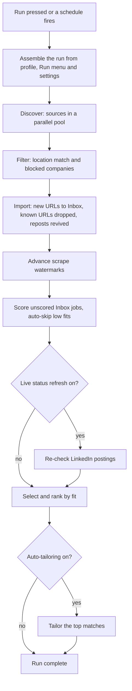
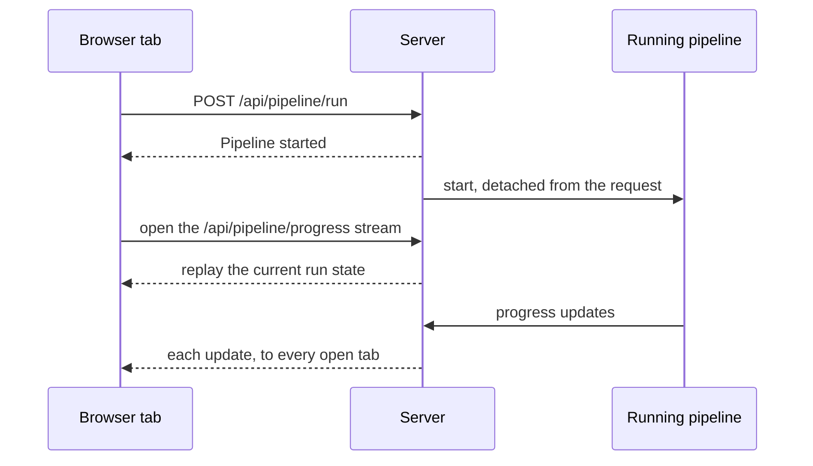

# Pipeline runs

A run is how jobs get into CV Clanker. Pressing **Run** in the **Run pipeline** menu on the Manage screen (or a schedule firing) scrapes every source the chosen [Search Profile](search-profiles.md) selects, throws away postings in the wrong place or from blocked employers, stores what is new in the Inbox, scores the unscored Inbox jobs with the LLM, and, only if you asked for them, re-checks LinkedIn postings and tailors the best matches. The run lives on the server: the banner you watch is a view onto it, and closing the browser stops nothing.

Using it: [Running a search](../guide/runs.md)

## How it works

Every step reports into the run banner. The banner's step badge reads Crawling, Importing, Scoring, Live status, Processing, then Complete, Cancelled or Failed.

| Step | What happens | Bounded by |
|---|---|---|
| Assemble | The server resolves search terms, location, sources, max job age and per-term budgets from the Search Profile, applies the Run menu's overrides, and refuses the run outright if the requested window breaks a source's ceiling (see below). | Profile + Run menu |
| Discover | One task per built-in extractor (a fan-out extractor such as JobSpy covers several boards in one task) and one per Apify actor instance, run in a pool. Built-in sources the profile's location setup cannot serve are skipped; if none of the selected built-in sources is left the run fails with "No compatible sources…". A source that errors still hands over any jobs it salvaged; if every source fails and nothing was salvaged, the run fails. | **Discovery concurrency** setting, default 3; profile budgets |
| Filter | Each posting goes through the [location matcher](location-matching.md); then the employer is compared with the profile's blocked companies (exact, case-insensitive). Dropped rows count towards **Rejected**, each with the reason it was dropped. | |
| Import | URLs are canonicalised; a new URL becomes an Inbox row stamped with the profile that found it; a known URL counts as **Duplicated**, unless its posting date moved forward, which makes it a repost (see [Job lifecycle](job-lifecycle.md)). | Unique job URL |
| Score | Every Inbox job with no score is classified, not only this run's. The run opts into the cheap pre-filter screen when a pre-filter model is configured. Jobs with too short a description stay unscored; a job whose scoring fails is left unscored and the run moves on; an LLM rate-limit stop ends the run. Rows at or below the auto-skip tier move to Skipped unless you ever applied to them. See [LLM providers and scoring](llm-and-scoring.md). | **Scoring concurrency**, default 4 |
| Live status | Optional. Re-reads up to 100 LinkedIn rows in Inbox, Backlog and Ready, never-checked first, skipping rows checked in the last 24 hours and rows already known to be closed. Best effort: nothing in this step can fail the run, and it stops early when LinkedIn starts refusing the machine. | **Live-status postings per run** 100, **Live-status recheck interval (hours)** 24 |
| Select | Keeps this run's scored jobs at or above the profile's minimum fit, ranked by fit, then (on a **Remote worldwide** location scope) how well the location matches your chosen places, then newest. The cut to **Resumes tailored** applies only when auto-tailoring. | Profile **Resumes tailored**, default 10 |
| Tailor | Optional. Runs the same tailoring a Tailor press does on each selected job. See [Tailoring](tailoring.md). | **Tailoring concurrency**, default 3 |

### The Run menu: per-run overrides

**Run pipeline** opens a menu that changes one run without editing the profile; its **Run** button starts the run. The menu opens pre-set from the profile and settings, and what it shows is what the run uses.

| Run menu control | Effect for this run | Pre-set from |
|---|---|---|
| Scrape from: **Since last run** / **Last N days** | Narrow each source to the days since it last scraped, or ask for an explicit window. A window over a source's ceiling is flagged in the menu and refused by the server. | Profile's **Only scrape since the last run** and **Max job age (days)** |
| **Sources** | Untick a source to leave it out. With everything ticked no list is sent, so the profile's own pins decide (and a source enabled later is picked up). | Profile's selected sources, Sources page enablement |
| **Refresh LinkedIn live status** | Turns the live-status step on or off. | Settings, default off |
| **Auto-skip bad matches** | Ticked: skip at the Settings tier, or Bad fit if that is unset. Unticked: skip nothing. | Settings → **Auto-skip jobs scoring at or below**, default off |

Auto-tailoring is not in the Run menu: it follows Settings → **Auto-tailor selected jobs after each pipeline run** (default off). A schedule with **Tailor top matches automatically** ticked turns it on for its runs; unticked, the schedule's runs follow the Settings value.

### Several profiles in one run

Ticking more than one profile in the header's profile dropdown makes the run a chain: the server runs each profile as a complete run, one after another, in the dropdown's order. A profile that fails does not stop the chain; a cancel does, and so does an LLM rate-limit stop (the remaining profiles would scrape and then fail to score anything). In a chain the Sources list narrows each profile's own selection rather than replacing it, and a profile left with no sources is skipped and named. The banner keeps one page of results per profile with **Previous profile** / **Next profile** arrows, and the chain ends with one summary such as "Multi-profile run complete (2/3 profiles)".

### Watching a run: the banner

- **Per-source funnel.** Each source row shows **Scraped**, **Imported**, **Duplicated** and **Rejected**. Clicking a count lists the jobs behind it, including why a rejected one was dropped. Those lists are held in memory only, for the latest manual run and the latest scheduled run (per profile in a chain), because duplicated and rejected postings never become rows.
- **Retries.** Once the run has finished, each source row has a re-run button, and **Retry all** re-runs every failed source of the page you are looking at in one run, one source at a time. Retries reconcile into the existing banner instead of wiping it, and never trigger the live-status step.
- **Dismiss** hides the banner for every viewer, and only for the run you dismissed.
- **Two tables.** Manual runs show on Manage (and as a strip on Swipe); scheduled runs show only on the Schedule page. While a scheduled run works, Manage's Run control is replaced by a "Scheduled run in progress" link.

### Scheduling

The **Schedule** page holds any number of schedules (**New schedule**). Each has a **Cadence** (**Daily at** a time, or **Every N hours**), weekday ticks, **Search profiles, in run order**, a source rule (**Whatever each profile selects**, **Free scrapers only**, or **Pick sources**), and three boxes: **Close duplicate copies automatically after each run**, **Tailor top matches automatically**, **Auto-skip bad matches**. A card's **Run now** starts an extra run without moving the next scheduled one. A scheduled run is always run as a chain of its profiles, even when it has only one.

| Situation | What the scheduler does |
|---|---|
| A schedule comes due | Checked every 60 seconds; at most one schedule fires per check. Times are read in the scheduler's time zone, UTC by default, which the schedule editor shows. |
| Pipeline already busy | Waits; the schedule stays due and fires once the pipeline is free. |
| Server was down when a schedule came due | One catch-up run at boot, never a backfill of every missed slot. "Every N hours" counts from when the schedule was created, so lateness never accumulates. |
| **Free scrapers only** | Resolved when the schedule fires, so a board enabled later is included and Apify actors are excluded. |
| Run fails (no profile of it completed), can't be assembled, or stops on an LLM rate limit | All scheduling pauses, including after a **Run now**. An app-wide banner says "Automatic runs are paused." until someone presses **Resume scheduling**. A cancelled run does not pause it. |
| Run completes and duplicates box is ticked | Closes duplicate copies, title-agreeing groups only; see [Duplicates](duplicates.md). |

### Cancelling, and one run at a time

**Cancel run** sets a flag the run checks between steps and between items in each pool (sources, jobs being scored, jobs being tailored). A cancel during discovery throws away what was scraped (import never runs and no watermark moves), while jobs already imported stay. Cancelling a chain stops the current profile and starts no more.

There is only ever one run in flight, manual or scheduled. A chain, a schedule and **Run now** each take a claim on the pipeline before anything else happens: a chain request or **Run now** while a run is going is refused with a 409, so is any run request during a chain, and a due schedule waits. The same "a run is going" signal blocks switching User Profiles (which swaps the database file) and updating the Claude Code CLI, which is why it stays raised even in the seconds between two profiles of a chain.

Each run also writes a record at start (configuration snapshot, the stage it reached, counts, any error); the client's fallback status poll reads the latest one when the live stream is unavailable.

## Design decisions

### The run belongs to the server, not the tab
A run is started fire-and-forget and the server keeps its whole funnel, replaying it to every tab that connects. A banner that subscribed only while the tab believed a run was going would leave nothing to look at for a run that died on a rate limit after the window was closed. Dismissal is server-side for the same reason, and names the run it dismisses so an old tab cannot hide a newer run for everyone.

### Chains are sequenced and closed by the server
A client-side loop over profiles dies when you navigate away, and the "running" flag between two profiles guards the database swap. So the server owns the loop, tags every event with the profile it belongs to, and emits exactly one untagged end event. That one rule (a tagged end is a profile's, the untagged one is the chain's) is what lets a cancelled or crashed chain still close out on the client.

### Max job age is a ceiling, not a suggestion
A run is not started unless its settings are good. A Run-menu window wider than a source's **Max job age** fails the whole run before anything is scraped, rather than being clamped or skipping that source, because a run that quietly scraped less than asked is worse than no run; deselecting the source is the way out. The same refusal covers Apify actors that only accept fixed windows and would silently snap a request down to their widest one: less coverage than asked for, but invisible to the plain cap check.

### "Since last run" can only narrow, and only advances when it is safe
Each source task keeps a per-profile watermark. It is the run's start time (earlier than any request, so the next window reaches back far enough), it is written only after import (a run that scrapes and then crashes must not skip those jobs next time), and only for sources that finished without error (a failed source re-covers what it missed). The narrowed window is never wider than the profile's cap.

### Live status is opt-in, after scoring, and best effort
LinkedIn limits requests per IP address, and hammering it also blocks your own browsing on the same connection. The step therefore runs only when asked, after the expensive LLM work is already saved, paces every request, stops at the first sign that LinkedIn is refusing the machine, and can never turn a good run into a failed one.

### A rate limit ends the run, and only a person clears it
An LLM rate-limit stop is account-wide: every remaining job would hit the same wall, so scoring stops the run rather than leaving each row unscored in turn. Pressing Run (or starting an LLM bulk action by hand) is the signal that the limit may have passed and clears the latch; a timer is not, so a scheduled run never clears it, and a schedule that hits it pauses scheduling, because Apify bills per result and runs that scrape but cannot score are money spent for nothing.

### Manual and scheduled runs keep separate tables
A scheduled run never takes over the Manage banner, and a manual run never appears on the Schedule page, so the run you started is the one you see. The pipeline is still one at a time; the two are separated in where they are shown, not in when they run.

### Failed schedules stop all scheduling until acknowledged
Automatic runs continue only while healthy. A failure raises a notice on every page and pauses every schedule, because a user who never opens the Schedule page would otherwise leave scheduling silently broken, or silently spending.

## Where it lives

| Path | What it holds |
|---|---|
| `orchestrator/src/server/pipeline/orchestrator.ts` | The run itself: step order, the one-run guard, cancellation |
| `orchestrator/src/server/pipeline/steps/` | Discover, import, score, live status, select, tailor |
| `orchestrator/src/server/pipeline/progress.ts` | Run progress per table, the event stream, per-profile banner pages |
| `orchestrator/src/server/pipeline/profile-sequence.ts` | Multi-profile chains |
| `orchestrator/src/server/services/pipeline-run/` | Turning a request plus a profile into a run; the window ceiling check |
| `orchestrator/src/server/services/scheduler/` | The 60-second tick, next-fire maths, the duplicate sweep |
| `orchestrator/src/server/api/routes/pipeline.ts`, `orchestrator/src/server/api/routes/schedules.ts` | Run, cancel, progress stream, run options, schedule CRUD |
| `orchestrator/src/client/components/PipelineRunBanner.tsx`, `orchestrator/src/client/pages/orchestrator/RunPipelineMenu.tsx`, `orchestrator/src/client/pages/SchedulePage.tsx` | Banner, Run menu, Schedule page |
