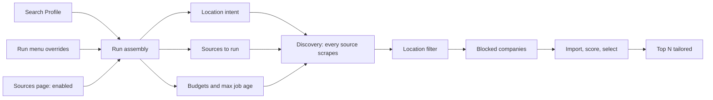
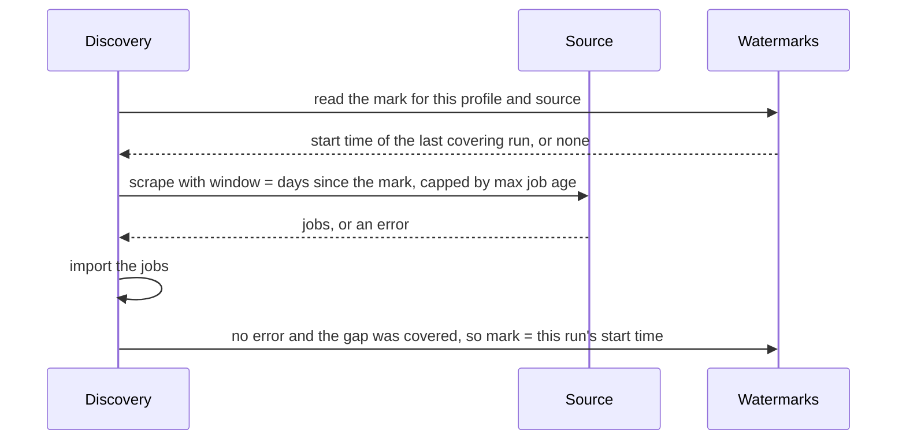

# Search profiles

A Search Profile is one named job hunt: what to search for, where, how much to fetch, which companies to skip, and which sources to ask. Every pipeline run is driven by a Search Profile (or by several, one after another), so two hunts such as "Vienna data roles" and "remote backend" live side by side without overwriting each other. You manage them on the **Profiles** page; the **Profile** dropdown on the jobs and Swipe pages picks which ones the next run uses. A Search Profile is not a User Profile: a User Profile is a whole separate database, and each one holds its own set of Search Profiles.

Using it: [Search profiles](../guide/search-profiles.md)

## How it works

When you press Run, the server turns the selected Search Profile into one run configuration: its terms, its location intent, the sources it pins (intersected with what the Sources page has enabled), its budgets and its max job age. Anything the Run menu sets for this run only (a shorter window, a narrower source list) overrides the profile field by field without being saved back.

Ticking several profiles in the **Profile** dropdown makes the next run a chain: each profile runs as its own leg, in the dropdown's (alphabetical) order, with its own pins, terms and location, and a source list chosen in the Run menu only narrows each leg's own pins, never replaces them. Whenever the selection comes down to a single profile, that profile becomes the default; ticking several leaves the default as it was. See [Pipeline runs](pipeline-runs.md) for the run itself.

### What a profile holds

The editor (**Profiles → Add profile**, or **Edit** on a card) has six cards: **Profile** (its name), then the five below. The last column says whether changing the field resets "Only scrape since the last run" (see below).

| Editor card | Field (label) | What it does | Resets scrape window |
|---|---|---|---|
| Search terms | search terms | The keywords every source searches. Order matters for the per-term LinkedIn actors, which run in this order. | yes |
| Location | **Remote profile** | Switches the profile to remote mode: no country or cities are sent, work arrangement is always Remote, Apify actors are skipped, the remote-only boards unlock, and filtering drops only postings a source flags as not remote and what the **Exclude locations** blocklist names. | yes |
| Location | **Exclude locations** (remote profiles) | The remote profile's blocklist. See [Location matching](location-matching.md). | yes |
| Location | **Country**, **Cities** | Where the boards search, and what the location filter keeps. No cities means one country-wide search per source; each city is its own search. | yes |
| Location | **Work arrangement**, **Location scope**, **Match strictness** | Remote/hybrid/on-site ticks sent to the sources, and how strictly results must sit inside the selected place. Hidden on a remote profile. See [Location matching](location-matching.md). | yes |
| Run settings | **Max jobs discovered** | A run budget (default 500, 50 to 1000 in the editor) divided evenly over search terms times built-in boards, giving each built-in source its "max jobs per term". Apify actors are not part of the division. | no |
| Run settings | **Resumes tailored** | How many of the best matches auto-tailoring picks (default 10, 1 to 50). Has no effect when auto-tailoring is off. | no |
| Run settings | **Max job age (days)** | The default window a run scrapes, and a ceiling: the Run menu may ask for less, never more. Blank means no ceiling and each source keeps its own default. | yes |
| Run settings | **Only scrape since the last run** | Narrows each source's window to the days since it last scraped for this profile. | no |
| Run settings | **LinkedIn jobs per search term** | The default result budget for each term on the per-term LinkedIn actors (default 100, 10 to 5000), plus an optional number per term. | no |
| Run settings | **Min suitability** | The lowest fit category a job needs to be picked for tailoring. | no |
| Blocked companies | company names | Postings from these employers are dropped during discovery. | no |
| Sources | Extractors, Apify actors | Which built-in boards and which Apify actors this profile pins. | no |

### Which sources a run uses

A source runs only when two switches agree: it is enabled on the **Sources** page, and it is ticked on the Search Profile being run. A source disabled on the Sources page still shows in the editor, greyed out with "disabled on the Sources page"; a remote-only board on a non-remote profile shows "runs only on a remote profile".

| Sources page | Profile tick | Runs? |
|---|---|---|
| enabled | ticked | yes |
| enabled | not ticked | no |
| disabled | ticked | no, and the editor says why |
| disabled | not ticked | no |

The editor's **Save** stays disabled until at least one source is both ticked and enabled, and the run is refused with a message naming the profile if that intersection is empty when it starts. A new profile starts with every source the Sources page has enabled, Apify actors included. The server fills either list in at creation if it arrives empty, so unticking every Apify actor on a brand-new profile only sticks once the profile is edited and saved again; on an existing profile an emptied list stays empty. The **Enable in all profiles / Disable in all profiles** control on each Sources page card ticks or unticks that source on every profile in one step (a remote-only board is skipped on non-remote profiles); see [Job sources](job-sources.md).

### The default profile

Exactly one profile is the default; it carries a **Default** badge on its card and the others offer **Set as default**. The default is what a run uses when it names no profile, what the Sources page's "Show raw" effective settings and an Apify actor's **Test** preview read their terms and location from, and what onboarding checks: setup counts as complete only while the default profile has at least one search term. If the default is deleted, the most recently edited profile takes its place. The last remaining profile cannot be deleted.

The Profiles list is alphabetical (case-insensitive, with numbers compared as numbers), so saving a profile never moves it. **Duplicate** copies a profile under the same name with "(copy)" appended.

### The Term matrix tab

**Profiles → Term matrix** edits search terms across all profiles at once: one row per term (compared case-insensitively, shown with the first spelling met), one column per profile, a tick where the profile searches that term. Clicking a term or a profile name switches its whole line on, or off when it is already all on. The **Jobs** column sets a term's LinkedIn job budget on every profile the term is ticked on; blank clears the override so each profile falls back to its own default, and "mixed" means the profiles disagree. Nothing is written until **Save**, which writes only the profiles that changed. Save is blocked when it would leave the default profile with no terms (that would send every page back to onboarding), push a profile past 200 terms, or set an invalid budget. If one profile fails to save, its edits stay on screen and the others are kept.

### Only scrape since the last run

On an install that runs every day, most of a 30-day window is postings the last run already fetched. With **Only scrape since the last run** ticked, each source's window shrinks to the days elapsed since that source last scraped for this profile, rounded up and never wider than **Max job age (days)**. The bookkeeping is a watermark per profile and per source task (one built-in extractor such as JobSpy, which covers LinkedIn and Indeed together, or one Apify actor). Marks are kept on every run of a profile, ticked or not, so switching the option on takes effect from the next run.

| Situation | What happens to the mark |
|---|---|
| Source has never run for this profile | The first successful run sets it, whatever its window. |
| Source finished without error, window reached back to the old mark (or to the full max job age) | Advances to this run's start time. |
| Source failed, or the run died before import | Holds, so the next window reaches back over what was missed. |
| Run used a narrower window than needed (an explicit Run menu window after a long gap) | Holds; an explicit window also switches the narrowing off for that run. |
| A field marked "resets" in the table above changes | Every mark of the profile is dropped; when the option is on, the save toast says the next run scrapes the full window. |
| Profile deleted | Its marks are deleted with it. |

Sources that ignore max job age (startup.jobs, Working Nomads) have no window to narrow, so a successful run of theirs counts as covering any gap.

### Blocked companies

The **Blocked companies** card holds one company name per line (one per line because names contain commas, as in "Kforce, Inc."). During discovery, after the location filter, any posting whose employer is exactly one of those names, ignoring case and surrounding spaces, is dropped and listed in the run's Rejected column as "blocked company". Jobs already in the database are untouched, and manual URL import and batch import never consult the list. From the jobs view, clicking a company name opens its job list, whose **Blacklist** button adds the company to whichever profiles you tick; removing a company is done in the editor. A profile holds at most 200 names.

## Design decisions

### A profile pins its own sources, and runs read the profile
A real job hunt is usually several parallel searches with different places, titles and boards, which one global set of scrape settings, overwritten by every run, cannot hold. Making the whole bundle, sources included, a named profile lets each search keep its own configuration, and lets a chain run several of them back to back. On upgrade the old global scrape settings were copied into a seeded "Default" profile, and the app settings no longer have scrape fields at all, so there is one place a run's configuration comes from.

### A tick means what it says: no "empty means all"
A source runs only when it is enabled and pinned, and at run time an empty pin list means no sources, not every source. An "empty means all" fallback would silently start paid Apify actors on a profile that never asked for them. The cost of the strict rule is a refusal when nothing is left, which is why Save and the run both check the intersection and name the reason.

### Blocking a company is an exact match
A substring rule over-blocks invisibly: an entry "Nova" would also remove "Novartis" and nothing would tell you. An exact rule fails visibly instead, since a differently spelled posting arrives and can be blacklisted too. For the same reason nothing else is normalized: no accent folding, no punctuation stripping, no "Ltd"/"GmbH" trimming.

### The scrape window must never leave a gap
The mark is the start of the run, not the moment a source's request went out, and elapsed time rounds up to whole days, so a narrowed window always reaches back past the previous run's coverage. The mark advances only after the jobs are imported and only for sources that finished cleanly. When in doubt it holds: a stale mark only makes the next window wider than needed, while a premature one would skip postings nothing ever fetched. Any edit to what the profile searches for drops the marks, because a narrowed window is only safe while the previous run looked for the same things.

### Max job age is a ceiling, and a run that asks for more is refused
A Run menu window wider than a selected source's max job age fails the whole run instead of being clamped or skipping that source. A run is not started unless its settings are good, because a run that quietly scraped less than asked is worse than no run. Deselecting the offending source is the way forward.

### Job budgets belong to each search term
On the per-term LinkedIn actors the budget is set per search term, not per city or per actor: each term's run is capped at its own number, and the run banner names the terms that reached it, so you raise exactly the term that had more to give. Overrides are keyed by the lowercased term, so changing only a term's capitals keeps its number, and the server prunes the override when a term is removed, including when the Term matrix sends only the term list.

### Bulk writers check limits before writing anything
A stored profile is read back tolerantly: a field that fails validation silently falls back to its default. Writing a 201st blocked company or a 101st pin would therefore not error; it would erase the whole list on the next read. The Blacklist action and the all-profiles pin buttons check every target profile first and refuse the whole request if one is full, rather than applying to some profiles and wiping another.

### The list order never moves
A list sorted by most recently edited makes a profile jump every time it is saved. The list is alphabetical instead, and the default-profile fallback asks for the most recently edited profile explicitly instead of relying on list order.

## Where it lives

| Path | What it holds |
|---|---|
| `shared/src/types/profile.ts` | The profile's fields, their limits, defaults, and the tolerant per-field read |
| `orchestrator/src/server/repositories/profiles.ts` | Create, update, delete, alphabetical listing, watermark reset on coverage edits |
| `orchestrator/src/server/services/profiles.ts` | Default profile, the Blacklist write, pin-in-all-profiles |
| `orchestrator/src/server/services/pipeline-run/assemble.ts` | Turning one or several profiles into run configurations |
| `shared/src/scrape-window.ts` | Since-last-run window, watermark advance rule, the coverage field list |
| `shared/src/blocked-companies.ts`, `shared/src/term-budgets.ts` | Exact company matching; per-term budgets |
| `orchestrator/src/client/pages/ProfilesPage.tsx`, `orchestrator/src/client/pages/ProfileEditorPage.tsx` | The Profiles page and the editor |
| `orchestrator/src/client/pages/profiles/` | Editor fields, profile cards, the Term matrix |
