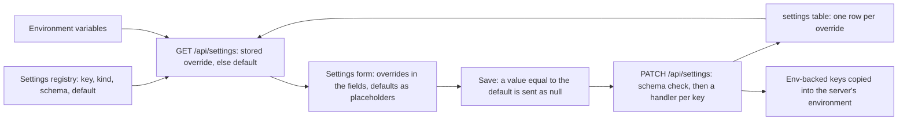
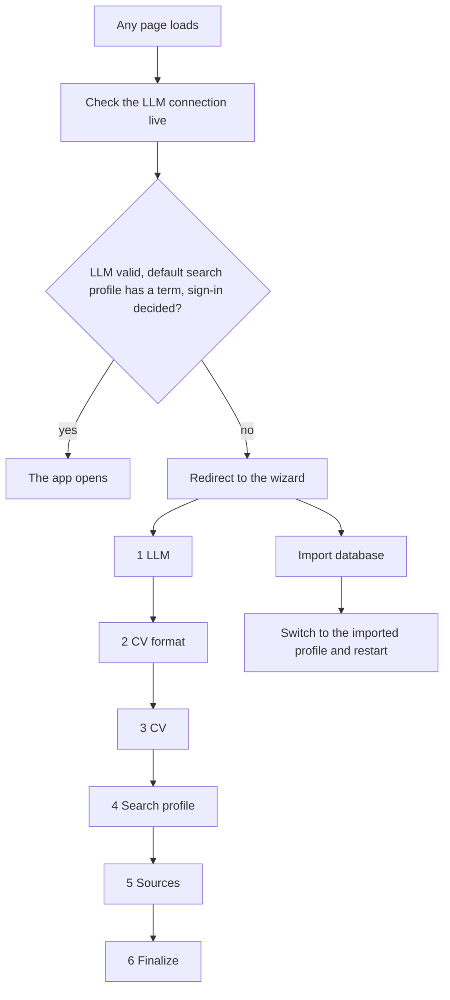
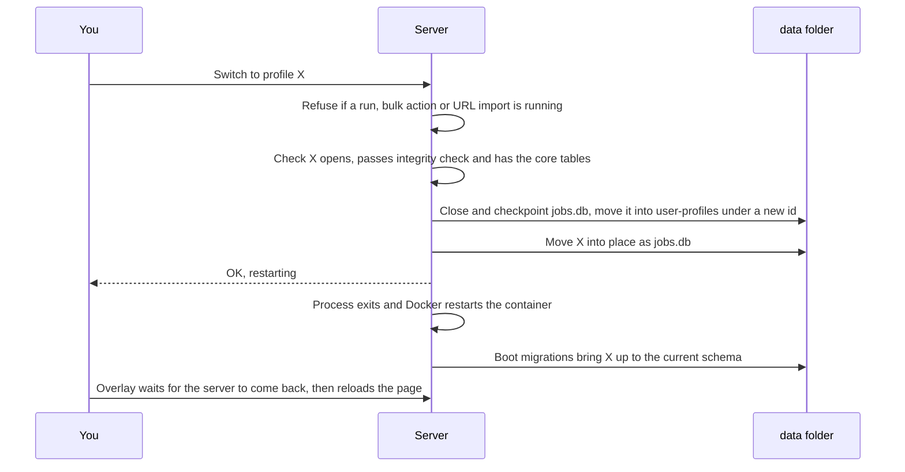
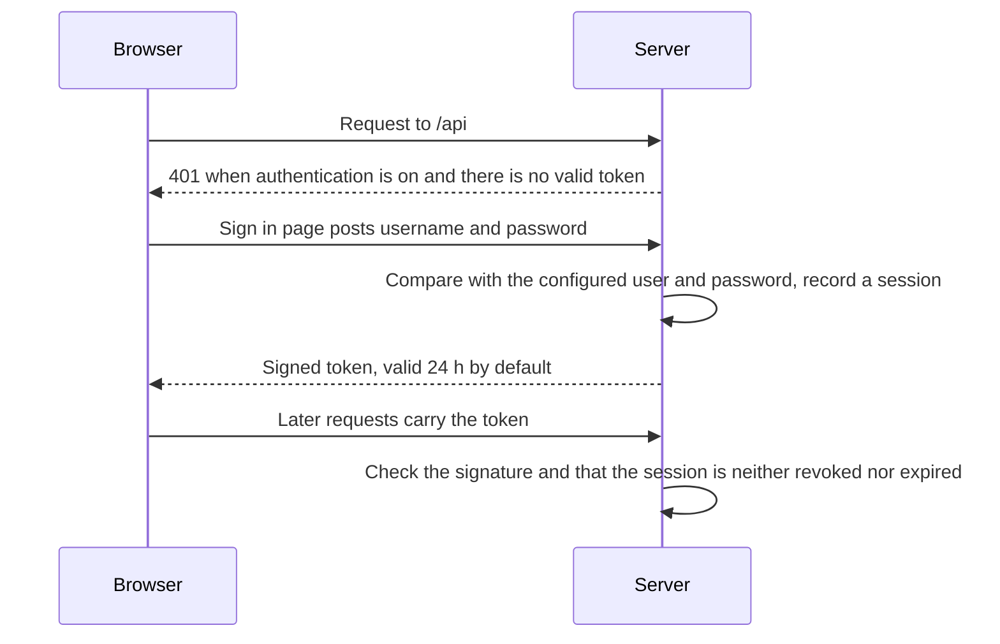

# Settings and onboarding

Everything you can tune lives on the **Settings** page and is stored in the database, with a few environment variables as a baseline underneath. The first time you open the app (or after starting a fresh user profile) a six-step onboarding wizard collects the minimum the app needs (an LLM connection, your CV, what to search for and where) and keeps the rest of the app closed until that minimum is there. This page explains how a setting travels from its definition to the screen and back, how the wizard decides you are done, how whole-database **User Profiles** are swapped, and how sign-in and the destructive tools work.

Using it: [Configuration](../guide/configuration.md)

## How it works

### From definition to database to form

Every setting is one entry in a single shared registry: its kind, its validation schema, its default, and how it is read from and written to the database. The update schema (used both by the server and by the Settings form's validation), the generic save handler for each key, the environment mirroring and the list of secrets an export strips are all derived from that one list. The database stores only what you changed, one row per key; saving a key as null deletes its row, so the default applies again.

| Kind | What it is | Sent to the browser as |
|---|---|---|
| typed | Validated values with a default: timeouts, concurrency, the scoring policy, Writing Style, auto-skip… | value, default and your override |
| model | **Scoring Model** and **Tailoring Model**; empty falls back to the default model | value and override |
| string | Plain values with no default, most of them managed by the server: the user-profile name, the CV format, the scheduling pause reason, the schedule time zone, the Claude Code effort, the basic-auth user… | the value |
| secret | LLM API key, basic-auth password, Apify token, Claude Code OAuth token | a hint of the first few characters; the basic-auth password is also returned in full while sign-in is on |
| virtual | **Enable authentication**: derived from whether a user and password are both set, never stored | true or false |

These keys are *env-backed*: LLM provider, LLM base URL, the LLM request and LaTeX compile timeouts, session expiry, Claude Code effort, the basic-auth user and password, the LLM API key, the Apify token, the Claude Code token. For those, the stored value is copied into the server's environment at boot and on every save, and clearing it restores whatever the environment had at startup. Precedence is always: what you saved in Settings, then the environment variable, then the built-in default.

### The Settings page

| Group | Section | What it holds |
|---|---|---|
| AI | **Models** | Provider, key or token, base URL, default and task models, reasoning effort, two-stage scoring; see [LLM providers and scoring](llm-and-scoring.md) |
| AI | **Provider Credentials** | Keys and base URLs for providers other than the configured one (benchmark columns, the pre-filter) |
| AI | **Model Benchmarking** | Compare models on a sample of your jobs |
| AI | **Writing Style** | Tone, formality, constraints, words to avoid, output language, the cover-letter policy |
| AI | **Context limits** | Character caps on the brief, job description, tailored content and cover letter; a longer write is refused, never silently cut |
| Accounts & Security | **Accounts & Access** | **Enable authentication**, username, password, **Session expiry (seconds)** |
| Accounts & Security | **User Profiles** | Switch, import, export, rename, delete and create whole databases |
| Display | **Display Preferences** | Theme (kept in this browser), Markdown rendering, the company-in-flight warning before tailoring, **Your name** for downloaded CVs and cover letters |
| Pipeline | **Pipeline Behavior** | Auto-tailor, LLM scoring on/off, auto-skip, **Scoring policy**, Inbox stale threshold, live-status refresh, LinkedIn term stop, LLM retries and timeouts, LaTeX timeout, max jobs per bulk action, pool widths, URL-fetch knobs, upload size caps |
| Prompts | **LLM Prompts** | The prompt editor |
| Danger Zone | **Danger Zone** | Clear jobs by status or fit category, or clear the database |

Each section shows whether it has unsaved edits; **Discard changes** drops them, and **Reset section to defaults** clears that section's saved overrides only.

### The onboarding wizard

The gate is in the browser: every route except the wizard and **Sign in** redirects to `/onboarding` until three facts hold, and the wizard sends you to the jobs view the moment they do. Because the LLM check runs on every load, a key that stops validating brings the wizard back.

| Step | What it records | Done when | Needed to leave the wizard |
|---|---|---|---|
| 1 LLM | The app's provider (the first one added), plus optional extras for the scorer's pre-filter and the model benchmark | the app's provider passes its connection check | yes |
| 2 CV format | LaTeX, Word or HTML, fixed for this user profile once saved | a format is stored | no |
| 3 CV | Your CV and the personal brief drafted from it, or a skip | a CV exists, or you chose to skip | no |
| 4 Search profile | Job titles (drafted from your CV by the LLM the first time you arrive) and location | the default search profile has a saved term | yes |
| 5 Sources | Built-in boards (all on by default) and optional Apify actors | at least one source is enabled | no |
| 6 Finalize | A username and password, or a skip; optionally your name for downloaded files; a theme | the sign-in choice is recorded | yes |

Steps can be visited in any order. The title suggestions need a CV: without one the request is refused, and if the LLM call fails the suggestions fall back to terms taken straight from the CV (headline, past positions, projects, skills). **Import database**, beside the step list, is the way out for an existing installation: it files the uploaded database as a new user profile and switches to it, so the wizard disappears if that database is already set up. What each step asks of you is in [Getting started](../guide/getting-started.md).

### User Profiles: one database each

A user profile is a whole database: jobs, CVs, search profiles, settings, prompts, generated documents and the sign-in secret. The active one is always `data/jobs.db`; the others are closed files in `data/user-profiles/`, each named by a random id and carrying its own display name inside.

| Action | Where | Effect |
|---|---|---|
| **Activate** / switch | User Profiles, or the profile line in the navigation menu | The swap above; sessions do not carry over, so sign in again if authentication is on |
| **New profile** | User Profiles | Stashes the current database and restarts into a fresh install, which opens the wizard |
| Import | User Profiles; **Import database** in the wizard | Validates the file and files it under a new id without touching the live database; the wizard then switches to it |
| **Export** | User Profiles | A consistent copy of the database; API keys, tokens, the basic-auth password and the sign-in secret are removed unless **Include API keys & secrets in exports** is ticked (provider base URLs stay) |
| Rename, delete | User Profiles | Rename writes the name into the file; only stored profiles can be deleted |

### Sign-in

Authentication is on only when both a username and a password are set (in Settings or the environment). Then every `/api` request except sign-in and sign-out needs the token; the page itself, `/health` and the generated documents under `/pdfs/` stay readable without it. The token lives in the browser tab's session storage, so a new tab signs in again. It is signed with `JWT_SECRET` when that is set (at least 32 characters), otherwise with a secret generated on first sign-in and stored in the database's own secrets table. Signing out revokes the session; expired sessions are swept hourly.

### Danger Zone

| Control | Deletes | Keeps |
|---|---|---|
| **Clear Jobs by Status** | Every job in the ticked statuses, including application history if you tick applied ones | Everything else |
| **Clear Jobs by Fit Category** | Jobs scored at or below the chosen fit | Anything in the applied or in-progress status, or ever marked applied |
| **Clear Database** | All jobs, pipeline runs, generated documents and scrape watermarks; schedules forget their last run | Settings, CVs, cover letters, search profiles, sources, schedules, prompts |

## Design decisions

### One registry, one place for every limit

Each setting is declared once, and the validation (server and form alike), the database parsing, the save handler, the environment mirroring and the secret list used by exports are derived from that declaration. A limit or default therefore lives in exactly one place, and a new secret is stripped from exports without anyone remembering to add it. The page's layout and form mapping are still written by hand, so a setting can exist in the registry with no control on the page.

### Only overrides are stored, and saving the default clears them

The form sends null for any value equal to its default, and null deletes the row. A setting you never really changed keeps following the shipped default, so an improved default (the scoring policy, for instance) reaches you on upgrade instead of being frozen at whatever was current the day you pressed Save.

### Env-backed settings live in the server's environment

The keys that hot paths read (the LLM timeout on every call, the Claude Code token and effort that the CLI call reads at spawn time) are mirrored into the process environment at boot and on save, so nothing pays a database read per call and nothing serves a stale value after a save. The environment variable stays the operator's baseline: a saved value wins, and clearing it falls back to the environment rather than to nothing.

### Credentials are write-only; the sign-in secret has no read path at all

API keys and tokens come back to the browser only as a short hint, enough to tell "saved" from "missing". The session-signing secret is not a setting at all: it lives in a separate secrets table that no route returns, because anything in the registry is echoed through `GET /api/settings` in some form. A secrets-stripped export clears that table too, so a restored copy simply mints a new secret at first sign-in.

### Reset never touches credentials

**Reset section to defaults** skips the LLM key, the Claude Code token and the basic-auth user and password, and keeps **Your name** too, since it is who you are rather than a preference with a default. Losing the LLM key would fail the wizard's live LLM check and lock the whole app behind onboarding again.

### Some settings are guarded on the server

The generic save path can write any key, so the keys with rules get their own handler. The CV format is write-once per user profile (and cannot be switched to Word or HTML while LaTeX CVs exist), because every stored CV was accepted in one format and would be misread as another; the way to work in another format is a new user profile. The scheduling pause can only be lifted with **Resume scheduling**, so a bulk settings save cannot silently restart automatic runs that stopped after a failure.

### The wizard's gate is three facts, and sign-in defaults to Skip

Completion is a working LLM, at least one search term on the default search profile, and a recorded sign-in decision. The CV, format and sources steps are not part of it: the CV step can be skipped, an unset format means LaTeX, and a fresh install already has every built-in board enabled. The Finalize step starts on **Skip**, in line with the app being unauthenticated by default, which is fine on localhost. Because the gate hides Settings, the way back to another database from inside the wizard is the profile switcher in the navigation menu, which every page carries.

### The first provider added runs the app

Every ordinary LLM call reads one provider, stored as the provider, key and base URL settings; the scorer's pre-filter and the model benchmark can also call other providers, each with a key saved for it. The LLM step mirrors that: while no provider is in use, **Add** makes the picked one the app's provider, and after that it saves extras. Removing the app's provider reopens the step rather than promoting another one, so the app never switches vendor without you choosing it. A key or token set in the server's environment cannot be removed from the wizard; it says so instead.

### A user profile is a file swap plus a restart

Keeping the active profile at `data/jobs.db` meant no existing code path had to change; inactive profiles are self-describing files with random ids, so importing a copy of a profile you already have can never collide. Switching closes the database, renames files and exits; the container's restart policy (`restart: unless-stopped` in compose, `--restart unless-stopped` in the release `docker run` line) brings the app back and the boot migrations upgrade an older profile. The switch is refused while a pipeline run, a bulk action or a URL import is in flight, because the swap closes the database underneath them.

### The container runs with no Linux capabilities

The app feeds scraped, untrusted text to an LLM CLI and untrusted documents to tectonic, LibreOffice and a browser; the realistic path from a prompt injection to the host is a memory-safety bug in one of those parsers. The container drops every capability and blocks privilege escalation (the whole workload was verified to run that way), which is also why the data folder must stay writable by root. See [System overview](system.md).

## Where it lives

| Path | What it holds |
|---|---|
| `shared/src/settings-registry.ts`, `shared/src/settings-schema.ts` | Every setting, its default and validation; the derived update schema |
| `orchestrator/src/server/services/settings.ts`, `orchestrator/src/server/services/envSettings.ts`, `orchestrator/src/server/services/settings-update/` | Effective settings, the environment mirror, per-key save handlers and guards |
| `orchestrator/src/client/pages/SettingsPage.tsx`, `orchestrator/src/client/pages/settings/` | The Settings page and its sections |
| `orchestrator/src/client/pages/OnboardingPage.tsx`, `orchestrator/src/client/pages/onboarding/`, `orchestrator/src/client/components/OnboardingGate.tsx` | The wizard, its steps and the gate |
| `orchestrator/src/server/api/routes/onboarding.ts`, `orchestrator/src/server/services/onboarding-search-terms.ts` | LLM validation and search-title suggestions |
| `orchestrator/src/server/db/user-profiles.ts`, `orchestrator/src/server/db/snapshot.ts`, `orchestrator/src/server/api/routes/user-profiles.ts` | Profile files, export and validation, the swap routes |
| `orchestrator/src/server/app.ts`, `orchestrator/src/server/auth/jwt.ts`, `orchestrator/src/server/api/routes/auth.ts` | The auth guard, tokens and sessions |
| `orchestrator/src/server/db/clear.ts`, `orchestrator/src/server/api/routes/database.ts` | Clear Database |
