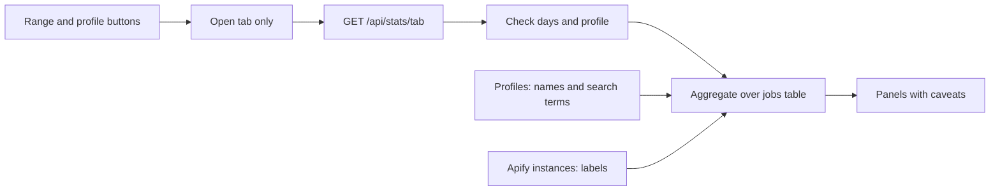
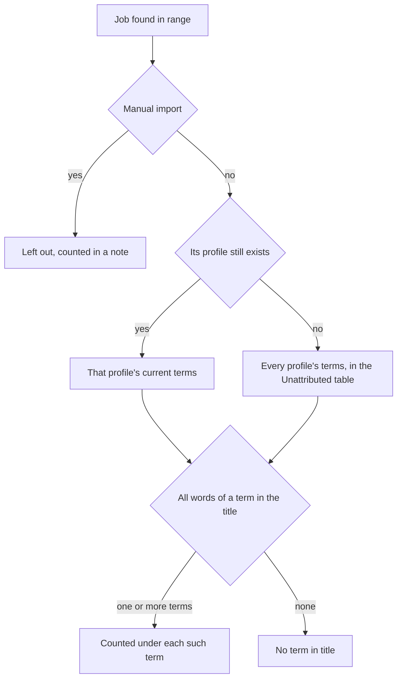

# Stats

The Stats page turns the jobs you already have into numbers: how much came in, which boards, Search Profiles and search terms are earning their place, what happened to your applications, and which companies are worth your time. It is the fourth segment of the **Swipe | Manage | Schedule | Stats** switch at the top of the screen (it is not in the side menu). Everything on it is read-only and computed on the fly from the jobs table: nothing is recorded specially for it, and opening it changes nothing.

Using it: [Stats](../guide/stats.md)

## How it works

Two rows of buttons set the filters: the date range (**7d**, **30d**, **90d**, **All**; 90 days when the page opens) and the profile (**All profiles**, then one button per Search Profile, shown once at least one profile exists). Only the tab you are looking at asks the server for its numbers; a tab you opened earlier is kept in the browser's cache, so flicking back shows it at once while a fresh copy loads if it has aged. The choices live in the page and reset when you leave it.

The server rejects a range that is not a whole number from 1 to 3650 days, and answers "not found" for a profile id that does not exist: a typo would otherwise render as a page of zeros that looks like a real answer.

| Tab | Endpoint | Panels | The range applies to |
|---|---|---|---|
| Overview | `/api/stats/overview` | Tiles (Jobs found, Good fit or better, Tailored, Applied), **Where jobs stop**, **Scorer versus you**, **Activity** | when the job was found |
| Discovery | `/api/stats/discovery` | **Boards**, **Search Profiles**, **Yield per run** | when the job was found |
| Job profile | `/api/stats/terms` | **By source**, **Search terms** (caveats and notes), then one term table per Search Profile | when the job was found |
| Applications | `/api/stats/applications` | Tiles (Applications, Heard back, Median reply, Outstanding), **What happened**, **How long replies took**, **Waiting on** | when the application was sent |
| Companies | `/api/stats/companies` | **Companies** (top 25 by good fit), **Posting churn** | when the job was found |

### What the words mean

| Figure | Counted as | Permanent or current |
|---|---|---|
| Found | every job in range | permanent |
| Scored | the job has a fit rating now | current: a rescore overwrites it |
| Good fit or better (Good+) | rated good, very good or great fit | current |
| Tailored | the job carries a tailoring date, stamped when it moves to Ready | permanent mark |
| Applied | the job carries the applied mark, stamped on the first move to Live or Interviewing and kept through a close, a skip or a reopen | permanent mark |
| Closed | an outcome is recorded (rejected, ghosted, and so on), not the Closed status | |
| Fit rate / Hit rate | Good+ divided by **scored** jobs; a dash when nothing is scored | |

Undoing a move on the Manage screen also puts the tailoring date and the applied mark back the way they were, so a mis-click does not leave a job counted as tailored or applied for ever.

**Overview.** The funnel shows Found, Scored, Good fit or better, Tailored, Applied. Tailored and Applied are not limited to good fits (you can tailor and apply to anything), so those two bars may be longer than the one above them, and the panel says why when that happens. **Scorer versus you** is a crosstab: for each fit rating (and Unscored), how many you skipped, applied to, tailored but did not apply to, or took no action on (the Inbox column). Each job lands in the first of skipped, applied, tailored, closed and inbox that fits it, so a job you applied to is not also counted as tailored; a job closed with an outcome but never tailored or applied to is in none of the shown columns. **Activity** is one square per day that found something, shaded by volume, in UTC days.

**Discovery.** **Boards** gives jobs, scored, Good+ and fit rate per board: per *board*, not per scraper, so JobSpy's LinkedIn and Indeed results are separate lines, and each Apify instance appears under its own name. **Search Profiles** gives the same per profile. A job is attributed to the profile whose run first found it; jobs found before attribution existed, or by no profile, show as **Unattributed**, and jobs of a since-deleted profile as **Deleted profile**. **Yield per run** is shown as not available, and says why (see the design decisions).

**Applications.** Every job carrying the applied mark falls into exactly one bucket, first match wins in this order (the **What happened** panel lists them in its own order and hides empty buckets):

| Bucket | Rule |
|---|---|
| Advanced to interview | the job is at Interviewing |
| Rejected | outcome rejected |
| Marked ghosted | outcome ghosted |
| Closed for another reason | any other outcome |
| No answer in 21 days | still at Live (status Applied), sent more than 21 days ago |
| Still waiting | still at Live (status Applied) |
| Moved out of applications | anything else: reopened, skipped or swept after applying |

**Heard back** is rejections plus interviews, as a share of applications. **Median reply** is the gap between applying and closing, measured only on closed applications, with a histogram in 0–3, 4–7, 8–14, 15–21 and 22+ days. **Waiting on** lists the oldest 20 applications still at Live with no outcome, with days waiting (red from 21 days) and whether the posting is still live, closed, or not checked.

**Companies.** The top 25 companies by Good+ jobs, with postings, Good+, hit rate and how many you applied to; when there are more than 25, the note says how many companies exist in total. **Posting churn** counts jobs re-posted at least once, jobs whose board now reports them closed, and how many jobs have been checked for live status at all.

### The Job profile tab: crediting jobs to search terms

The **By source** panel comes first: per board, how many jobs it returned (manual imports left out), what share of them have a title naming one of the search terms of the profile that found them, and the fit rate of the two halves side by side. A board with a low share is returning a lot of titles your terms do not name; comparing the two fit rates tells you whether those are worth scoring.

Below it, each Search Profile that found jobs in the range gets a table with one row per current search term and a final **No term in title** row; the Unattributed table comes last. A job is credited to a term by what its title says:

The match is: every word of the term appears in the title, in any order, ignoring case and accents, with `+` and `#` kept as part of a word so "C++" and "C#" stay apart. A term with no words matches nothing. Terms made of the same set of words (another order, spacing, case or accents) collapse to one row. A title naming two terms counts under both, so a profile's rows can add up to more than its total.

Every column of the term tables counts **scored** jobs only: Scored jobs, Good+, Applied (scored jobs you applied to at any point), Applied rate and Fit rate. Click a column heading to sort every profile's table by it: ascending, then descending, then back to alphabetical; **Term** just flips between Z–A and A–Z, and **No term in title** always stays last. A row whose term no title names is tagged "no title names it"; one with jobs but none scored is tagged so.

This is a different rule from the Manage view's **Job title** filter badges, which look for the search term as a plain piece of text inside the title (see [Manage and Swipe views](manage-and-swipe.md)). The two can disagree on a job whose title has the words in another order.

## Design decisions

### Terms are credited by the job title, not by which search found the job
Several boards cannot say which term found a job: JobSpy and Working Nomads put every search term into one combined query, and Himalayas and We Work Remotely run no search at all and match the terms on our side, so each returns one merged list. A per-job record of the finding term would be blank or arbitrary for them, and how a source splits its searches is not the question anyway: what matters is the flow of jobs per term. What a title says is knowable for every board and for every job already stored, so the tab measures that. The cost is stated on the page: a search for "ML Engineer" that returns "Machine Learning Engineer" lands under No term in title.

### A strict all-words match, not a "closest term" guess
A looser rule, crediting each job to the term it overlaps most, was tried and rejected: its biggest credits came from single generic words such as "senior" or "engineer", which made off-target results look on-target. The strict rule keeps the two halves meaningfully different, which is what makes the By source panel useful.

### Every rate divides by scored jobs, and an empty rate shows a dash
"0% good fit" reads as a measured verdict about a board when it really means nothing has been scored yet, so a share with nothing to divide by renders as "—". Dividing by all jobs instead would put two different denominators under one column heading and make a profile whose jobs were simply unscored look like a failure; the profile, company and term rows carry their own scored count for this reason.

### No figure is a share of a total that does not contain it
Applying does not require tailoring (**Mark applied** never stamps a tailoring date), so "applied out of tailored" can exceed 100%, and the Applied and Tailored tiles are plain counts. For the same reason the Job profile tab counts only *scored* applications, so its applied rate is a share of a total that contains it; the Overview tile and the Companies table count every application and can be larger, and the caveat says so.

### Each tab filters on its own date
"The last 30 days" means jobs found then on Overview, Discovery, Job profile and Companies, and applications sent then on Applications. The consequence is spelled out under the reply-time histogram: a narrow range keeps recent applications whose slow replies have not arrived yet, so it reads faster than reality.

### "Closed" means an outcome, and the buckets always add up
Recording an outcome and changing the status are separate writes, so a job can carry an outcome while still at Live; every panel treats an outcome as closed so two panels never disagree. Reopening a job clears its outcome but keeps the applied mark, so applications also exist on Inbox, Tailoring, Backlog, Stale and Skipped jobs; the **Moved out of applications** bucket holds them, which is what makes the buckets sum to the Applications total. **Heard back** is labelled a floor because there is no stage history: a job that reached Interviewing and was later closed for another reason can no longer be seen to have had a reply.

### Companies are grouped exactly the way the jobs list filters them
A company row is its name ignoring case only, the same rule the Manage view uses to list one company's jobs, so the count matches what that list shows. Trimming spaces or using the more aggressive duplicate-detection name rule would merge spellings the list still treats as different. Two spellings of one company therefore stay two rows, which usually means a scraper is reading the name inconsistently.

### Only what the jobs table can prove
Everything is computed from stored jobs plus profile names and terms. Per-run counts (how many a board returned, how many the location filter dropped) live in memory during a run and are gone after a restart, so **Yield per run** says "not available" instead of guessing. Live status exists only for LinkedIn postings, so the number checked is shown as a count, never as a share of all jobs, which would read as near-total neglect of every other board.

## Where it lives

| Path | What it holds |
|---|---|
| `orchestrator/src/client/pages/StatsPage.tsx` | The page: range and profile buttons, the five tabs, per-tab fetching |
| `orchestrator/src/client/pages/stats/` | One component per tab, shared panels and bars, number formatting, the term-table sort |
| `orchestrator/src/server/api/routes/stats.ts` | The five GET endpoints and their query checks |
| `orchestrator/src/server/repositories/stats.ts` | All the aggregate queries and the per-term matching loop |
| `shared/src/term-title-match.ts` | The rule for "this title names this search term" |
| `shared/src/types/stats.ts` | Payload shapes, the 21-day ghosted threshold and the reply-time buckets |
