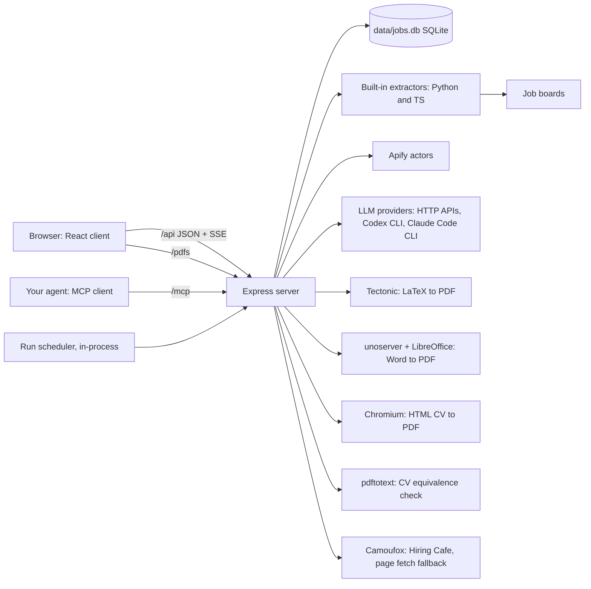
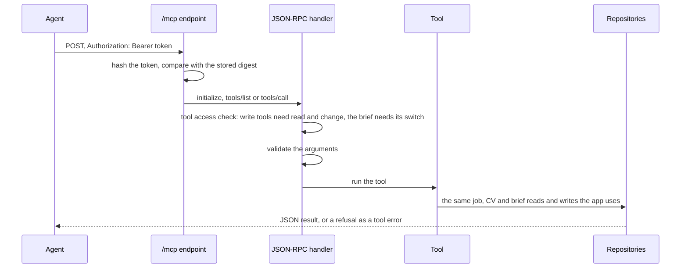
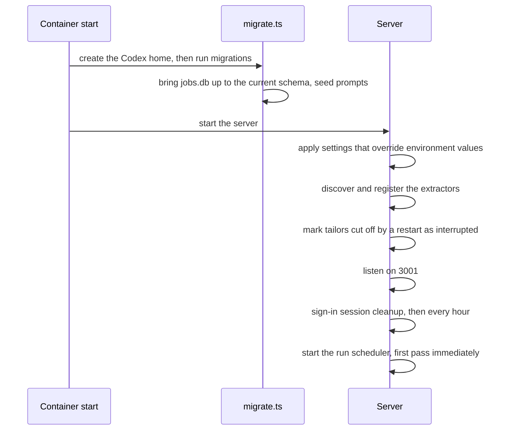

# System overview

CV Clanker is one Docker container. Inside it a Node/Express server serves the React client and a JSON API, keeps everything in a single SQLite file under the data directory, and shells out to helper programs (the job-board extractors, Tectonic, LibreOffice, Chromium, `pdftotext`, Camoufox, the Codex and Claude Code CLIs) when a piece of work needs them. Nothing runs outside the container, and the only outbound traffic is to the LLM provider and the job sources you configure.

Using it: [Getting started](../guide/getting-started.md), [Configuration](../guide/configuration.md), [Agent access](../guide/agent-access.md), [Chat](../guide/chat.md)

## How it works

The server is the only long-lived process. A pipeline run, a tailor, a cover letter or a CV upload is a piece of server code that calls out to one of the helpers above and writes the result back to SQLite; the client polls or listens for it.

### What the server answers

| Path | What it serves |
|---|---|
| `/api/*` | The JSON API. Every answer has the same envelope: `{ ok: true, data }` or `{ ok: false, error: { code, message } }`, plus a request id (also sent as the `x-request-id` header) that appears in the logs. |
| `/api/...` streams | Long work reports progress as Server-Sent Events: pipeline run progress, bulk job-action batches, the ghostwriter chat, the chat panel's answers, batch import of jobs by URL, the LLM call queue and the scoring benchmark. |
| `/pdfs/*` | Generated CV and cover-letter documents, read out of the database (see [Tailoring and cover letters](tailoring.md)). |
| `/mcp` | The agent endpoint: MCP over JSON-RPC for an agent you run, behind its own token (below). |
| `/health` | A liveness probe; the image's and the compose file's healthchecks call it every 30 s. |
| anything else | The client app (`index.html`), so every client route is a deep link. |

### The agent endpoint

`POST /mcp` lets an agent the user runs (Claude Code, Codex, any MCP client) read jobs and, when allowed, mark a job applied or add a note. It answers only after a token has been generated in Settings → Agent access (`/api/mcp-access`); before that, or after a revoke, it answers 404. It is mounted before the sign-in guard, so the web login never sees it: the request carries `Authorization: Bearer <token>`, and the endpoint checks that token itself. The token is shown once and never stored; `runtime_secrets` holds only its SHA-256 digest, with the access level and the brief switch beside it.

A missing or wrong token gets 401, a method other than POST 405. Seven tools are offered: `search_jobs` (the ctrl+K search), `get_job`, `get_job_documents`, `get_tailored_cv`, `get_personal_brief`, `mark_applied` (only from Ready, through the ordinary status update, so the first applied date is kept) and `add_job_note` (the note route's own validation). A refused tool call comes back as a tool error naming the setting in Settings → Agent access that would allow it. Batch requests are not supported.

### The chat

The chat panel (`/api/chat`) answers questions with the same tools. Each question is a loop on the model chosen in the chat window, the Tailoring Model until one is picked: the model replies with a JSON object holding an answer and a list of tool calls; each call goes through the same JSON-RPC handler as `/mcp`, called in-process, so there is no HTTP request and no token; the results go back to the model until it answers with no tool calls, in at most 8 steps per question, each one LLM call that the provider layer may retry once on a transient failure, as the ghostwriter's are. The read tools are always offered, the brief included, since the Agent access switches govern outside agents only; the two write tools are offered, and allowed by the handler's access check, only while the `chatCanChangeJobs` setting (the panel's **Can change jobs** switch) is on. Sending a question returns a Server-Sent Events stream that starts with a `ready` event, has one event per tool call (naming the job when the call's arguments carry a job id), and ends with either the saved answer (completed or cancelled) or an error event. Cancel, or the client dropping the stream, aborts the LLM call in flight and skips the tool calls not yet run. Each answer is saved with its outcome (complete, failed or cancelled), and only complete messages are sent back to the model as history.

### Boot

If the extractor registry cannot be built, the server does not start: in production the process exits rather than run with sources missing. The same boot step that marks interrupted tailors also returns any job left at the transient `selected` status to the Inbox. The scheduler's first pass runs straight after boot, so a scheduled run that came due while the container was down fires once, never a backfill of every missed slot (see [Pipeline runs](pipeline-runs.md)).

### What lives in the data directory

The data directory is `/app/data` inside the container: `./data` on the dev path, the `cvclanker-data` volume on the release path.

| Path | Holds |
|---|---|
| `jobs.db` (+ `-wal`, `-shm`) | The whole active workspace: jobs, CVs, cover letters, generated documents, search profiles, sources, runs, schedules, settings, prompts, chat threads, secrets. |
| `user-profiles/` | The inactive [user profiles](settings-and-onboarding.md), each a complete database file swapped in when you switch. |
| `codex/`, `codex-home/` | The Codex CLI, installed at runtime from Settings, and its login. |

### The main tables

| Table | Holds |
|---|---|
| `jobs`, `job_notes`, `job_pdfs` | Every job ever discovered, its notes, and the generated documents as BLOBs. |
| `cv_documents`, `cover_letter_documents` | The uploaded CVs (source, template, extracted fields) and the cover-letter documents. |
| `profiles`, `source_scrape_watermarks` | Search profiles and, per profile and source, how far back the last scrape reached. |
| `source_configs`, `provider_instances` | Configured sources: built-in extractors and Apify actors. |
| `pipeline_runs`, `run_schedules` | Run history with per-run detail, and the schedules that start runs. |
| `job_chat_threads`, `job_chat_messages`, `job_chat_runs` | The ghostwriter chat per job. |
| `chat_threads`, `chat_messages` | The chat panel's saved chats and their questions and answers. |
| `settings`, `prompts` | Settings values and the live prompt YAML (with its shipped default for Reset). |
| `runtime_secrets`, `llm_provider_credentials`, `auth_sessions` | The sign-in signing secret and the agent token's digest and access switches, keys for providers other than the configured one, and sign-in sessions. |

### Programs in the image

| Program | Used for |
|---|---|
| Tectonic 0.15.0 | Compiling LaTeX CVs; never run with shell escape. |
| `pdftotext` (poppler) | The CV upload gate: the templated PDF's text must match the original's. |
| LibreOffice Writer + unoserver | Converting Word CVs to a PDF preview, through a long-lived conversion daemon. |
| Chromium headless shell (Playwright) | Printing HTML CVs to PDF: one shared browser, JavaScript off, every request answered from the uploaded files. |
| Python 3 + python-jobspy | The LinkedIn and Indeed extractor. |
| Camoufox | Hiring Cafe scraping and the browser tier of reading a job off its URL: a Firefox build that gets past bot checks, driven through Playwright. |
| Claude Code CLI | The `claude -p` LLM provider, pinned to the version the provider was verified against. |
| Codex CLI | Not baked in: installed into the data directory from Settings or the wizard, so it updates without a new image. |

## Design decisions

### One SQLite file holds everything

The database is the install: jobs, CVs, prompts, settings, secrets and even the generated documents (stored as BLOBs rather than files) all live in `jobs.db`. Copying the data directory moves a complete workspace, importing a database during onboarding restores one, and a user profile is simply another database file swapped into place. The file runs in SQLite's WAL journal mode.

### Migrations run at every boot

There is no separate upgrade step. Before the server starts, `migrate.ts` creates missing tables, adds missing columns, rebuilds tables whose shape changed and drops the tables of features that were removed. Any older database, including one imported from another install, is brought to the current schema on start.

### TypeScript runs through tsx, not a build

The server runs its TypeScript sources directly through `tsx`; only the client is bundled (by Vite, at image build). That keeps the image simple and stack traces readable, at the cost that a broken import is a boot failure rather than a build failure.

### A least-privilege container

The app runs an agentic CLI over text scraped from the internet and feeds untrusted documents to Tectonic, LibreOffice, Chromium and Camoufox, so the realistic escalation path is a parser bug. The compose file and the release `docker run` line drop every Linux capability and forbid privilege escalation; the whole workload was verified to run that way. The one cost: root loses its override on file permissions, so the data directory must be writable by uid 0, which it is by default.

### Sign-in is optional, and off by default

When `BASIC_AUTH_USER` and `BASIC_AUTH_PASSWORD` are both set (in Settings or the environment), every `/api` request except sign-in and sign-out, and every request outside `/api` other than a GET or HEAD, needs a session token from the sign-in page; `/mcp` checks its own token instead. With neither set, anyone who can reach the port can use the app: it is built to be bound to localhost or a trusted network. See [Settings and onboarding](settings-and-onboarding.md).

### The agent endpoint is a hand-written JSON-RPC handler

The endpoint implements the few MCP methods it needs (`initialize`, `ping`, `tools/list`, `tools/call`) as a small JSON-RPC handler instead of using the MCP SDK, so the feature added no packages. Each tool's input is declared once, and both the schema `tools/list` shows and the validator `tools/call` runs are built from that declaration.

### Agent access is read only by default

A new token, and every regenerated one, starts at read only with the brief not shared; changing anything needs the user to switch to read and change. Even then the agent can only mark a Ready job applied and add notes: it has no tool to tailor, score, delete, change settings or read keys. The app's undo is kept by the browser that made the move, so an applied mark the agent sets has no undo: the job can be moved back, but its applied date stays.

### The brief sits behind its own switch

The personal brief is the most personal text in the app, so reading it needs a separate switch that is off by default, independent of the access level.

### One token per user profile

The token's digest lives in the database like every other secret, so it belongs to the active user profile: each profile has its own token, so an agent connected to one profile is refused by another until it is given that profile's token, never quietly handed that profile's jobs. A with-secrets export carries the token; a secrets-stripped export drops it, so a restored copy has agent access off.

### Independent of upstream JobOps

CV Clanker started as a fork of JobOps, diverging at commit `01452b6`. The fork removed telemetry, version polling, the original project's hosted images and CI, and keeps it that way: no analytics calls and no links back to the original project's services. The only workflow in the repository publishes this documentation site, and the only outbound calls the app makes are the ones you configure.

### Two ways to run: release and dev

Users run the published image `ghcr.io/joaopn/cvclanker:latest` with a single `docker run` line that applies the same hardening as compose and keeps the data in a Docker volume named `cvclanker-data`; updating is pull, remove, and the same line again, so the volume is reattached. The dev path clones the repository and runs `docker compose up -d --build`, which builds from source and keeps the data in `./data`. Nothing has to be configured before the first start, because every setting lives in the app, so there is no `.env` step; environment variables remain only as optional overrides. The compose file names the image after the release, so a dev build carries the release name locally: the two paths should not share a machine.

### Codex installs at runtime, Claude Code is baked

Codex is installed into the data directory from Settings, so it can update independently of the image. Claude Code is baked in at a pinned version, because the provider passes it a specific set of flags and the Settings panel shows which version those were verified against.

### Two browsers, each for what it can do

The image carries Chromium for printing HTML CVs and Camoufox for the sites that check for bots, and no plain Firefox. Chromium gives the cleanest PDF of a web page, but sites behind Cloudflare answer headless Chromium with a challenge page (hiring.cafe does), so scraping stays on Camoufox. When Hiring Cafe's first page load fails, the extractor retries once in a fresh Camoufox rather than falling back to another browser.

### Word conversion goes through a daemon

Word CVs convert through `unoserver`, a long-lived LibreOffice process, rather than a cold `soffice --convert-to` per file: real CVs were found to hang the cold path indefinitely while converting fine through the daemon.

## Where it lives

| Path | What |
|---|---|
| `orchestrator/src/server/index.ts`, `orchestrator/src/server/app.ts` | Boot sequence, middleware, sign-in guard, static serving. |
| `orchestrator/src/server/api/routes/` | One router per API area. |
| `orchestrator/src/server/db/` | Schema, boot migrations, user-profile database files. |
| `orchestrator/src/server/services/`, `orchestrator/src/server/pipeline/` | The domain logic and the run pipeline. |
| `orchestrator/src/server/mcp/` | The agent endpoint: token and access (`access.ts`), the HTTP layer (`endpoint.ts`), the JSON-RPC handler (`protocol.ts`), the tools (`tools.ts`). |
| `orchestrator/src/server/api/routes/mcp-access.ts`, `orchestrator/src/client/pages/settings/components/AgentAccessSection.tsx` | The Settings → Agent access routes and section. |
| `orchestrator/src/client/` | The React app; `App.tsx` holds the routes. |
| `shared/src/` | Logic and types used by both server and client (location matching, duplicates, settings registry). |
| `extractors/` | The built-in job-board scrapers, discovered at boot. |
| `Dockerfile`, `docker-compose.yml` | The image (with every helper program) and the hardened service. |
