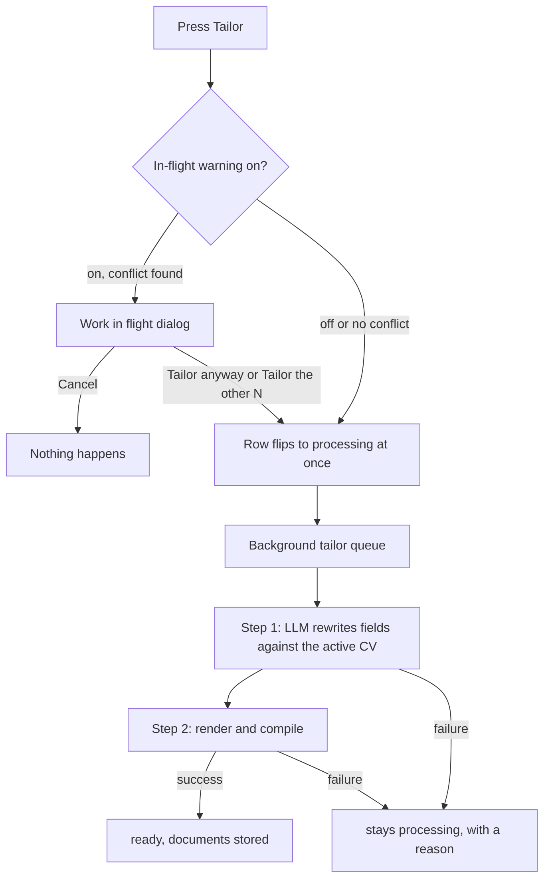
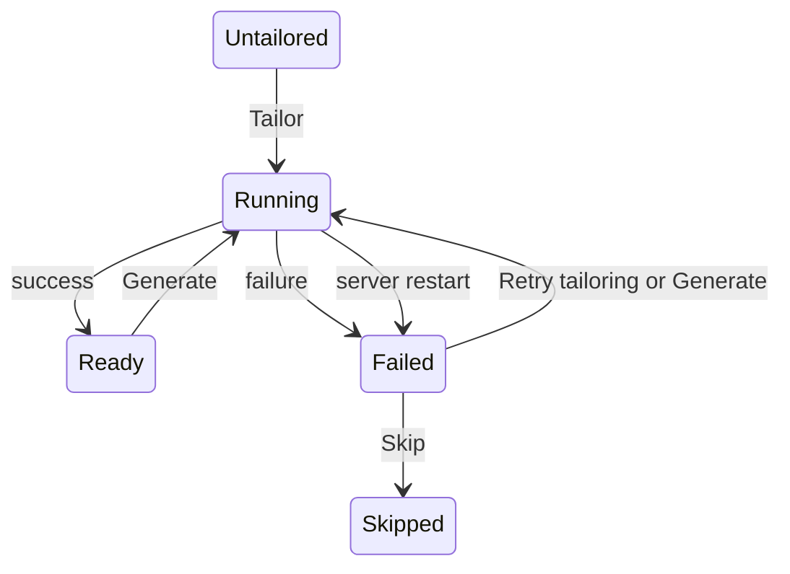

# Tailoring and cover letters

Tailoring produces your CV for one job. The LLM rewrites some of your CV's fields toward the job's keywords, using only evidence it finds in your personal brief; the server renders the result into a PDF (plus a `.docx` on a Word profile, or the page or zip on an HTML profile); the job lands on the **Tailoring** tab with its documents. Around that core sit the per-job cover letter, the ghostwriter chat that proposes edits you accept or reject, the keyword-coverage badge, and interview prep for jobs you have applied to. How the CV template itself is built is on [CV upload and rendering](cv-pipeline.md).

Using it: [Tailoring and AI assist](../guide/tailoring.md)

## How it works

### Pressing Tailor

The selection bar sends one batch to the server, which runs it detached from the page: closing the browser does not stop it, and every open tab sees its progress. For Tailor and Generate the batch only flips each row to `processing` and queues it, so it finishes in moments; the real work happens in a background queue that runs **Tailoring concurrency** tailors at a time (default 3, Settings → Pipeline). A tailor's LLM call shows in the live LLM call queue as "tailor CV" with the job's title and employer.

| Where | Label | What it starts | Runs through | Accepted from |
|---|---|---|---|---|
| Selection bar on Inbox, Backlog, Stale, All Jobs | **Tailor N jobs** | A tailor | Background queue | `discovered`, `backlog`, `stale`, or a failed tailor |
| Job panel of an untailored or failed row | **Start Tailoring** / **Retry tailoring** | A tailor | Background queue | Same |
| Swipe deck | Tailor swipe or button | A tailor | Background queue | Same |
| Selection bar on Tailoring | **Generate N jobs**, after a confirm | A fresh tailor against the active CV | Background queue | `ready` or a failed tailor; rows still running are skipped |
| Pipeline run with **Auto-tailor selected jobs after each pipeline run** (off by default) | — | A tailor for the run's top-ranked jobs | The run itself | The jobs the run selected |
| Tailoring workspace: Tailor CV **Generate**, Personal Brief **Re-tailor with brief** | — | A tailor that the page waits for | Nothing: starts at once | Any status |

### What one tailor does

**Step 1: rewrite.** The server takes the active CV and sends the **Tailoring Model** the job description, your personal brief and the CV's fields (id, role, value, locked). Unlocked fields are shown with their original text; locked fields with this job's edited text, marked read-only. The model returns a list of `{fieldId, newValue}` changes plus two keyword lists: `matched` (job keywords it worked in, with evidence in the brief) and `skipped` (keywords it dropped for lack of evidence). The server drops any change that names an unknown or locked field, is malformed, contains forbidden LaTeX, or repeats the original value. If no change survives, or the stored result would exceed **Tailored content (chars)**, the tailor fails. Otherwise the job records which CV it used, its new field values (earlier edits survive only on locked fields), and the two keyword lists.

**Step 2: render.** The job's values are laid over the CV's originals and rendered (see [CV upload and rendering](cv-pipeline.md)). If the result is identical to your untouched CV, the tailor fails. Otherwise tectonic compiles it (on a Word profile the `.docx` is rebuilt and converted to a PDF preview; on an HTML profile the page is rebuilt and printed by Chromium) and the files are stored. On an HTML profile a proposed value that uses formatting the CV does not use is dropped at step 1, before anything is rendered. A row still at `processing` becomes `ready`; a row you moved elsewhere while it ran stays where you put it and still gets its PDF.

### Running, failed, done

| What you see | Status | Failure reason | Means |
|---|---|---|---|
| Processing spinner | `processing` | empty | Queued or running |
| **Tailor failed** chip; **Last tailoring attempt failed** box with **Show details** | `processing` | set | Failed; retry in place or skip |
| Tailoring workspace | `ready` | — | Tailored, documents available |

A failure reason is one short summary line, optionally followed by a detail block that **Show details** expands:

| Summary contains | Usually means | Details carry |
|---|---|---|
| LLM call failed | The provider refused or timed out | Provider error code and model |
| produced no usable changes | Every proposed change was dropped | The field ids proposed and the ids the CV has |
| The model returned … | Malformed change list | The start of what the model sent |
| exceeds the configured limit | Over **Tailored content (chars)** | The largest fields |
| produced no actual change to the CV | Render identical to the original | Ids written and ids the CV has |
| LaTeX compile failed / PDF conversion failed | Compile or conversion error | The last lines of the compiler log |
| Tailoring interrupted (server restart) | The server restarted mid-run | — |

### The tailoring workspace

A `ready` row on the **Tailoring** tab opens the workspace: tabs **Tailor CV**, **Tailor Cover Letter**, **Personal Brief** and **Details**, with the ghostwriter chat beside the first three.

| Control | Uses the LLM | What it does |
|---|---|---|
| Keyword badge "X/Y JD keywords surfaced" | — | Green from 75 %, amber from 50 %. Hover lists the skipped keywords: the ones to add to your brief if you do have them. |
| **Refresh** next to the badge | No | Re-sorts the job's existing keywords into matched/skipped by plain case-insensitive text search over the current field values. A keyword the model worked in through a synonym can drop to skipped. |
| **Edit** → **Fields** / **Raw**, lock icons, **Clear locks**, **Reset all**, **Save** | No | Edit this job's field values by hand; a locked field is never rewritten by tailoring and cannot be changed by a ghostwriter edit. |
| **Render PDF** | No | Saves any pending edits, then renders. Rendering an unchanged CV is allowed here. |
| **Generate** (Tailor CV), **Re-tailor with brief** (Personal Brief) | Yes | A full tailor, waited for |
| **PDF** | — | Preview of the stored PDF |
| More actions → **Regenerate PDF** | No | Re-renders from the stored values |

### Cover letters

Cover letters are LaTeX on every profile, Word and HTML ones included. You upload one cover-letter template on the **My Cover Letter** page (**Cover Letter** in the navigation); it passes the same gate as a LaTeX CV, and the extraction must mark exactly one field as the letter's body. Per job, **Tailor Cover Letter** has **Edit** and **PDF**:

| Action | What happens |
|---|---|
| A job opens | The body field starts empty: the uploaded letter's prose is never carried into a job. Other fields (a recipient or role line, if your template has them) keep their uploaded text. |
| **Generate** | Saves your edits, then one LLM call (the **Tailoring Model**) fills the template's fields from the job description, your brief, this job's tailored CV and your **Cover-letter policy**. A body is required; other fields may be left at their uploaded text (an address the job description does not state is never invented). Then it renders and switches to **PDF**. If only the render fails, the draft is kept and the toast says so. |
| **Render PDF** | Template plus this job's values, compiled. No LLM. |
| **Reset all** | Back to the per-job starting point: body empty. |

The **Cover-letter policy** (Settings → AI → Writing Style) is the letter's length, structure and voice in your own words; it falls back to the shipped text when empty. The prompt keeps the rules that are not yours to edit: which fields to fill, matching each field's shape, not inventing an address, honesty about skills the brief does not show.

### The ghostwriter

The chat beside the workspace knows the job, your brief, this job's CV field values and keyword lists, and the cover letter you are looking at. Each reply is a chat message plus at most one proposed edit, shown as a card with **Accept** and **Reject**:

| Proposal | On Accept |
|---|---|
| CV edit | Each changed field must exist, must not be locked, and must still hold the value the proposal was based on; otherwise Accept is refused. The new values are saved and the PDF is re-rendered; if the render fails, the values are rolled back. |
| Cover-letter rewrite | The complete new letter becomes this job's body text. |
| Brief edit | Appended to the active CV's brief (preferred) or replaces it. |

Replies stream in, can be cancelled, regenerated or edited (earlier versions stay reachable as branches), and the whole conversation can be reset.

### Interview QA

Jobs at **Applied** or **Interviewing** get an **Interview QA** tab in the job panel. **Generate strategy** asks the **Tailoring Model** for a markdown strategy (a core narrative, likely questions and how to play them, questions to ask) from the job description, your brief and this job's tailored CV, steered by the optional **Focus** box. It is saved on the job; **Regenerate** replaces it after a confirm. Nothing runs it automatically, and the server refuses it for jobs at other stages.

### Generated documents

| Document | Served at | Written by |
|---|---|---|
| Tailored CV (PDF) | `/pdfs/resume_<jobId>.pdf` | A tailor, **Render PDF**, **Regenerate PDF**, an accepted CV edit |
| Tailored Word CV | `/pdfs/resume_<jobId>.docx` (download) | The same, on a Word profile |
| Tailored HTML CV | `/pdfs/resume_<jobId>.html` or `.zip` (download only, sandboxed) | The same, on an HTML profile, in the shape the CV was uploaded |
| Cover letter (PDF) | `/pdfs/cover_letter_<jobId>.pdf` | Cover-letter **Generate** and **Render PDF** |

The bytes are stored in the database (the `job_pdfs` table), one row per job and kind, replaced on every render and removed when the job is deleted. The job itself keeps only the file name as a "has a document" flag, and the page appends the job's last-update time to the URL so the browser never shows a stale copy. Download buttons (and `d`) name the file from **Your name** in Settings → Display: `Doe_JQ_resume_Acme.pdf` and `Doe_JQ_cover_Acme.pdf` for "Jane Q. Doe" (last name, initials, document, employer), or just `resume_Acme.pdf` / `cover_Acme.pdf` when no name is set. A comma marks a last name of more than one word ("García Márquez, Gabriel" gives `Garcia_Marquez_G`), and accents are folded. On a Word profile they hand you the `.docx`, and the PDF stays a preview. Saving from the browser's PDF viewer instead still gives `resume_<jobId>.pdf`, because the browser takes that name from the URL.

## Design decisions

### Move-then-tailor, in a background queue

Pressing Tailor only moves the row to `processing` and queues the work, so the row jumps to the Tailoring tab at once and the slow part (an LLM call and a compile per job) runs without the page. Bulk actions likewise run as server-owned batches rather than for as long as a request stays open, so you can start work from a phone, close the browser and pick it up on the desktop. The queue is bounded by **Tailoring concurrency** because each tailor costs a provider call and a compiler process, and it is the same setting the pipeline's own tailoring step reads. It lives in memory only: a restart loses what was queued, and the next boot marks those rows as interrupted.

### A failed tailor stays where it failed

A failure does not bounce the job back to the Inbox; it stays on the Tailoring tab with its reason and a **Retry tailoring** button. A job interrupted by a restart stays there too, marked as interrupted. No new status was added: `processing` with an empty reason means running, with a reason means failed, so every guard can tell a live run from a retryable one. The reason is a single text value holding a summary and an optional detail block rather than two columns, because every place that clears a failure already clears that one value. The detail is capped at 2000 characters, because the reason travels with every row of every job list; for a compile failure the detail carries the last lines of the log, where the actual error is.

### Never ship your untouched CV as "tailored"

A tailor that changes nothing fails loudly instead of producing a PDF identical to your CV under a tailored label. It is checked twice: when no proposed change survives validation, and again at render time when the output equals your original, which also catches changes keyed to field ids the CV no longer has. Manual **Render PDF** is exempt, because rendering an unchanged or reset CV is what you asked for there.

### The model rewrites from your original, and locks are enforced by the server

Every tailor shows the model your original text for unlocked fields, not what it wrote last time, so it does not anchor on its own previous output. Locked fields are shown as read-only evidence, and the server drops any change aimed at one and keeps your earlier edit, so a lock holds however the model behaves.

### After a CV change, re-tailor rather than re-render

**Generate** on the Tailoring tab runs the full tailor again instead of re-rendering stored values. Field ids are written by the model at extraction, so a re-extract can rename them; stored values keyed to old ids would be dropped silently (a half-tailored CV) or, if all of them die, the render would fail the "no actual change" check. Re-tailoring rewrites against the current fields and moves the job onto the active CV. The confirm says so and counts only the rows it will touch. Applied, interviewing and closed jobs are refused, because their PDF is the record of what was sent.

### The in-flight warning is about the employer, exactly

The same opening is often scraped under two board URLs that duplicate review cannot join. **Warn before tailoring a company you have work in flight at** (Settings → Display, off by default) catches that at the moment it matters: before tailoring, it lists jobs at the same employer that are tailoring (or failed a tailor), tailored, applied to or interviewing. It matches on the employer only, not a fuzzy title-and-employer score, and the match is exact apart from case and surrounding spaces, because a looser match would hide a real second opening behind a warning about an unrelated one. It is a check in the browser, not a server refusal, because it is a question for a person; it also gates the Swipe deck. If the check cannot load, it warns and tailors anyway rather than blocking.

### The ghostwriter proposes; you accept

Every reply uses one format on every provider: a chat message plus a list of proposed edits, returned as structured output rather than each provider's native tool calls, so weaker or local models work too. Keeping the message separate from the edit fixed a model that narrated "I've changed it" while changing nothing. The model names only the field and the new text; the server fills in the current value, which turns Accept into a check that nothing changed underneath it. A reply that does not fit the format is sent back once with the exact error; if it still fails, the turn fails rather than pretending to propose an edit.

### A job's letter starts empty, and its length is your policy

The uploaded letter's body is prose written for some other application, so each job starts with an empty body rather than inheriting it. This is a starting point, not a saved value, so **Reset all** means back to empty and an untouched job is not marked as edited. Letter length and structure moved out of the fixed prompt into **Cover-letter policy** after letters came out too long and setting the tone to concise did nothing: a fixed word count in the prompt outweighed the one-word tone. The policy sits before the field rules in the prompt, so your text can never override, say, the rule that a body-only template opens with the greeting.

### Generated documents live in the database

PDFs and tailored `.docx`, page and zip files are stored in the same SQLite database as everything else, so the database file is the whole installation and a user profile carries its own documents. They are served at `/pdfs/…`, outside the `/api` routes, so preview frames and plain links work when sign-in is switched on. The response deliberately names no file, so the browser uses the name each download button sets.

## Where it lives

| Path | What |
|---|---|
| `orchestrator/src/server/pipeline/orchestrator.ts` | One tailor: rewrite step, render step, failure recording |
| `orchestrator/src/server/services/cv/llm-adjust-content.ts` | The tailoring LLM call and the checks on its changes |
| `orchestrator/src/server/services/pdf.ts` | Per-job render for LaTeX, Word and HTML, the "no actual change" check |
| `orchestrator/src/server/api/routes/jobs.ts` | Tailor / Generate actions, the background queue, keyword refresh, per-job render and generate routes |
| `orchestrator/src/server/services/ghostwriter.ts`, `orchestrator/src/server/services/job-edits.ts` | The chat format and what Accept does |
| `orchestrator/src/server/services/cover-letter/`, `orchestrator/src/server/services/interview-qa/` | Cover-letter upload, generate and render; interview QA |
| `orchestrator/src/server/api/routes/pdf-files.ts` | Serves `/pdfs/…` from the database |
| `shared/src/tailoring-failure.ts`, `shared/src/company-in-flight.ts` | The failure-reason format; the in-flight rule |
