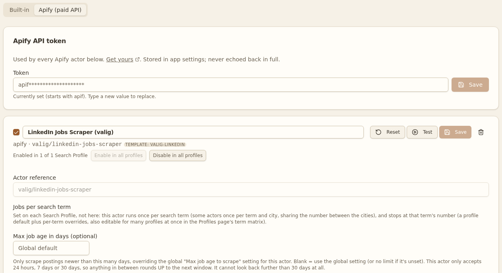

# Apify integration

[Apify](https://apify.com) is a marketplace of ready-made web scrapers (called **actors**). CV Clanker can use an Apify actor as a job source, in addition to the [built-in boards](job-sources.md): one of three ready-made LinkedIn templates, or any other actor you configure yourself.

## Setup

1. Create an account at [apify.com](https://apify.com) and copy your API token.
2. In CV Clanker, open **Sources → Apify (paid API)** and paste it into the token field (or set `APIFY_API_TOKEN`; see [Configuration](configuration.md#environment-variables)).

The token is used only to call your own Apify account. Until one is saved, Apify actors fail. From there, **Add actor** adds an actor from a template or as a custom actor.

## Templates

Templates come with the input and the output mapping already set up. Pick one and give it a label:

| Template | Actor | How it searches |
|---|---|---|
| **LinkedIn Jobs Scraper (curious_coder)** | `curious_coder/linkedin-jobs-scraper` | One actor run per search term, one after another, with one search per city. Takes the max job age exactly. |
| **LinkedIn Jobs Scraper (cheap_scraper)** | `cheap_scraper/linkedin-job-scraper` | One actor run per search term, one after another. The actor will not stop below 150 results, so a term may take up to 150 even when its budget is lower. |
| **LinkedIn Jobs Scraper (valig)** | `valig/linkedin-jobs-scraper` | One actor run per search term and city, several at once. The actor keeps only postings whose title contains every word of the term, so you pay only for matching postings. |

All three build their LinkedIn searches from the search profile's terms and location at run time; there are no LinkedIn URLs to paste.

Their result budget comes from the search profile's **LinkedIn jobs per search term** (and any per-term numbers there or in the [Term matrix](search-profiles.md#the-term-matrix-tab)), not from the actor card. A posting that matches two terms is fetched, and billed, by both runs. After a run, the run banner says for each actor which terms reached their budget ("LinkedIn likely had more"), so you know which term to raise.

cheap_scraper and valig only accept LinkedIn's own date windows (24 hours, 7 days or 30 days), so a max job age in between rounds up, and they cannot look back further than 30 days: a profile's max job age above 30 is scraped as 30 days, and a Run menu window above 30 days is refused.

**Stopping a term early (curious_coder).** LinkedIn pads a one-term search with loosely related postings. While a term's run is going, CV Clanker stops it once its latest results mostly stop naming the term, so you stop paying for padding. The threshold is **Stop a LinkedIn search term early** in Settings → Pipeline Behavior (default 2; 0 switches it off); the rule is in [Job sources](../architecture/job-sources.md#apify-actors).

## Configuring your own actor

In **Add actor**, choose **Custom actor** and provide:

1. **Label**: the name the source shows under.
2. **Actor reference**: the actor's ID, from its Apify URL (for example `username/actor-name`).
3. **Input template (JSON)**: the input the actor expects, with placeholders for the values CV Clanker fills in per run.
4. **Output mapping (JSON)**: where each job field sits in the actor's results, as a dot-path. `jobUrl` and `title` are required; `employer`, `location`, `jobDescription`, `datePosted`, `isRemote`, `applicationLink`, `salary`, `jobLevel` and `jobType` are optional.

The placeholders are:


| Placeholder | Filled with |
|---|---|
| `{{searchTerms}}` | the profile's search terms (a list) |
| `{{city}}` | the profile's city |
| `{{country}}` | the profile's country |
| `{{workplaceTypes}}` | the work arrangement ticks (a list) |
| `{{maxJobsPerTerm}}` | the per-term budget worked out from the run budget |
| `{{maxJobs}}` | the actor's own **Max jobs**, else the per-term budget |
| `{{maxAgeDays}}` | the actor's own max job age, else the run's; empty when neither is set |


A placeholder must be a whole JSON value on its own, not part of a longer string. Results missing a required field are counted as unreadable and shown in the run banner rather than imported half-empty. Map `isRemote` if the actor reports it: that is what lets a profile keep remote jobs from outside its area (see [Location scope](search-profiles.md#location-scope)).

## Per-actor settings

Each actor is an independent card with its own label, **enabled** tick, optional **Max job age in days** and, for custom actors, optional **Max jobs**. A disabled actor never runs. **Test** runs the actor once with the default search profile's terms and location and shows up to five mapped results, so you can check a mapping before a real run.

Like built-in boards, an actor runs only on the search profiles that tick it (see [Sources per profile](search-profiles.md#sources-per-profile)). **Enable in all profiles** on an actor card asks for confirmation first, because it starts paying for that actor on every profile, schedules included. Apify actors never run on a [remote profile](search-profiles.md#remote-profiles).

## How it runs

Each enabled actor runs as its own source alongside the built-in boards, labelled with the name you gave it. Its jobs go through the same location filter and blocked-company check, land in the same Inbox and get the same [scoring](job-lifecycle.md#fit-scoring) and [tailoring](tailoring.md). If an actor run times out or is aborted, the jobs it had already scraped (and been billed for) are still imported, and the source shows as failed so you can re-run it from the banner.

## Cost

Apify actors are billed by Apify, on your account; CV Clanker calls them with your token. Most charge per result, so check an actor's pricing on Apify. To keep runs small, lower **LinkedIn jobs per search term** (templates) or **Max jobs** (custom actors), keep the city list short (each city is another search), and set a max job age.

How it works: [Job sources](../architecture/job-sources.md)
