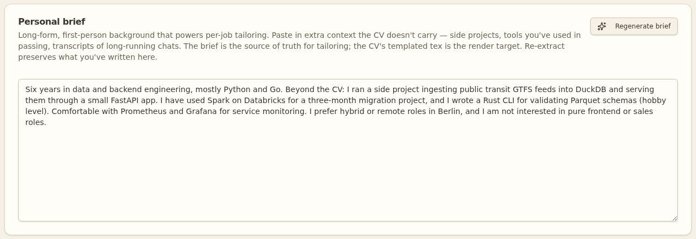

# CVs: LaTeX, Word, HTML & the personal brief

CV Clanker tailors a copy of a CV you upload; it edits the content of that document rather than generating a new one. The upload can be LaTeX, Word or HTML.

You choose the format once per [user profile](configuration.md#user-profiles), in the onboarding wizard. It is fixed for that user profile (each format is handled differently internally), but you can keep several user profiles, each with its own format. You upload and inspect your CV on the **My CV** page, or in the CV step of onboarding.

## LaTeX CVs

Upload a single `.tex`, or a `.zip` containing your main file plus anything it pulls in with `\input{}` / `\include{}` (class files, fonts and images included).

On upload, CV Clanker:

1. **Flattens** all `\input{}`s into one document.
2. **Compiles your untouched source** with [Tectonic](https://tectonic-typesetting.github.io/). If it does not compile, the upload is rejected before any LLM call is made.
3. **Extracts** a templated `.tex` with placeholders plus a list of the editable fields (summary, bullets, skills, dates, and so on), and drafts a personal brief.
4. **Checks the round-trip**: it puts your original text back into the placeholders, recompiles, extracts the text of both PDFs with `pdftotext`, and compares them line by line.

Steps 3 and 4 are tried up to three times, each retry told what went wrong. If the result still doesn't match, the upload is rejected and the page shows **Upload failed** with what each attempt produced. There is no partial acceptance: a CV is accepted only when every tailorable part of it is a field.

If an upload is rejected, it is usually an unusual macro or a package Tectonic can't resolve. Compile the `.tex` with Tectonic locally first (if Tectonic can't build it, CV Clanker can't either), prefer standard packages, and make sure every `\input{}` file is in the `.zip`. The first compile on a fresh install downloads the LaTeX packages your CV uses, so it is much slower than later ones.

Tailored LaTeX CVs render to PDF via Tectonic.

## Word (`.docx`) CVs

With a Word profile you download a `.docx`; the PDF is a preview only.

On upload, CV Clanker extracts the text, has the LLM name the tailorable spans (it doesn't write markup — CV Clanker inserts the markers), and accepts the file only if the extracted text matches the original exactly and it converts to PDF via LibreOffice. Password-protected or legacy `.doc` files, documents with macros, unresolved tracked changes, or fields that pull in external content are rejected.

Tailoring rewrites the marked spans in place and repackages the `.docx`, so the downloaded file keeps your original fonts and layout with tailored content. A PDF preview is generated for the browser.

Note: cover letters are LaTeX only. A Word profile tailors the Word CV, but its cover letters use the LaTeX substrate — see [Tailoring](tailoring.md#cover-letters).

## HTML CVs

Meant for simple CVs written as a web page, such as the ones AI agents produce. Upload a single `.html` page, or a `.zip` with the page and every file it uses (stylesheets, fonts, images) linked by relative paths.

The page must be self-contained: nothing loaded from the internet and no scripts. An upload that links a font, image or stylesheet on the web is rejected; put those files in a `.zip` with the page instead. Links that change nothing in the PDF (icons, preloads) are dropped, and so are OS junk files in a zip.

On upload, CV Clanker has the LLM name the tailorable text and marks it in place, and accepts the page only if the marked-up page still holds exactly the same text as yours and it renders to PDF cleanly.

Tailoring rewrites the marked text in place: a tailored value may only use the inline formatting (bold, italics, links and so on) your CV already uses. You download the tailored page in the shape you uploaded it — the `.html`, or the `.zip` with the page swapped in and every other file kept. The PDF is printed by Chromium, at A4 unless the page sets its own `@page` size, and with a 1 cm margin unless the page sets its own.

## Which format?

| | LaTeX | Word | HTML |
|---|---|---|---|
| You download | PDF | `.docx` (plus PDF preview) | `.html` or `.zip` (plus PDF preview) |
| Best if | You already have a `.tex` résumé | You work in Word / Google Docs and want an editable file to submit | Your CV is a web page, e.g. one an AI agent wrote |
| Cover letters | LaTeX | LaTeX | LaTeX |
| Upload check | Recompile + `pdftotext` diff | Exact-text match + LibreOffice conversion | Exact-text match + Chromium render |
| Hand-edit the template | Yes | No | No |

If you don't already have a LaTeX CV, Word is usually simpler.

## The My CV page

| Control | What it does |
|---|---|
| **Templated PDF** / **Original PDF** | Your CV rendered from the template, and your untouched upload, each in a new tab. They should read the same. |
| **Extracted fields** | Every field with its role and original text. If a role looks wrong, re-extract. |
| **Re-extract** | Runs the whole upload check again on the stored upload, for example after a bad extraction or a prompt change. Your brief is kept; if it fails, nothing changes. |
| **Extraction prompt** | The prompt used to extract this CV, with **Save** and **Reset to default**; **Re-extract with this prompt** tries an edited one. |
| **Personal brief** | Your brief, saved with **Save changes**. **Regenerate brief** replaces it with a fresh 100–400 word summary of your CV, after asking. |
| **Templated LaTeX** | LaTeX only: hand-edit the layout (a line break, spacing, a font size) and **Save template**. The edit must keep exactly the same set of fields and must not add LaTeX errors; check **Templated PDF** afterwards. A later re-extract replaces hand edits, and PDFs already made for jobs keep the old layout until they are rendered again. |
| **Compile log** / **Conversion log** | The output of the last accepted render. |

The app works with one CV per user profile: the active CV is the one shown on My CV, and tailoring, scoring, cover letters and the ghostwriter all read it. To work with a different CV, use another user profile.

## The personal brief

The brief is long-form, first-person text describing things a CV doesn't include: side projects, tools used briefly, context behind a role.

Tailoring draws only on the brief and the job description, and fit scoring reads the brief too. With little in the brief there's little for tailoring to reference; with more, there's more it can use. It isn't used to invent experience.

Writing one:

- First person and concrete: technologies, scale, outcomes.
- Include what didn't fit on the CV.
- Accuracy and completeness matter more than polish.

CV Clanker drafts one from your CV when you upload it, as a starting point to edit. The tailoring workspace's **Personal Brief** tab edits the same brief (a change there applies to every job), and the [ghostwriter](tailoring.md#the-ghostwriter) can propose additions to it.

## Locked fields

Fields you don't want rewritten for a job (a name, a specific title, a credential) can be locked in that job's tailoring workspace, with the lock icon in **Edit**. A locked field keeps your text: it is excluded from every tailoring pass and refused for [ghostwriter](tailoring.md#the-ghostwriter) edits. Locks belong to that job.

How it works: [CV upload and rendering](../architecture/cv-pipeline.md)
