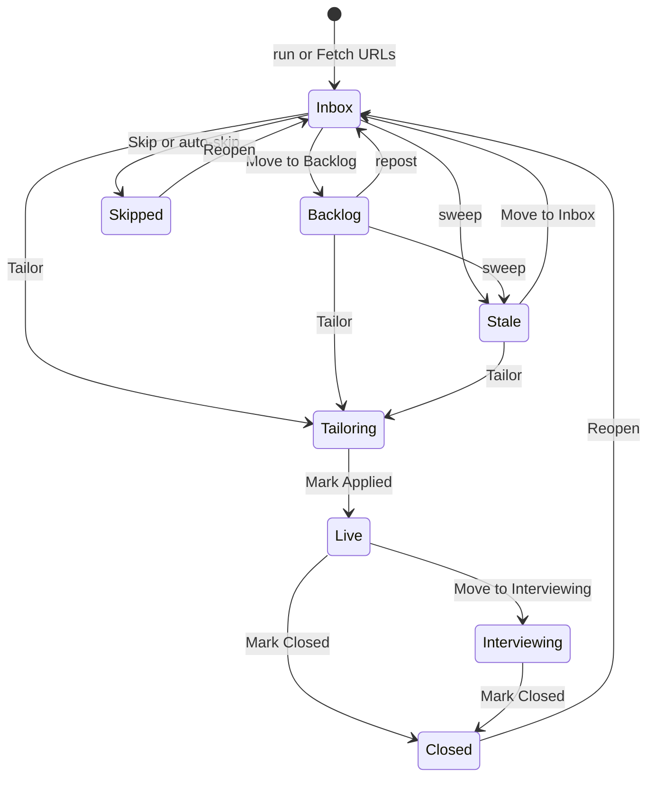

# Tracking your hunt

Every job sits in exactly one stage, and the stage decides which Manage tab shows it. Jobs move because you press something (a button, a bulk action, a swipe, the **Stage** dropdown), because a [run](runs.md) acts on them (import, auto-skip, auto-tailor), or because you sweep them into the Stale tab. Separately from the stage, a job can carry a permanent **applied** mark that survives every later move.

## Stages and tabs

| Stage | Tab | Meaning |
|---|---|---|
| Discovered | Inbox | New, waiting for triage. Everything a run or **Fetch URLs** adds starts here. |
| Processing | Tailoring | A tailor is running, or it failed and waits for a retry. |
| Ready | Tailoring | Tailored; the documents are ready. |
| Applied | Live | Application sent. |
| Interviewing | Interviewing | Past the first stage of the application. |
| Backlog | Backlog | Parked by hand. |
| Stale | Stale | A holding pen for jobs you are thinking of retiring. |
| Skipped | Closed | Not pursued. |
| Closed | Closed | Concluded, with an outcome: rejected, withdrawn, ghosted, duplicated or other. |

The diagram shows the ordinary routes; the **Stage** dropdown can move a job anywhere.

## Moving jobs

| Action | From | To | Notes |
|---|---|---|---|
| **Tailor** | Inbox, Backlog, Stale, a failed tailor | Tailoring | The job moves at once and tailoring runs in the background; see [Tailoring](tailoring.md). |
| **Generate** | Tailoring (tailored or failed) | Tailoring | Tailors again from scratch against your current CV. |
| **Skip** | Inbox, Tailoring, Backlog, Stale | Skipped | A run can also auto-skip low-fit Inbox jobs. |
| **Move to Backlog** | Inbox, Stale | Backlog | |
| **Move to Inbox** | Stale | Inbox | |
| **Mark Applied** / **Applied** | Tailoring | Live | Sets the applied mark. |
| **Move to Interviewing** | Live | Interviewing | |
| **Mark Closed** | Live, Interviewing | Closed | Asks for the outcome: Rejected, Withdrew, Ghosted or Other. |
| **Close** | Stale | Closed as ghosted, or Skipped | Ghosted if you had applied, skipped otherwise. |
| **Reopen** | Skipped, Closed | Inbox | Clears the outcome. |
| **Delete** | anything but a running tailor | gone | Removes the job and everything attached to it. Cannot be undone. |

### The Stage dropdown

Every job's detail panel carries a **Stage** dropdown that moves it to Inbox, Tailoring, Live, Interviewing, Backlog, Stale or Skipped from wherever it is now, including jobs the ordinary buttons cannot reach (such as a tailor that never finished). On jobs you applied to it also offers a **Close with reason** group (Rejected, Withdrew, Ghosted, Other); on a job that is already closed it reads **Change reason** and keeps the original close date. Closing with an outcome is offered only for jobs you applied to; everything else you are done with goes to Skipped, which shares the Closed tab. Moving a closed job anywhere else clears its outcome.

Moves can be undone (the header's undo button, the toast's **Undo**, or Ctrl/Cmd+Z), except a move away from a running or failed tailor.

## The permanent applied mark

The first time a job moves to Live or Interviewing it gets an applied date, and later moves never change it; only undoing the move that set it clears it. Wherever the mark is set but the stage no longer says so (a closed, skipped or reopened job), the row shows a teal **Applied** badge, and the search's **Ever applied** filter finds it.

The mark is what lets CV Clanker tell a closed application from a job you never applied to:

| Where | What the mark changes |
|---|---|
| Auto-skip in a run | Never skips a job you applied to. |
| Stale sweeps | Only **Move Applied** shelves jobs you applied to; the other sweeps leave them alone. |
| **Close** on the Stale tab | Applied → closed as ghosted; not applied → skipped. |
| A repost of a stale job | A stale job you applied to stays in Stale instead of returning to the Inbox. |
| Duplicate review | Jobs you applied to are never proposed as duplicates. |
| **Stage** dropdown | **Close with reason** appears only on jobs you applied to. |
| [Stats](stats.md) | Applications are counted by the mark, however they ended. |

## Fit scoring

When scoring is on (Settings → Pipeline Behavior → **Score discovered jobs with the LLM**, on by default), each run rates every unscored Inbox job against your [personal brief](cvs.md#the-personal-brief) as **Great fit**, **Very good fit**, **Good fit** or **Bad fit**, with a one-line reason. The model sees the job's title, employer, location, salary, degree, disciplines and description, and the **Scoring policy** in Settings → Pipeline Behavior, which defines what each rating means; edit it to change how strict scoring is.

- A job whose description is under 100 characters is left unscored rather than guessed at, and so is a job whose scoring call fails.
- **Recalculate match** rescores selected jobs. With a pre-filter model set (see [LLM providers](llm-providers.md#which-model-does-what)), **Screen first** lets the cheap model throw out bad fits before the main model sees the rest.
- The fit card's tooltip says which model scored the job.
- **Auto-skip**: with Settings → **Auto-skip jobs scoring at or below** set (or the Run menu box ticked), a run moves new Inbox jobs at or below that rating to Skipped, never ones you applied to.
- An optional penalty demotes a job one rating when it lists no salary. It is off by default and has no Settings control; set the `PENALIZE_MISSING_SALARY` environment variable to `1` to turn it on.

## The Stale tab

Nothing ages jobs automatically. Instead, the Stale tab has an **Older than** day count (the Inbox stale threshold from Settings, 7 days by default) and four buttons that move old jobs into Stale in one step:

| Button | Moves into Stale | Age measured by |
|---|---|---|
| **Move stale rows** | Inbox and Backlog jobs you never applied to | Posting date, else the date found |
| **Move Tailoring** | Tailored jobs you never applied to | Posting date, else the date found |
| **Move Applied** | Live and Interviewing jobs | Applied date, else posting date |
| **Move closed postings** | Inbox and Backlog jobs whose LinkedIn posting no longer accepts applications, never applied to | not aged |

**Move closed postings** relies on a live-status check; run **Live status** on a selection first. Jobs being tailored, or whose tailor failed, are never swept. From Stale you can **Close** jobs, move them back to the Inbox, park them in Backlog, or tailor them.

## Reposts

When a run finds a link CV Clanker already has, nothing new is created, unless the posting date has moved forward. Then it counts as a repost: the posting date advances, the row's `Reposted N×` badge goes up, its LinkedIn live status is cleared (it described the old posting), and a job sitting in Backlog, or in Stale without the applied mark, returns to the Inbox. Every other stage keeps its place: a skip or a close is a decision a relisting should not undo.

## Reviewing duplicates

The same LinkedIn posting often arrives more than once: under a country subdomain, a slugged link, or from a second scraper. When two or more jobs in the Inbox or Tailoring tabs share a LinkedIn posting id, Manage shows a banner ("N duplicate groups (one posting id, listed more than once)") with **Review duplicates** and **Dismiss**.

The review walks the groups largest first. For each it lists the copies with their source, tab, fit and age, an **Open** link, and a pre-selected copy to **Keep**: the one furthest along (tailored, then being tailored, then Inbox), then the best fit, then the newest. Pick a different one if you like, then:

- **Close k as duplicates** closes the other copies as duplicated (undoable);
- **Skip group** moves on without closing anything;
- **Close all** closes this group and every following one in one press, stopping at the first group whose copies disagree about the job title, which the review flags for you to decide yourself.

Only the board's own posting id counts as proof, and only LinkedIn ids are read today. The same role on two *different* boards, or two postings that merely look alike, are left alone on purpose: closing a job that only looks similar loses an opening you wanted. Jobs you applied to are never proposed. A schedule can also close title-agreeing duplicates after each run; see [Scheduling](runs.md#scheduling).

For the softer case (you already have work in flight at the same company), see [The company in-flight check](reviewing-jobs.md#the-company-in-flight-check).

## Live LinkedIn status and Easy Apply

The **Live status** bulk action (LinkedIn jobs only), and the optional step at the end of a run, read each posting's public LinkedIn page and store whether it still accepts applications, the applicant-count caption, whether it is an Easy Apply posting, and when it was checked. The row then shows **No longer accepting applications** or an **Easy Apply** chip, and the sorter can order by applicant count. Requests are paced at about one a second and back off when LinkedIn starts refusing, because LinkedIn limits by IP address and hammering it would also block your own browsing.

## Adding jobs by URL

**Fetch URLs** in the Manage header opens the **Import URLs** sheet. Paste up to 50 job links, one per line, and press **Fetch jobs**. The import runs on the server: you can close the sheet and reopen it from any tab to see per-link results, and only one import runs at a time. Each link is read with a plain fetch first, then a headless browser if the page needs one, and the LLM picks out the title, employer and description.

- Each new job lands in the Inbox with source "Manual", and is scored in the background when scoring is on.
- A link already in your jobs is reported as a duplicate instead.
- A page that yields no title, employer or description (often because the company name is an image) ends as a failed row. Its **Manual** button opens a form pre-filled with whatever was read; saving it files the job like a fetched one, and the row then reads **saved**. **Retry failed only** retries the rest.

Links are imported as they are: the location filter and blocked-company list apply to runs only.

**Rescrape** (bulk action) re-reads a job's own link the same way, replaces the description, fills in only fields that were empty, and rescores the job when scoring is on.

## Bulk actions run in the background

The bulk bar and the Swipe deck send each action to the server as a batch and show a progress toast; closing the tab does not stop it, and every open tab sees its progress. One action takes at most **Max jobs per bulk action** jobs (default 1000) and **Bulk action concurrency** sets how many it works on at once (default 4), both in Settings → Pipeline Behavior. A job that another running batch is already working on is refused for the second. Moves between stages offer **Undo**; Delete, Generate and the scoring actions do not.

## Notes, outcomes and interviews

- **Notes**: Live and Interviewing jobs have a **Notes** tab for your own free-text notes.
- **Outcomes**: when you close an application, you tag how it ended (rejected, withdrawn, ghosted or other); duplicate review closes copies as duplicated. The Closed tab's chips filter by outcome.
- **Interviews**: jobs you are interviewing for sit on the Interviewing tab. Live and Interviewing jobs get an **Interview QA** tab for [interview prep](tailoring.md#interview-qa).

## Searching across every tab

**Ctrl/Cmd+K** opens a search over every job, whatever tab it sits on, with `@` filters and the **Ever applied** button for working through rejection emails. See [Searching every job](reviewing-jobs.md#searching-every-job).

## Clearing jobs in bulk

Settings → Danger Zone can delete jobs by stage or by fit rating, or clear the whole job database; see [Configuration](configuration.md#danger-zone).

How it works: [Job lifecycle](../architecture/job-lifecycle.md), [Duplicates](../architecture/duplicates.md)
