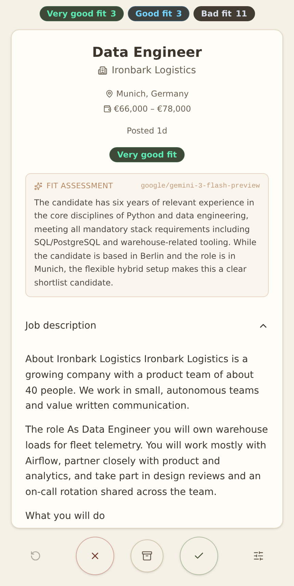

# Manage and Swipe

These are the two screens where you work through the jobs a run found. **Manage** is the full workspace: a list split into tabs by stage, filters and sorting, a detail panel with every action, a search across all jobs, and bulk actions on ticked rows. **Swipe** is the phone-friendly deck for the Inbox: one card at a time, right to tailor, left to skip. Both act on the same jobs through the same actions; only the presentation differs.

The **Swipe | Manage | Schedule | Stats** switch at the top of these screens moves between them (the side menu reaches them too, as **Jobs** and **Swipe**). How a job moves between stages is on [Tracking your hunt](job-lifecycle.md); this page is about the screens.

## The tabs

The address bar always carries the tab (`/jobs/inbox`, `/jobs/live`, …) and the selected job, so a view can be bookmarked or reloaded.

| Tab | Shows | Key | Tab-specific controls |
|---|---|---|---|
| Inbox | New jobs waiting for triage | `1` | Filter facets; titles dim once older than the Inbox stale threshold |
| Tailoring | Jobs being tailored, tailored, or whose tailor failed | `2` | **Untailored** toggle hides the finished ones |
| Live | Applications sent | `3` | The date pill shows days since you applied |
| Interviewing | Applications past the first stage | | The date pill shows days since you applied |
| Backlog | Jobs you parked | `4` | Filter facets |
| Stale | Jobs you are thinking of retiring | `5` | Filter facets; the sweep buttons (see [The Stale tab](job-lifecycle.md#the-stale-tab)) |
| Closed | Skipped and closed jobs | `6` | Chips: All, Skipped, Rejected, Withdrawn, Ghosted, Duplicated, Other |
| All Jobs | Everything except Closed, Skipped and Stale | `7` | Filter facets |

The counts on the tabs are totals for every job in that tab. The list picks up changes by itself (see [Loading the list](../architecture/manage-and-swipe.md#loading-the-list)).

## The detail panel

Selecting a job opens its detail panel beside the list (on a narrow screen, as a drawer). On a desktop you can drag the splitter between list and panel, or hide the list; both are remembered by the browser. What the panel shows depends on the tab:

- **Inbox**: the decision view: **Start Tailoring**, **Skip Job**, **Backlog**, **Recalculate match**.
- **Tailoring**: a job being tailored shows its progress; a failed one shows the reason and **Retry tailoring**; a tailored one opens the tailoring workspace with the PDF and the editing chat (see [Tailoring](tailoring.md)).
- **Everywhere else**: the job card with **View**, the **Stage** dropdown, the buttons that fit the status (**Applied**, **Move to Interviewing**, **Mark Closed**, **Tailor**, **Skip**, **Reopen**) and a **More actions** menu (edit the description or details, copy the job's info, downloads).

On a tailored LinkedIn job that is not Easy Apply, the panel shows **Add real URL**. Paste the employer's application address and save; **Open Job Listing** then opens that address instead of LinkedIn. To change it later, use **Edit details** in the **More actions** menu.

The panel's tabs are **Overview** and **Description**, plus **Documents**, **Interview QA** and **Notes** on Live and Interviewing jobs. The Description, Interview QA and Notes tabs have an expand icon at the top right that opens the text in a wide reader box; click outside it or press Esc to close it.

## A row in the list

Each row shows a status dot, the title, company, location, one date pill, badges and the source.

- The **date pill** reads `Posted 3d` (or `Found 3d` when the board gave no date). On Live and Interviewing it reads `Applied 12d`, because there the number that matters is how long ago you applied.
- Other badges: `Reposted 2×`, `Tailor failed`, the salary, the fit rating, an outcome or **Skipped** chip, and a teal **Applied** badge on any job you once applied to whose status no longer says so (closed, skipped or reopened).
- When a live-status check has read a LinkedIn posting, a line shows LinkedIn's applicant caption or **No longer accepting applications**, an **Easy Apply** chip, and how long ago it was checked.
- The **status dot** turns to the warning colour when another job at the same company is already in Tailoring, Live or Interviewing; its tooltip says how many.

Clicking a **company name** anywhere opens the company dialog (below).

When the same LinkedIn posting is listed more than once, a banner above the list offers **Review duplicates**; see [Reviewing duplicates](job-lifecycle.md#reviewing-duplicates).

## Filtering

Filters stack: each layer narrows what the one before it left.

| Filter | Where | Remembered | Applies on |
|---|---|---|---|
| **Filters** panel: Sources, Ever applied (Any, Yes, No), Dates (Ready, Applied, Closed, Discovered), Ad age, Salary, Sort | the **Filters** button beside the search box | in the address bar | every tab |
| **Fit** badges (the four ratings plus Unscored) | the filter bar | in the address bar | every tab except Closed |
| **Profile** badges (one per search profile, plus Unattributed) and **Job title** badges (every profile's search terms), each behind its tickbox | the filter bar | until you leave the page | tabs with a filter bar |
| **+ Filter** facets: Company, Title, Location, Description, Degree required, Job level, Remote | the filter bar | until you leave the page | Inbox, Backlog, Stale, All Jobs |

Within one family, picks combine with "or"; across families, with "and". A Job title badge matches when the term appears as text inside the title. Facets accept `a|b` for "either", ignore accents, and apply when you press Enter. Adding a Description, Degree required, Job level or Remote facet reloads the tab. **Reset** in the Filters panel clears everything, badges and facets included.

## Sorting

The sorter icon at the right end of the filter bar offers four orders:

| Sorter | Order |
|---|---|
| **None** | The Filters panel's Sort (newest posted first by default). |
| **Posted / found** | Newest posting date first, discovery date when the board gave none. |
| **Fewer applicants** | Jobs with a LinkedIn applicant count, fewest first; jobs without a count come after them ([the full order](../architecture/manage-and-swipe.md#sorting)). |
| **Easy Apply, Fewer applicants** | The same, but every Easy Apply job comes before every job that is not. |

Applicant counts come from the live-status check (the **Live status** bulk action, or the Run menu option).

## Searching every job

**Ctrl/Cmd+K** or **/** opens a search over every job in every status. Type words from the title, company or location and press **Enter** (or the **Search** button); typing alone does not search. It shows up to 200 matches and says when there are more ("Search with more words to narrow"). With an empty box it lists the 200 newest jobs.

Matching ignores accents ("malaga" finds "Málaga") and treats the last word as the start of a word ("eng" finds "Engineer"), but does not find letters inside a word or across a space; the full rules are in [The ctrl+K search](../architecture/manage-and-swipe.md#the-ctrlk-search). Results are grouped under Ready, Discovered, Applied and Other. Choosing a result jumps to that job's tab and clears the filters that could hide it.

Type `@` to narrow the search to one status; finish the word and press Tab or Enter, then search. Backspace on an empty box, or Esc, removes it.

| Narrow to | Shows | Type, for example |
|---|---|---|
| ready | Tailored jobs | `@ready`, `@rdy` |
| discovered | Inbox | `@discovered`, `@disc` |
| applied | Live | `@applied`, `@app` |
| in-progress | Interviewing | `@in-progress`, `@prog` |
| skipped | Skipped | `@skipped`, `@skip` |
| ever-applied | Every job you ever applied to, however it ended | `@ever-applied`, `@ever`, or the **Ever applied** button |

With **Ever applied**, each application still open (Live or Interviewing) carries a **Rejected** button. Pressing it closes that job as rejected, empties the search box and keeps the search open, so a pile of rejection emails can be worked through one company name after another. It can be undone like any other move.

## The company dialog

Clicking a company name opens a dialog with every job from that employer (same name, ignoring capitals) in every status: title, age, location, fit, status or closure reason. Clicking a job jumps to it. **Hide skipped** hides the skipped ones (with their count). **Blacklist** adds the company to the [blocked companies](search-profiles.md#blocked-companies) of the search profiles you tick; it affects future runs only.

## Bulk actions and undo

Tick rows (Shift-click for a range, or the select-all box) and an action bar appears with the actions that fit the tab: **Tailor**, **Generate** (on Tailoring), **Skip**, **Move to Backlog**, **Move to Inbox**, **Mark Closed**, **Close**, **Reopen**, **Recalculate match**, **Screen first**, **Clear match**, **Rescrape**, **Live status** and **Delete**. Each runs on the server as a background batch with a progress toast, so closing the tab does not stop it. One action takes at most **Max jobs per bulk action** jobs (1000 by default, in Settings → Pipeline Behavior).

The header's undo button, the toast's **Undo** and Ctrl/Cmd+Z undo the most recent move between stages (skip, backlog, stale, inbox, close, reopen). Tailoring, Generate, rescoring, clearing a score and delete cannot be undone.

## Keyboard shortcuts

| Key | Does | Where |
|---|---|---|
| `j` / `k`, Down / Up | Next / previous job | all tabs |
| `1`–`7`, Left / Right | Inbox, Tailoring, Live, Backlog, Stale, Closed, All Jobs; previous / next tab | all tabs |
| `s` | Skip (on Stale: close) | Inbox, Tailoring, Backlog, Stale |
| `r` | Tailor | Inbox, Backlog, Stale |
| `a`, `p`, `d` | Mark applied, view PDF, download CV | Tailoring |
| `b` | Move to Backlog | Inbox, Stale |
| `i` | Move to Inbox | Stale |
| `u` | Reopen | Closed |
| `o`, `x`, Esc | Open the listing, tick the row, clear ticks | all tabs |
| Ctrl/Cmd+K or `/`, `?`, Ctrl/Cmd+Z | Search, shortcut help, undo | all tabs |
| Shift+H | Hide or show the top bar | every page |

Holding Ctrl shows the key hints on the tabs and buttons and, on a desktop, a strip listing every shortcut that works on the current tab. The help dialog opens by itself the first time on a device with a keyboard.

## The top bar and themes

Clicking empty space in the top bar, or Shift+H, folds it away to a thin **Show top bar** strip; the browser remembers the choice. The [Chat](chat.md) button stays in the top right corner of the window either way.

Themes are chosen in Settings → Display (and on the last step of onboarding): **System**, **Light** or **Dark**, with a palette for each mode. The light palettes are Sandstone (the default), Ice, Newsprint, VS Code Light and Grape Light; the dark ones are Graphite Mono (the default), Slate Blue, Forest Amber, Nord and Crimson Noir. **System** follows your OS setting, using your light or dark pick. The choice is stored in this browser, not in your data. Status and fit badges keep the same colours on every palette.

## The Swipe deck

{: width="300" }

The deck holds every Inbox job, best fit first, then newest posted. Chips above it count the cards left per fit rating. A card shows the title, company, location, salary, age, the live-status line, the fit rating with its reason, and the description.

- Swipe right, or press **Tailor**, to tailor the job.
- Swipe left, or press **Skip**, to skip it.
- **Move to backlog** parks it.

The card leaves as soon as you let go and the action runs in the background; if it fails, the card comes back with an error. **Undo last swipe** reverses the last skip or backlog (one level; a tailor cannot be undone). While a run is going and the deck is empty, it checks for new jobs every few seconds.

**Filters and sorting** opens a sheet with a Sort row (the same four sorters as Manage) and the Fit, Profile and Job title badges, with the same meaning as on Manage. These choices last while the deck is open. When every card is filtered out, the deck offers **Adjust filters** and **Clear filters**.

## The company in-flight check

Settings → Display → **Warn before tailoring a company you have work in flight at** (off by default) puts a check in front of every tailor: the Manage buttons, `r`, the bulk Tailor and a right swipe. If you already have jobs at the same company in Tailoring, Live or Interviewing, a dialog lists them ("You already have work in flight at …") and you choose **Cancel**, **Tailor the other N** (only the jobs with no clash) or **Tailor anyway**. On the deck, Cancel puts the card back.

The match is the exact company name, ignoring capitals and surrounding spaces. If the check cannot reach the server, it warns and tailors anyway. Why it exists: [The company check](../architecture/manage-and-swipe.md#the-company-check-is-employer-only-opt-in-and-on-the-client).

How it works: [Manage and Swipe views](../architecture/manage-and-swipe.md)
