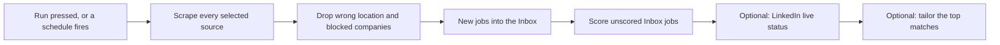
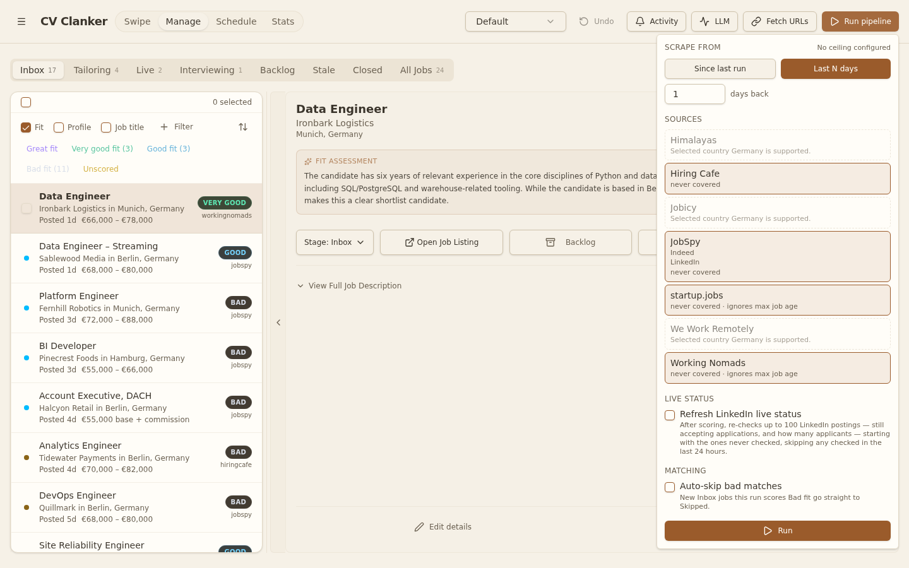

# Running a search

A run is how jobs get into CV Clanker. It scrapes every source the chosen [search profile](search-profiles.md) selects, throws away postings in the wrong place or from blocked companies, stores what is new in the Inbox, scores the unscored Inbox jobs with the LLM (unless Settings → **Score discovered jobs with the LLM** is off), and, only if you asked for them, re-checks LinkedIn postings and tailors the best matches.

The run lives on the server. The banner you watch is a view onto it, so closing the browser stops nothing, and any tab you open later shows the same run.

A job whose source gave too little description to judge cannot be scored and stays unscored in the Inbox. With Settings → **Re-fetch jobs with a missing description** on (off by default), the run then opens the posting page of each such job it just found, reads the description there and scores it like any other job of the run, so auto-skip and auto-tailoring apply to it too. The banner shows this within Scoring as "Re-fetching" and the job's title. Each job gets at most one try, and only jobs found in this run are re-fetched; jobs that were already unscored are left alone. A page that cannot be read leaves the job unscored and the run carries on. Each job costs a page fetch and a few LLM calls.

## Starting a run

1. In the header of the Manage screen, pick one or more search profiles in the **Profile** dropdown. It starts with the default profile ticked. Whenever the selection comes down to a single profile, that profile becomes the new default; ticking several leaves the default as it was, and the extra ticks last until you reload the page.
2. Open **Run pipeline**, check the options (below) and press **Run**.

The Swipe screen has the same **Profile** dropdown and a **Run pipeline** button, which starts a run straight away with the profile's own settings, without the menu.

### The Run menu

**Run pipeline** opens a menu that changes this one run without editing the profile. It opens pre-set from the profile and your settings, and what it shows is what the run uses.

| Control | Effect for this run | Pre-set from |
|---|---|---|
| Scrape from: **Since last run** / **Last N days** | Narrow each source to the days since it last scraped for this profile, or ask for an explicit number of days back. The header shows the profile's ceiling ("Profile max 30d") or "No ceiling configured". | The profile's **Only scrape since the last run** and **Max job age (days)** |
| **Sources** | Untick a source to leave it out of this run. Each source says how far back it is already covered ("covered to …" or "never covered"); a source that cannot serve the profile's location is greyed out with the reason. | The profile's ticked sources |
| **Refresh LinkedIn live status** | After scoring, re-checks LinkedIn postings: whether they still accept applications and how many people applied. The menu says how many postings it will check. | Settings → **Refresh LinkedIn live status during a pipeline run** (off by default) |
| **Auto-skip bad matches** | New Inbox jobs this run scores at or below the auto-skip rating go straight to Skipped. Jobs you ever applied to are never skipped. | Settings → **Auto-skip jobs scoring at or below** (off by default; Bad fit when ticked here with nothing set) |

A window longer than a selected source's ceiling is flagged in the menu and refused: the run does not start rather than quietly scraping less than you asked for. Untick that source, or ask for fewer days.

Auto-tailoring is not in the Run menu. It follows Settings → **Auto-tailor selected jobs after each pipeline run** (off by default), or a schedule's own **Tailor top matches automatically** box. When it is on, the run tailors the profile's **Resumes tailored** best jobs at or above its **Min suitability**.

## Running several profiles

Tick more than one profile in the **Profile** dropdown and the next run becomes a chain: each profile runs as a complete run of its own, one after another in the dropdown's order, each with its own terms, location and sources. The Run menu says how many profiles will run; unticking a source there removes it from every profile in the chain (it narrows each profile's own selection, never replaces it), and a profile left with no sources is skipped.

A profile that fails does not stop the chain. A cancel does, and so does an LLM rate limit, since the remaining profiles would scrape and then be unable to score anything. The banner keeps one page of results per profile, with **Previous profile** and **Next profile** arrows, and ends with one summary such as "Multi-profile run complete (2/3 profiles)".

## Watching a run: the banner

The banner shows the current step (Crawling, Importing, Scoring, Live status, Processing, then Complete, Cancelled or Failed) and a row per source with four counts:

| Count | Means |
|---|---|
| **Scraped** | Postings the source returned. |
| **Imported** | New jobs stored in the Inbox. |
| **Duplicated** | Links CV Clanker already had. |
| **Rejected** | Postings dropped by the location filter or the blocked-company list. |

Click a count to list the jobs behind it; the Rejected list gives the reason for each (see [What the Rejected list says](search-profiles.md#what-the-rejected-list-says)). These lists exist for the latest run only, and are gone after a restart. For a LinkedIn Apify actor, the banner also says which terms reached their budget, so you know which one to raise.

**Dismiss** hides the banner for every open tab, for that run only.

## Re-running failed sources

A source that failed shows a **Re-run** button on its row, and **Retry all** beside the failure count re-runs every failed source on the page you are looking at, one after another. A retry fills in the existing banner instead of starting a new one, and never runs the live-status step. A source that failed still hands over any jobs it scraped before failing.

## Scheduling

The **Schedule** screen (the **Schedule** segment of the switch at the top of Manage) runs the pipeline on its own. **New schedule** opens the editor:

| Field | What it sets |
|---|---|
| **Name** | A label for the card. |
| **Cadence** | **Daily at** a time, or **Every N hours**. |
| **Days** | Which weekdays it may fire on. |
| **Search profiles, in run order** | The profiles it runs, as a chain. |
| **Sources** | **Whatever each profile selects**, **Free scrapers only** (the built-in boards, no Apify actors; worked out when the schedule fires, so a board enabled later is included), or **Pick sources**. |
| **Close duplicate copies automatically after each run** | After a completed run, closes the extra copies of [duplicate groups](job-lifecycle.md#reviewing-duplicates) whose titles agree. There is no undo for this. |
| **Tailor top matches automatically** | Auto-tailoring for this schedule's runs. |
| **Auto-skip bad matches** | As in the Run menu. |

The dialog warns when a schedule will run paid Apify actors, which bill per result on every fire. Times are read in the time zone the dialog shows (UTC by default).

Each card shows the cadence, the next and last run, the profiles and, when the duplicate box is ticked, how many duplicates it has closed. The switch turns a schedule on or off; **Run now** starts an extra run without moving the next scheduled one.

- If the pipeline is busy, a due schedule waits and fires once it is free.
- If the app was down when a schedule came due, it makes one catch-up run when it starts again, never one per missed slot.
- If a scheduled run fails, cannot start, or stops on an LLM rate limit, **all** scheduling pauses and every page shows "Automatic runs are paused." until you press **Resume scheduling** on the Schedule screen, so a broken setup cannot keep failing, or spending, unnoticed.

Scheduled runs are shown on the Schedule screen only, not in the Manage banner. While one is running, Manage's run control is replaced by a **Scheduled run in progress** link.

## Cancelling

While a run is going, the **Run pipeline** button becomes **Cancel run**. The run stops at its next checkpoint, once the source, job or step in hand is done. A cancel during scraping throws away what was scraped, so nothing from that run is imported; jobs already imported stay. Cancelling a chain stops the current profile and starts no more.

## One run at a time

Only one run is ever in flight, manual or scheduled. Pressing Run while another is going is refused, and a due schedule waits. While a run is going you also cannot switch [user profiles](configuration.md#user-profiles), because that swaps the database underneath it.

How it works: [Pipeline runs](../architecture/pipeline-runs.md)
