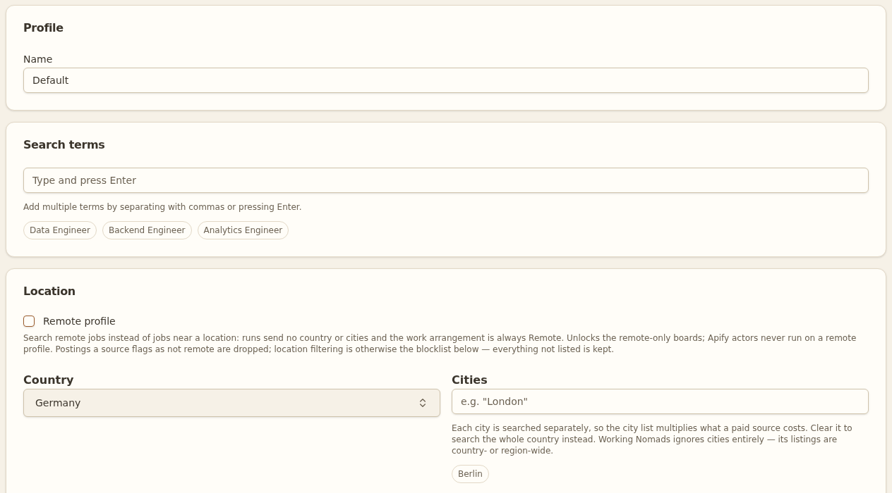

# Search profiles

A search profile is one named job hunt: what to search for, where, how much to fetch, which companies to skip, and which sources to ask. Every run is driven by a search profile (or by several, one after another), so two hunts such as "Vienna data roles" and "Remote backend" live side by side without overwriting each other.

You manage them on the **Profiles** page (**Search Profiles** in the side menu). The **Profile** dropdown in the header of the Manage and Swipe screens picks which profiles the next run uses; see [Running a search](runs.md).

A search profile is not a user profile. A [user profile](configuration.md#user-profiles) is a whole separate database with its own CV, settings and jobs, and each one holds its own set of search profiles.

## Creating and editing profiles

**Add profile** opens a new profile in the editor; **Edit** on a card opens an existing one. Each card also lets you:

- rename the profile by editing its name in place,
- **Set as default** (the default profile carries a **Default** badge; see below),
- **Duplicate** it, which copies everything under the same name with "(copy)" added,
- **Delete** it. The last remaining profile cannot be deleted.

The list is alphabetical, so saving a profile never moves it.

## What a profile holds

The editor has six cards: **Profile** (its name), then the five below.

| Card | Field | What it does |
|---|---|---|
| Search terms | the terms | The keywords every source searches. Separate several with commas or Enter. The LinkedIn Apify actors search the terms one after another in this order. |
| Location | **Remote profile** | Switches the profile to remote mode; see [Remote profiles](#remote-profiles). |
| Location | **Country**, **Cities** | Where the boards search, and what the location filter keeps. No cities means one country-wide search per source; each city is a search of its own, so a long city list multiplies what a paid source costs. |
| Location | **Work arrangement** | Remote, hybrid and on-site ticks, sent to the boards as their own search filter. |
| Location | **Location scope**, **Match strictness** | How strictly a job must sit inside your country and cities; see [Location filtering](#location-filtering). |
| Run settings | **Max jobs discovered** | The run's budget (50 to 1000), shared out over search terms and built-in boards. Apify actors are not part of it. |
| Run settings | **Resumes tailored** | How many of the best matches auto-tailoring picks after a run (1 to 50). It has no effect while auto-tailoring is off. |
| Run settings | **Max job age (days)** | The window a run scrapes by default, and a ceiling: the Run menu can ask for less, never more. Blank means no ceiling. The help text under the field says how each source honours it; see [Job sources](job-sources.md). |
| Run settings | **Only scrape since the last run** | See [below](#only-scrape-since-the-last-run). |
| Run settings | **LinkedIn jobs per search term** | How many results each search term may buy from the LinkedIn Apify actors (default 100, from 10 to 5000), with an optional number of its own for each term. Other sources ignore it. |
| Run settings | **Min suitability** | The lowest fit rating a job needs to be picked for auto-tailoring. |
| Blocked companies | company names | Postings from these employers are dropped; see [Blocked companies](#blocked-companies). |
| Sources | **Extractors**, **Apify actors** | Which built-in boards and which Apify actors this profile runs. |

## Sources per profile

A source runs only when it is enabled on the **Sources** page and ticked on the search profile being run. A source disabled on the Sources page shows "disabled on the Sources page" in the editor; a remote-only board (Himalayas, We Work Remotely, Jobicy) on a profile that is not remote shows "runs only on a remote profile" and cannot be ticked.

**Save** stays disabled until at least one source is both ticked and enabled, and a run whose profile is left with no usable source is refused with a message naming the profile. A new profile starts with every source the Sources page has enabled, Apify actors included. On the Sources page, **Enable in all profiles** and **Disable in all profiles** under each card tick or untick that source on every profile in one step.

## The default profile

Exactly one profile is the default. **Set as default** on a card makes a profile the default, and so does narrowing the **Profile** dropdown on the Manage screen down to that one profile. The default is what the dropdown starts with, what an Apify actor's **Test** and the Sources page's **Show raw** read their terms and location from, and what onboarding checks: the app counts as set up only while the default profile has at least one search term. If you delete the default, the most recently edited profile takes its place.

## The Term matrix tab

**Profiles → Term matrix** edits search terms across all profiles at once: one row per term, one column per profile, and a tick where the profile searches that term. Terms that differ only in capitals share a row.

- Click a term or a profile name to switch its whole row or column on, or off when it is already all on.
- **Add a search term** adds a row.
- The **Jobs** column sets a term's LinkedIn job budget on every profile the term is ticked on. Blank means each profile's own default; "mixed" means the profiles disagree.

Nothing is written until **Save**; **Discard changes** drops your edits. Save is blocked when it would leave the default profile with no terms, push a profile past 200 terms, or set a budget outside 10 to 5000. If one profile fails to save, its edits stay on screen and the others are kept.

## Only scrape since the last run

On an install that runs every day, most of a 30-day window is postings the last run already fetched. With **Only scrape since the last run** ticked, each source only looks back to when it last scraped successfully for this profile, never further than **Max job age (days)**. A source that failed, or has never run for this profile, still gets the full window. Switching the option on takes effect from the next run.

Changing what the profile searches for (its terms or any location setting, or the max job age) starts over; when the option is on, the save message says the next run scrapes the full window on every source. The Run menu can override this for one run; see [Running a search](runs.md#the-run-menu). How the window is tracked: [Only scrape since the last run](../architecture/search-profiles.md#only-scrape-since-the-last-run).

## Blocked companies

The **Blocked companies** card holds one company name per line, at most 200. During a run, any posting whose employer is exactly one of those names, ignoring capitals and surrounding spaces, is dropped and listed in the run banner's Rejected column as "blocked company". The match is exact: "Nova" does not block "Novartis", so add each spelling of a company you see.

Blocking affects future runs only. Jobs already found are unchanged, and jobs you add yourself through **Fetch URLs** are never checked against the list.

To block a company from the job list, click its name to open the company dialog and use **Blacklist**: tick the profiles that should skip it. To unblock a company, remove it in the profile editor.

## Location filtering

Boards return more than you asked for, so after every run each scraped job is checked against the profile's location, and jobs that do not fit are dropped before they are stored or scored. The run banner's **Rejected** count lists each dropped job with the reason.

On a normal profile the check works on country and cities; with no country selected, nothing is filtered. A job counts as in one of your cities when the city's name appears in its location ("London" matches "Greater London Area"), whatever country it gives. Accents are ignored ("Zurich" matches "Zürich") but translations are not: list both "Vienna" and "Wien" if a board uses both. The full rules: [Location matching](../architecture/location-matching.md#what-the-filter-reads).

### Match strictness

**Match strictness** decides what happens to a job that is in your country but names none of your cities. It only matters once the profile has both a country and at least one city.

| The job's location | **Include likely matches** (default) | **Exact matches only** |
|---|---|---|
| Names one of your cities | kept | kept |
| Another town in your country, or the whole country | kept | dropped |
| Names no country at all ("Greater Reading Area") | kept | dropped |
| Another country | dropped | dropped |

A job dropped by these rules can still be kept as remote worldwide, below. Stricter matching saves no scraping cost, since the filter runs after the scrape; what it saves is scoring, at one LLM call per job kept.

### Location scope

**Location scope** decides whether a remote job outside your country and cities may come in anyway. It applies only when **Work arrangement** includes Remote and the source itself marked the job as remote.

| Location scope | A remote job outside your area |
|---|---|
| **Only selected locations** (default) | dropped |
| **Selected locations + remote worldwide** | kept |
| **Remote worldwide** | kept; when auto-tailoring picks its top jobs, a job in your own area goes ahead of a remote-worldwide one of the same fit |

Only JobSpy (LinkedIn and Indeed), startup.jobs, Working Nomads and custom Apify actors that map `isRemote` say whether a job is remote. For the three LinkedIn actor templates and Hiring Cafe, only your own area is kept, whatever the scope.

### Remote profiles

Tick **Remote profile** to search remote jobs instead of jobs near a place. A remote profile:

- sends no country or cities to the boards, and always searches Remote,
- unlocks the remote-only boards (Himalayas, We Work Remotely, Jobicy),
- never runs Apify actors,
- keeps every job except postings the source marks as not remote and postings whose location, or a restriction in the title such as "(US Only)", names an entry of **Exclude locations**.

Entries ignore capitals and punctuation, and common country spellings are unified, so "US-only" also catches "USA Only" and "United States only". Leave the field empty to keep everything. The country, cities and other location settings are kept while the profile is remote, and come back if you untick the box. The details: [Remote profiles: a blocklist](../architecture/location-matching.md#remote-profiles-a-blocklist).

### What the Rejected list says

| Shown as | Means |
|---|---|
| location mismatch: outside *country* | The job is not in the selected country. |
| location mismatch: in *country*, but not in a selected city | In the country, but **Exact matches only** wanted one of your cities. |
| location matches the remote profile's blocklist | A remote profile's **Exclude locations** entry matched. |
| the source flags this posting as not remote | A remote profile dropped a posting its source called on-site or hybrid. |
| blocked company | The employer is on the profile's blocked list. |

Jobs you add through **Fetch URLs** are never location-filtered.

How it works: [Search profiles](../architecture/search-profiles.md), [Location matching](../architecture/location-matching.md)
