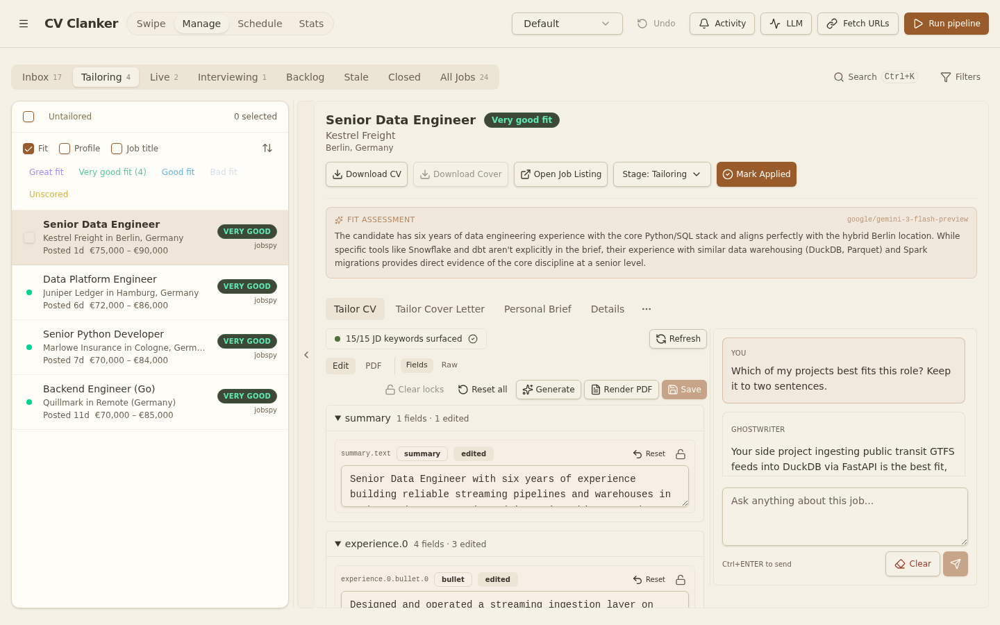

# Tailoring & AI assist

Per job, CV Clanker can edit your CV, write a cover letter, report which of the job's keywords the CV covers, and prepare interview notes. You review everything before you use it: hand edits are yours, and every change the chat proposes waits for you to accept or reject it.

## CV tailoring

Tailoring uses your personal brief, the job description and your CV's fields, and rewrites some of those fields toward the job's keywords.

- Edits are limited to what your brief or the job description supports; the model is instructed not to invent experience.
- It always starts from your original text, not from what it wrote for an earlier job.
- [Locked fields](cvs.md#locked-fields) are never rewritten.
- The result comes out in your CV's own format: a PDF for LaTeX; a `.docx` for Word and the page for HTML, each with a PDF preview.

### Starting a tailor

| Where | Button |
|---|---|
| One job on Inbox, Backlog or Stale | **Start Tailoring** in the detail panel, **Tailor**, or `r` |
| Several jobs | **Tailor N jobs** in the bulk bar |
| The Swipe deck | swipe right, or **Tailor** |
| After a run | Settings → Pipeline Behavior → **Auto-tailor selected jobs after each pipeline run** (off by default) tailors the run's best matches; see [Running a search](runs.md#the-run-menu) |

The job moves to the Tailoring tab at once and the work runs in the background, so you can keep triaging or close the browser. **Tailoring concurrency** in Settings → Pipeline Behavior sets how many run at once; see [Pressing Tailor](../architecture/tailoring.md#pressing-tailor). With the [company in-flight check](reviewing-jobs.md#the-company-in-flight-check) on, you are asked first if you already have work at that company.

### When a tailor fails

A failed tailor stays on the Tailoring tab with a **Tailor failed** chip. Its panel shows **Last tailoring attempt failed** with a one-line reason, **Show details** for the rest, and **Retry tailoring**. Common reasons:

| The reason says | Usually means |
|---|---|
| LLM call failed | The provider refused or timed out. |
| produced no usable changes | Every change the model proposed was unusable (for example aimed at a locked field). |
| produced no actual change to the CV | The result would be identical to your untouched CV, so it is not passed off as tailored. |
| exceeds the configured limit | The result is longer than **Tailored content (chars)** in Settings → Context limits. |
| LaTeX compile failed / PDF conversion failed | The renderer failed; the details carry the end of its log. |
| Tailoring interrupted (server restart) | The app restarted while the tailor ran. |

### Tailoring again

**Generate** (on the Tailoring tab, for one job or as **Generate N jobs** in the bulk bar) tailors a job again from scratch against your current CV. Use it after re-extracting or changing your CV, since stored edits may no longer line up with the new fields ([why](../architecture/tailoring.md#after-a-cv-change-re-tailor-rather-than-re-render)). It asks for confirmation first.

## The tailoring workspace

A tailored job on the Tailoring tab opens the workspace, with tabs **Tailor CV**, **Tailor Cover Letter**, **Personal Brief** and **Details**, and the ghostwriter chat beside the first three.

| Control | What it does |
|---|---|
| **Edit** → **Fields** / **Raw** | Edit this job's field values by hand and **Save** them. The lock icon on a field locks it against tailoring and ghostwriter edits; **Clear locks** unlocks every field; **Reset all** puts every field back to your CV's original text (locks stay). |
| **Render PDF** | Saves pending edits and renders the PDF. |
| **PDF** | Preview of the rendered PDF. |
| **Generate** (Tailor CV) | A full tailor again. |
| **Re-tailor with brief** (Personal Brief) | Edit your brief (the same one as on My CV, so the change applies to every job), then tailor this job again with it. |
| More actions → **Regenerate PDF** | Re-renders from the stored values. |
| **Mark Applied** | Moves the job to Live. |

## ATS keyword coverage

Alongside the tailored CV, tailoring lists the job's notable keywords in two groups:

- **Matched**: keywords worked into the CV, with evidence in your brief.
- **Skipped**: keywords the job asks for that your brief gives no evidence of.

The badge reads "X/Y JD keywords surfaced": green from 75%, amber from 50%. Hover it to see the skipped keywords. If one of them reflects real experience, add it to your brief and re-tailor. **Refresh** next to the badge re-checks the keywords against the current field values without calling the LLM; a keyword worked in through a synonym can drop to skipped.

## The ghostwriter

The ghostwriter is the chat beside the workspace, for changes that do not fit a single tailoring pass ("shorten the summary", "mention the Kubernetes migration"). It knows the job, your brief, this job's CV fields and keywords, and the cover letter you are looking at.

Each reply is a message plus at most one proposed edit, shown as a card with **Accept** and **Reject**:

| Proposal | On Accept |
|---|---|
| CV edit | The new values are saved and the PDF re-rendered. Accept is refused if a field changed underneath it or is locked; if the render fails, the change is rolled back. |
| Cover-letter rewrite | The new text becomes this job's letter. |
| Brief edit | Added to (or replaces) your personal brief. |

Replies stream in and can be cancelled, regenerated or edited (earlier versions stay reachable), and the conversation can be reset.

## Cover letters

Cover letters use a LaTeX cover-letter template you upload once on the **Cover Letter** page. It is checked the same way as a LaTeX CV, and one of its fields must be the letter's body. Cover letters are always LaTeX, including on Word and HTML profiles.

Per job, **Tailor Cover Letter** has **Edit** and **PDF**:

- A job's letter starts with an empty body; other fields of your template (a recipient line, say) keep their uploaded text.
- **Generate** writes the letter from the job description, your brief, this job's tailored CV and your **Cover-letter policy**, then renders it. It never invents an address the job description does not give.
- **Render PDF** renders your edits without the LLM; **Reset all** goes back to the empty body.

The **Cover-letter policy** (Settings → Writing Style) is the letter's length, structure and voice in your own words; it falls back to the shipped text when empty.

## Interview QA

Jobs on Live or Interviewing get an **Interview QA** tab in the detail panel. **Generate strategy** writes interview notes from the job description, your brief and this job's tailored CV: a core narrative, likely questions and how to answer them, and questions to ask. The optional **Focus** box steers it. The notes are saved on the job; **Regenerate** replaces them after a confirmation. Nothing runs it automatically.

## Downloading the documents

The download buttons (and `d` on the Tailoring tab) give you:

| Profile | CV download | Cover letter |
|---|---|---|
| LaTeX | PDF | PDF |
| Word | `.docx` (the PDF is a preview) | PDF |
| HTML | the `.html` page, or the `.zip` you uploaded with the page swapped in | PDF |

Downloads are named from **Your name** in Settings → Display: "Jane Q. Doe" gives `Doe_JQ_resume_Acme.pdf` and `Doe_JQ_cover_Acme.pdf` (last name, initials, document, employer), or just `resume_Acme.pdf` when no name is set. A comma marks a last name of more than one word ("García Márquez, Gabriel" gives `Garcia_Marquez_G`). Saving from the browser's own PDF viewer instead gives a file named after the job's id.

Deleting a job deletes its documents too.

## Watching calls

A tailor shows in the **LLM** call queue in the Manage header as "tailor CV" with the job's title and employer. See [Watching calls](llm-providers.md#watching-calls).

How it works: [Tailoring and cover letters](../architecture/tailoring.md), [LLM providers and scoring](../architecture/llm-and-scoring.md)
